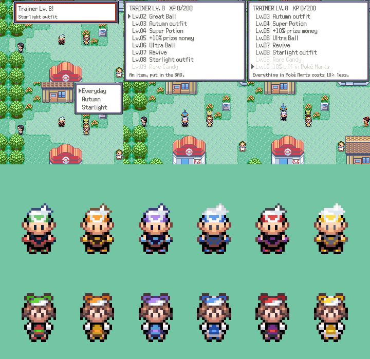
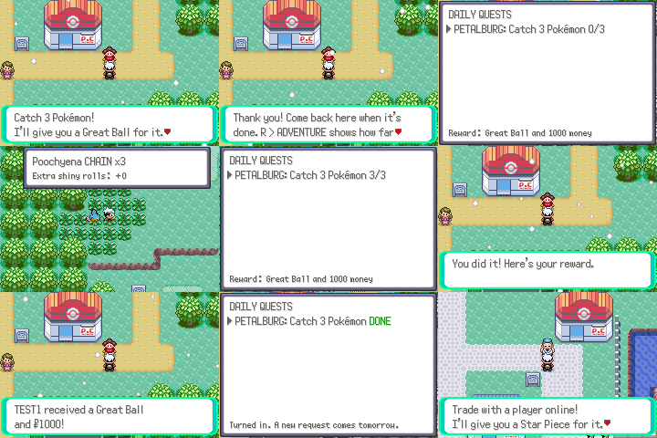
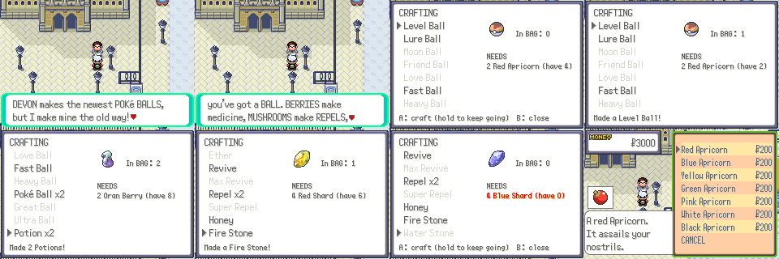
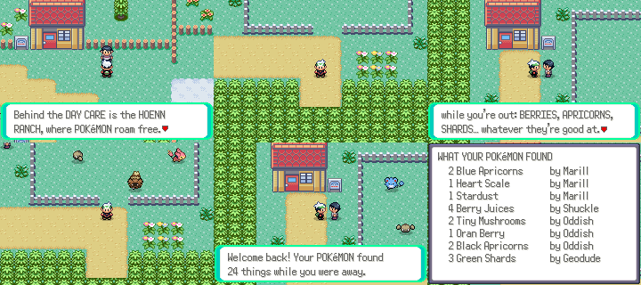
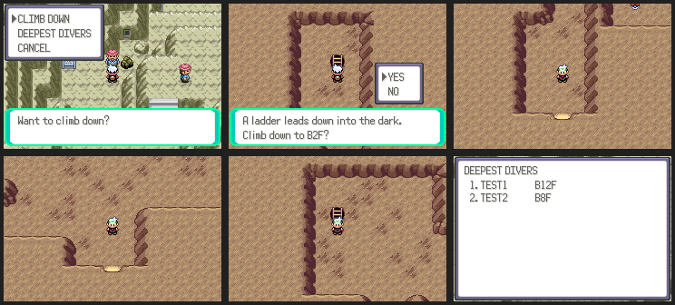
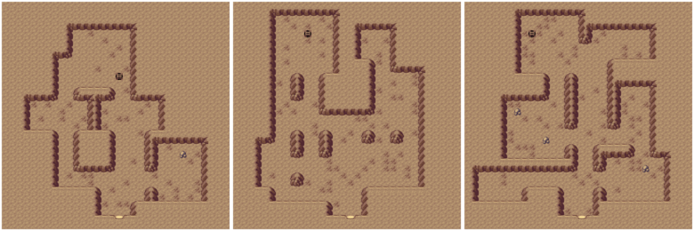

# Adventure features

Game features from the fourth batch: trainer levels, daily quests,
crafting, ranching, dungeons, regional forms, treasure hunts, the online
Battle Frontier and the Hall of Fame wall. Each has its own section;
screenshots are made with `tools/adventure_shots/` (below).

The features with a screen of their own are under R > **ADVENTURE**
(`data/scripts/adventure/menu.inc`). Their save data is
`struct AdventureSaveData` at the end of SaveBlock3
(`include/adventure_save.h`). The overworld and battle hooks come in
through `src/adventure.c`, which the world features' hooks in
`src/world.c` call.

Numbers this batch owns (agreed with the other feature threads): flags
`0x264`–`0x27C` and `0x281`–`0x28D`, object local ids 230–235 on shared
maps, world leaderboard ids 8–15, netplay request types 160–191, and its
own EWRAM mailbox (`gAdventureMailbox`, magic `PKMNADV1`).

## Trainer levels



Playing online earns trainer XP (`src/trainer_level.c`). It only counts
while connected to the server:

| | XP |
| --- | --- |
| Every minute in the overworld | 2 |
| Winning a battle against another player | 60 |
| Any other result against a player | 25 |
| A trade | 30 |
| Catching a Pokémon | 5 |
| Beating a trainer | 10 |

Level *n* needs 40 + 20·*n* XP to reach the next one, up to level 30
(about 9,900 XP in all). A notice shows each new level and what it gives.
R > ADVENTURE > TRAINER LEVEL lists every level, with the ones not reached
yet greyed out.

Most levels give an item. Five give a **perk**:

| Level | Perk |
| --- | --- |
| 5 | Trainers you beat pay 10% more |
| 10 | 10% off in Poké Marts |
| 15 | Eggs in the party hatch twice as fast |
| 20 | Trainers you beat pay 25% more (instead of 10%) |
| 25 | Wild Pokémon get one more shiny roll |

and five give an **outfit**: Autumn (3), Starlight (8), Ace (12),
Shadow (18) and Champion (30). R > ADVENTURE > OUTFITS changes clothes;
like START > STYLE, the player changes as the cursor moves. Outfits are
Brendan and May recoloured (the clothes, bandana and trim; colours taken
from Emerald's own palettes), for walking, both bikes, surfing, fishing,
watering and field moves. Each outfit is its own object graphics id, so
other players see it online with no change to the netplay protocol.
`tools/adventure/gen_outfits.py` writes the palettes and graphics
(`src/data/object_events/outfit_graphics_info*.h`).

## Daily quests



Three people next to the Pokémon Centers ask for a favour each day
(`src/daily_quest.c`, `data/scripts/adventure/daily_quests.inc`):

| Where | Requests |
| --- | --- |
| Petalburg (23,17) | catch 3, beat 3 Trainers, walk 1,000 steps, show a Lv. 20+ Normal type, catch a Bug type, battle a player online, hatch an Egg |
| Slateport (17,20) | fish up 3, catch 2 Water types, show a Lv. 30+ Water type, trade online, catch an Electric type, beat 5 Trainers, walk 2,000 steps |
| Fortree (3,7) | pick 10 Berries, catch 2 Flying types, catch 2 Grass types, show a Lv. 35+ Flying type, catch 5, show a Lv. 30+ Grass type, battle a player online twice |

Each person offers one request a day, picked from their list by the
clock's day. Every request pays an item that fits it (a Dive Ball for
fishing, a Miracle Seed for Grass types...), ¥800–3,000, and 40 trainer
XP when online. A request stays open until it's done; the next one comes
the day after it was turned in.

Progress counts from when the request was taken: catches and Trainers
are counted as they happen, the rest from the game's own counters (steps,
hatched Eggs, battles and trades with other players) and the world
records (Berries picked, fish landed). "Show" requests are checked when
talking to the person. A notice shows when a request is ready to turn in,
and R > ADVENTURE > DAILY QUESTS lists the open ones with their progress
and reward. Saved in `dailyQuests` (one slot per person).

## Crafting



A crafter stands outside the Devon Corporation in Rustboro (14,17). The
first talk explains crafting, gives 4 Red and 2 White Apricorns and sets
`FLAG_ADVENTURE_CRAFTING`; after that he sells all seven Apricorns
(¥20 each), and R > ADVENTURE > CRAFTING opens the recipe list anywhere
(`src/crafting.c`). The list greys out recipes the bag can't pay for, and
the right side shows the item, how many are in the bag and what it needs.
A crafts one; holding A keeps crafting. Each craft gives 3 trainer XP
online.

| Makes | From |
| --- | --- |
| Level, Lure, Moon, Friend, Love, Fast, Heavy Ball | 2 Red, Blue, Yellow, Green, Pink, White or Black Apricorns (Kurt's recipes) |
| 2 Poké Balls | Red + White Apricorn |
| Great Ball | 2 Poké Balls + Blue Apricorn |
| Ultra Ball | 2 Great Balls + Black + Yellow Apricorn |
| 2 Potions | 2 Oran Berries |
| Super Potion | 2 Oran + Sitrus Berry |
| Full Heal | Pecha + Chesto + Rawst Berry |
| Ether | 2 Leppa Berries |
| Revive | 2 Tiny Mushrooms + Sitrus Berry |
| Max Revive | 2 Revives + Big Mushroom |
| 2 Repels | Tiny Mushroom |
| Super Repel | 2 Repels + Tiny Mushroom |
| Honey | 3 Pecha Berries |
| Fire, Water, Thunder, Leaf Stone | 4 Red, Blue, Yellow or Green Shards (like the Route 124 treasure hunter) |
| Star Piece | 4 Stardust |

## Pokémon ranching



The **Hoenn Ranch** (`MAP_ADVENTURE_RANCH`) is a meadow behind the Route
117 Day Care: the ranch house, a stone-fenced pasture, a flower bed and a
path back. The ranch hand next to the Day Care (Route 117, 55,6) takes
the player there; walking out at the bottom leads back.
`tools/adventure/make_ranch.py` builds the layout from Route 117's own
metatiles (same tilesets), and `tools/adventure/render_map.py` draws any
layout to a PNG.

The Pokémon in the **last PC box** live at the ranch; the rancher names
that box RANCH on the first visit. The first six wander the pasture
(object graphics set from the box when the map loads, `Ranch_SetupMap`),
and talking to one plays its cry. All of them gather while the player is
away: one find every 6 hours of the clock each, up to a day's worth (40
finds at most), handed over by the rancher with a list of who found what
(`src/ranch.c`). Collecting gives 10 trainer XP online.

What a Pokémon finds:

- its species' own speciality: Shuckle → Berry Juice, Miltank → Moomoo
  Milk, Chansey/Blissey/Happiny → Oval Stone (rarely a Lucky Egg),
  Combee/Vespiquen → Honey;
- Honey with Honey Gather, Emerald's Pickup items with Pickup;
- Berries (Oran, Pecha, Cheri, Chesto, Rawst, Aspear, Leppa) half the
  time for Grass and Bug types;
- otherwise by one of its types, mostly crafting materials: Apricorns
  (Fire → Red, Water → Blue, Electric → Yellow, Psychic/Fairy → Pink,
  Dark/Ghost/Poison → Black...), Shards (Ground, Rock, Steel), Mushrooms,
  Heart Scales, Stardust, and a rare one per type (Pearl, Hard Stone,
  Charcoal, Star Piece, Dragon Scale...).

## Dungeons



The **Rift Below** (`MAP_ADVENTURE_DUNGEON`) is a cave under Route 114.
The spelunker outside Meteor Falls (Route 114, 10,64) lets the player
down and shows the DEEPEST DIVERS board. Every dive starts at B1F, and
every floor is dug out anew from a seed when the player climbs down
(`src/dungeon.c`): a few rooms joined by tunnels on a 16x16 grid of
2x2-metatile cells, with the wall pieces picked from the open cave around
them (Altering Cave's metatiles), some boulders, item balls, and a ladder
in the room farthest from the start. The way in at the bottom of the
start room always leads back up to Route 114. The seed is saved, so
battles and Continue give back the same floor
(`ON_TRANSITION` places the item balls, `ON_LOAD`/`ON_RESUME` draw it).

Going deeper:

- more rooms: 4 on B1F, one more every third floor, up to 8;
- more item balls: 2, one more every third floor, up to 4; from B4F and
  B8F the loot gets better (evolution stones, Star Pieces, then Full
  Restores, Max Revives, Rare Candies, PP Ups, Nuggets), and every fifth
  floor one ball holds a prize (Rare Candy, PP Up, Big Nugget, PP Max, and
  from B25F a Master Ball);
- wild Pokémon: Hoenn cave Pokémon on B1F–B3F (Zubat, Geodude, Aron,
  Whismur, Makuhita, Nosepass, Sableye, Mawile), then evolved and rarer
  ones from B4F and B8F (Lunatone, Solrock, Baltoy, Snorunt, Bagon,
  Beldum, Gible...), and from B15F fully grown ones (Crobat, Golem,
  Aggron, Steelix, Metang, Flygon, Dusclops...); two levels more per floor
  from level 12–16 on B1F, up to 75.

Each floor climbed gives 15 trainer XP online, and a new deepest floor
goes on the server's **DEEPEST DIVERS** board (world board 8: value the
floor, extra the number of dives). `tools/adventure/make_dungeon.py`
writes the base layout (solid rock), and `render_map.py --dump` draws a
floor as the game dug it out (`Driver.dumpMap` in the screenshot runner):



## Screenshots

```sh
python3 tools/adventure_shots/run.py tools/adventure_shots/trainer_level.lua out/trainer_level 30000 2
python3 tools/adventure_shots/run.py tools/adventure_shots/daily_quests.lua out/daily_quests 40000
python3 tools/adventure_shots/run.py tools/adventure_shots/crafting.lua out/crafting 20000
python3 tools/adventure_shots/run.py tools/adventure_shots/ranch.lua out/ranch 20000
python3 tools/adventure_shots/run.py tools/adventure_shots/dungeon.lua out/dungeon 9000
python3 tools/adventure_shots/run.py tools/adventure_shots/dungeon_online.lua out/dungeon_online 6000 2
```

`run.py` is `tools/world_shots/run.py` (headless libmgba, `Driver.scene`,
two players with a server when the last argument is 2) plus
`Driver.adventure{xp = ..., outfit = ..., items = {...}, ranch = {...},
dungeonFloor = ...}`, which sets up a scene through
`gAdventureShowcase` (`src/adventure.c`).
