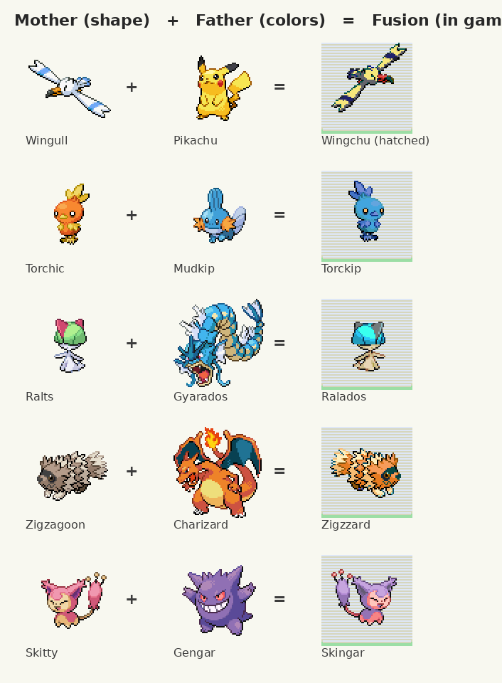

# Fusion breeding

Any two Pokémon of different evolution families can breed into a **fusion**.
Leave a female and a male at the Day Care (or pair up at the online shared
daycare). Egg groups don't matter, but Ditto still makes normal eggs and
Pokémon that can't breed at all still can't. The Day Care man warns you:
"They're different kinds, so their EGG will be a FUSION of the two!"

The baby has:

| | |
|---|---|
| Shape | its mother's (the egg is the mother's species, as usual) |
| Colors | its father's, painted onto the mother's sprite so the mother's shading stays |
| Name | the first half of the mother's name and the second half of the father's: Wingull + Pikachu = **Wingchu** |
| Types | the mother's first type and the father's first type (his second if the first matches) |
| Base stats | the average of both parents' |
| Moves | the usual egg moves, plus the father's first two moves |
| Ability | the mother's side, as usual |

A fusion stays a fusion when it evolves (a Wingchu becomes a Pikachu-colored
Pelipper) and when it's traded. The summary screen shows its types and
"Fused with Pikachu." in the trainer memo. Its follower, battle sprites, PC
sprite and party icon all use the fusion colors.

## How it works

- **Save data.** The father's species is kept in the Pokémon itself
  (`MON_DATA_FUSION_PARTNER`, 11 spare bits: the never-given Marine, Land,
  Sky, Country, National, Earth and World ribbons plus three unused bits).
  Nothing else per Pokémon, so it travels with trades and the online
  features for free.
- **The server builds the fusion.** When the party holds a fusion the server
  hasn't built yet (a new egg, one that just evolved, one you traded for),
  the game sends the two species (`COMMUNITY_REQ_FUSION_BUILD`). The server
  (`server/community_fusion.py`) works the fusion out from the real sprite
  art (`server/data/fusion.json.gz`, made by
  `tools/breed_fusion/make_fusion_data.py`) and answers with its colors,
  name, types and stats. The game saves the colors (SaveBlock3
  `breedFusion`, 12 pairs) and paints them onto the baby's own sprite.
- **Offline.** Until the server has built a pair, or when you play offline,
  the game builds the colors itself from the father's palette the same way.
  Types, stats and the name follow the same rules in the game and on the
  server, so two games always agree in a link battle even if one hasn't
  synced yet.
- **Legality.** The server's checks (`server/community_legal.py`) read the
  partner bits: a fusion may know moves from its father's side, and a
  partner that can't fuse (Ditto, legendaries, no such species) is flagged.

Memory: 292 bytes of SaveBlock3 and about 160 bytes of EWRAM for caches.
Code: `src/breed_fusion.c`, hooks in `daycare.c`, `pokemon.c`
(stats, types, palettes), `battle_main.c`, `battle_script_commands.c`,
`egg_hatch.c`, `pokemon_icon.c`, `pokemon_summary_screen.c`,
`event_object_movement.c` and `community.c`.

## Screenshots

`python3 tools/breed_fusion/run.py OUT_DIR` (needs a built ROM and
libmgba-dev) runs two players with the server: the Day Care, the egg,
the hatching, the summary, the follower, a battle, and four more fusions.
