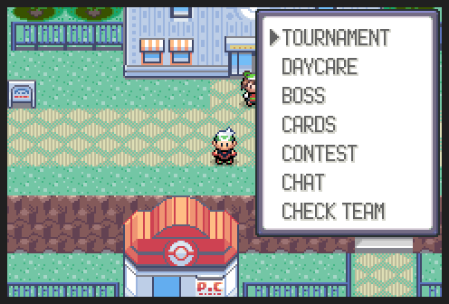

# Community features



Things to do with the other players on the server beyond battling and
trading: tournaments, a shared daycare, a server boss, trainer cards,
contests, chat rooms and a legality check, all under
**START > ONLINE > COMMUNITY**, plus offline postgame content (gym rematches
at your level, gym aces, a returning rival).

Each feature has its own page:

| Feature | In game | Server |
|---------|---------|--------|
| [Tournaments](community/tournaments.md) | COMMUNITY > TOURNAMENT | `server/community_tournament.py`, `/tournament` page |
| [Shared daycare](community/daycare.md) | COMMUNITY > DAYCARE | `server/community_daycare.py` |
| [Server boss](community/boss.md) | COMMUNITY > BOSS | `server/community_boss.py` |
| [Trainer cards](community/cards.md) | COMMUNITY > CARDS | `server/community_cards.py` |
| [Online contests](community/contests.md) | COMMUNITY > CONTEST | `server/community_contest.py` |
| [Chat rooms](community/chat.md) | COMMUNITY > CHAT | `server/community_chat.py` |
| [Legality checks](community/legality.md) | COMMUNITY > CHECK TEAM | `server/community_legal.py` |
| [Gym rematches and aces](community/rematches.md) | gym leaders, gym entrances | offline |
| [Postgame rival](community/rival.md) | four towns after the Hall of Fame | offline |

The COMMUNITY menu only lists the features that are built in (each one's
open function is a weak symbol in `include/community.h`), so they can be
merged one at a time.

## How it works

```
 ROM (gCommunityMailbox in EWRAM)  <->  netplay_community.lua  <->  TCP  <->  server/community*.py
```

- **ROM** (`src/community.c`): a request is a type, four numbers and up to
  256 bytes. Scripts make one with `callnative Community_ScriptRequest,
  waitstate=1` (type in `VAR_0x8004`, numbers in `VAR_0x8005`–`0x8007`), and
  get back a status in `VAR_RESULT`, up to 12 text rows, four numbers and
  256 bytes. `Community_ShowRows` shows the rows in a window,
  `Community_ChooseRow` lets the player pick one. When the game isn't online
  (or the server takes over 8 seconds), the answer is `COMMUNITY_OFFLINE`
  and the script says so.
- **Bridge** (`tools/netplay_bridge/netplay_community.lua`, loaded by the
  netplay bridge and part of the server's bridge download): finds the
  mailbox (magic `PKMNCOM1`), sends requests, writes answers and pushed
  events (chat messages, the boss's HP, a tournament match being ready)
  back, and sends the raw party bytes when the server asks for them.
- **Server** (`server/community.py`): the request plumbing. Each feature is
  a module that registers handlers with `@request(type)` and listens for
  `hello`, `gone`, `session_started` and `battle_finished`. Modules that
  aren't there are skipped. Feature data lives in the league database.

Request types, answers, flags and vars are in `include/constants/community.h`;
the scripts are in `data/scripts/community/`.

Numbers this batch owns (agreed with the other feature threads): flags
`0x1AA`, `0x1AB`, `0x1DE`–`0x1E3`, vars `0x40A8` and `0x40B8`, the unused
trainers `TRAINER_DUDLEY`, `KAYLEE`, `TERRY`, `MIKE_1`, `CINDY_2`, `LUCAS_2`,
`GRUNT_UNUSED`, `BRENDAN_PLACEHOLDER` and `MAY_PLACEHOLDER`, and its own
mailbox. No save data changes.

Trainers that scale to the player (`Community_SetTrainerScale`, used by the
rematches, the aces and the rival) go through one hook at the top of
`CreateNPCTrainerParty` in `src/battle_setup.c`.

## Screenshots

`tools/community_shots/run.py <scenario.lua> <out dir> [frames] [players] [VAR=value...]`
runs headless games against a local server (the world screenshot runner
plus the community helpers in `community_lib.lua`), for example:

```sh
python3 tools/community_shots/run.py tools/community_shots/tournament.lua /tmp/tour 40000 4 NETPLAY_TOUR_SIZE=4
```

The scenarios assume every community feature is built in (they pick menu
rows by position). `tournament_page.py` renders the bracket page.
