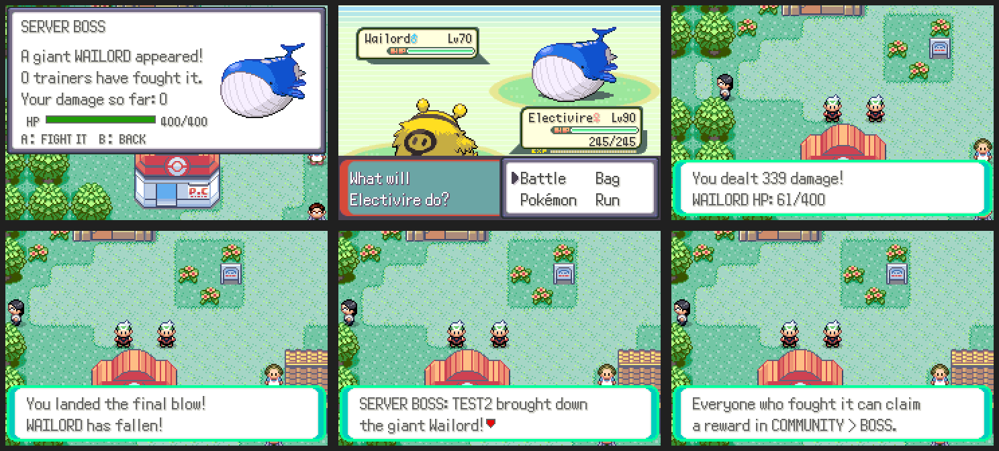

# Server boss

**START > ONLINE > COMMUNITY > BOSS**: one huge wild Pokémon is shared by
everyone on the server.

- The status window shows the boss, its shared HP and how many trainers have
  fought it. Battle it from there: it's a normal wild battle (it can't be
  caught), and all the damage you deal comes off the shared HP.
- When it falls, everyone online sees who landed the final blow. Everyone who
  fought it can claim a reward: Rare Candies (more for a bigger share), a
  Gold Bottle Cap for the top hitter, or a PP Max for anyone with a tenth of
  the damage or more.
- The next boss arrives `NETPLAY_BOSS_REST_SECONDS` (10 minutes) later. The
  bosses take turns: Wailord, Snorlax, Steelix, Tyranitar, Metagross,
  Dragonite, Gyarados, Aggron, at levels 70–74, with `NETPLAY_BOSS_HP`
  (20000) shared HP.
- One battle can't report more than 1200 damage.

Server: `server/community_boss.py` (state in `<db>.boss.json`). ROM:
`src/community_boss.c`, `data/scripts/community/boss.inc`.
