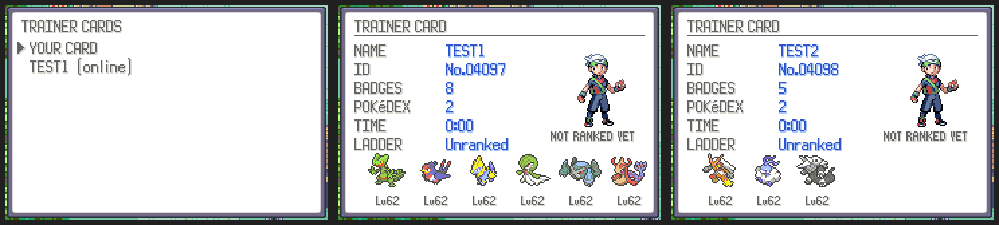

# Trainer cards

**START > ONLINE > COMMUNITY > CARDS** sends your card to the server and lists
everyone's: yours first, then players online, then recent ones.

A card shows the trainer's look, badges, Pokédex count, play time and team
(with levels and shinies), and the server adds their ladder rank, rating,
wins and losses, tier and the cups they have won.

Server: `server/community_cards.py` (table `cards`). ROM:
`src/community_cards.c`, `data/scripts/community/cards.inc`.
