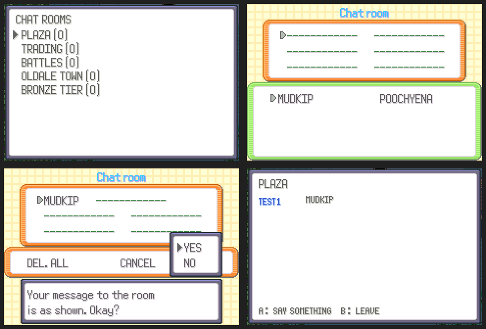

# Chat rooms

**START > ONLINE > COMMUNITY > CHAT** lists the rooms and how many players are
in each: PLAZA, TRADING and BATTLES for everyone, one for the area you're in,
and one for your ladder tier (only players in that tier can join it).

- Messages are Easy Chat phrases, so there's nothing to filter.
- A room keeps its last four messages, and while the room is open new ones
  appear as they're said. SAY picks a phrase, B leaves the room.
- One message every two seconds.

Server: `server/community_chat.py`. ROM: `src/community_chat.c`,
`data/scripts/community/chat.inc`.
