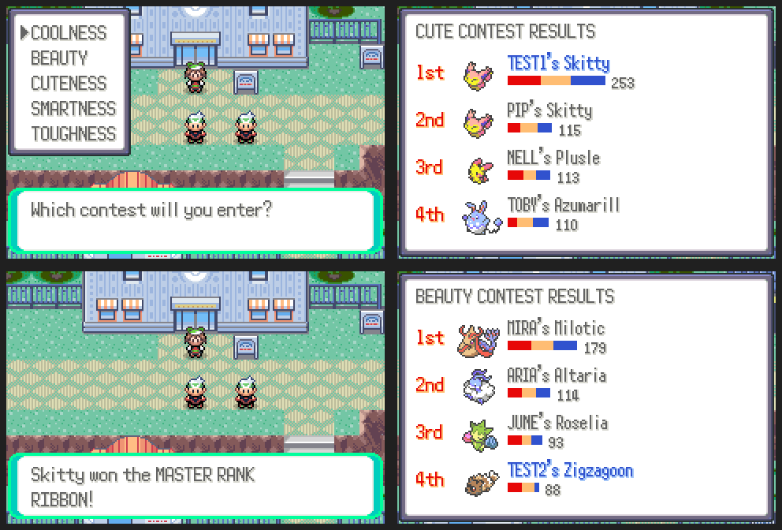

# Online contests

**START > ONLINE > COMMUNITY > CONTEST**: pick a category (COOL, BEAUTY, CUTE,
SMART, TOUGH) and a Pokémon. It's judged against the latest entries of three
other players in that category (contest regulars fill in until there are
enough).

- Three rounds, each scoring the Pokémon's condition for the category (raised
  with Pokéblocks), its sheen, and how well its moves suit the category (the
  appeal of each move, full for moves of that category), plus the crowd's
  mood.
- The results fill in round by round. A win gives the category's Master Rank
  ribbon.
- Every entry is kept, so the next player faces yours.

Server: `server/community_contest.py` (table `contest_entries`). ROM:
`src/community_contest.c`, `data/scripts/community/contest.inc`.
