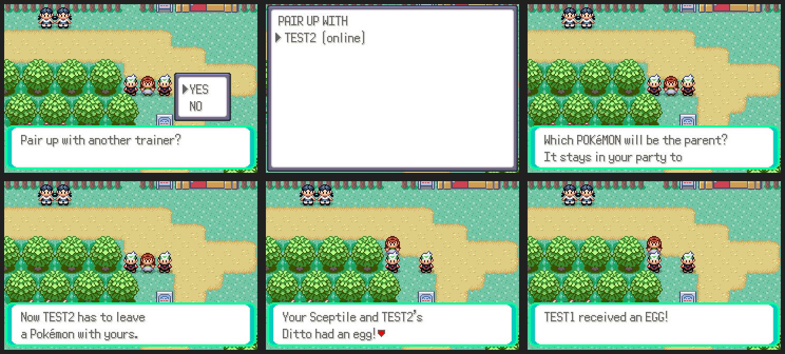

# Shared daycare

**START > ONLINE > COMMUNITY > DAYCARE**: two trainers each leave one
Pokémon as a parent, and both of them get an egg.

- Pick a partner (online players and friends), then the parent. The parent
  is a copy, so it stays in your party.
- Once both parents are in, an egg is ready after
  `NETPLAY_DAYCARE_EGG_SECONDS` (5 minutes). Each trainer collects their own
  egg from the pair, then the next one starts.
- Your game makes the egg from both parents with the game's own rules
  (species, compatibility, inherited moves, Everstone and Destiny Knot,
  and so on), so it's exactly the egg the daycare would make. If the two
  can't breed, there's no egg and you're asked to try another pair.
- End the pairing any time to make room for a new one.

Server: `server/community_daycare.py`. ROM: `src/community_daycare.c`
(builds a temporary `struct DayCare` from both parents and calls the
daycare's own egg code through `GiveEggFromParents`),
`data/scripts/community/daycare.inc`.
