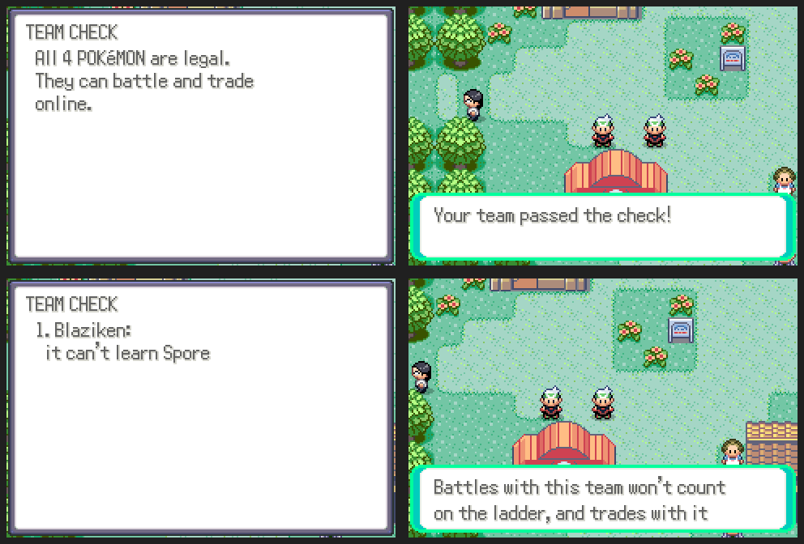

# Legality checks

The server checks the Pokémon players bring online, from their raw data:

- the checksum (edited data), Bad Eggs, real species, items and moves;
- moves it can learn: by level, TM, tutor or egg, as itself or anything it
  evolved from (from the expansion's learnsets, so moves from any game
  count), no move twice;
- effort values (at most 252 each and 510 in total), the ability slot;
- a level that matches its experience for its growth rate, and a met level
  no higher than that.

Where it applies:

- **Battles, trades, deals and co-op battles**: when one starts, the server
  asks both games for their party. An illegal Pokémon stops a trade or deal
  on the spot, and keeps a battle off the ladder (and out of tournaments).
- **The market board** refuses to list an illegal Pokémon.
- **START > ONLINE > COMMUNITY > CHECK TEAM** checks your own party and says
  what's wrong.

Every illegal Pokémon seen is logged in the `legality_reports` table.

The learnsets and growth rates come from the game's data:
`tools/community/make_legal_data.py` writes `server/data/legal.json.gz`. Run
it again after changing species or learnsets.

Server: `server/community_legal.py`. ROM: `src/community_legal.c`,
`data/scripts/community/legal.inc`.
