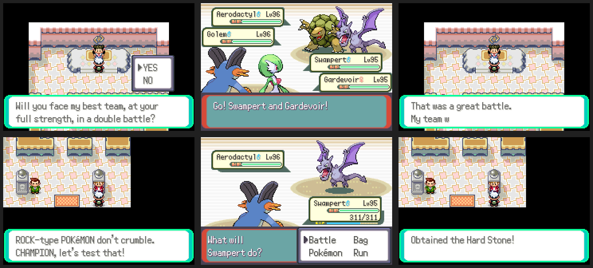

# Gym rematches and gym aces

After the Hall of Fame:

- **Every gym leader offers a rematch** when you talk to them: a double
  battle with their strongest team (their last Match Call team), one level
  above your best Pokémon, so it's always a fight. Their own Match Call
  rematches still come first when one is due.
- **Seven gym aces** wait by the gym entrances in Rustboro, Dewford,
  Mauville, Lavaridge, Fortree, Mossdeep and Sootopolis. Each one
  specialises in the gym's type with a full team at your level (their best
  Pokémon two above) and gives a type item when you beat them: Hard Stone,
  Black Belt, Magnet, Charcoal, Sharp Beak, Twisted Spoon, Mystic Water.
  Before the Hall of Fame they're training and won't battle yet.

ROM: `data/scripts/community/rematch.inc`, `src/community_rematch.c`, the
aces' teams in `src/data/trainers.party`, one line in each gym leader's
script, and one object in each gym.
