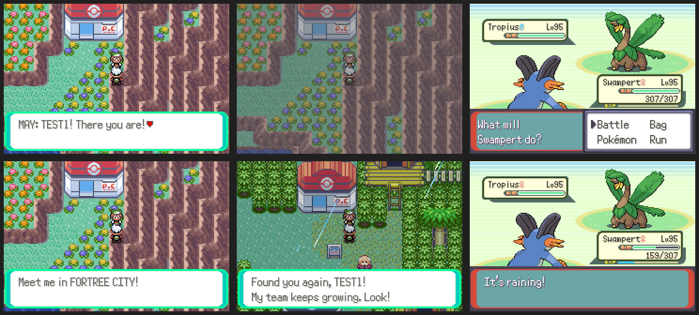

# Postgame rival

After the Hall of Fame, your rival (May, or Brendan if you play as May) is
back: first outside the Pokémon Center in Ever Grande City.

- Their team is at your level and always ends with the fully evolved starter
  that beats yours. It starts at three Pokémon.
- Each time you win, they move on, to Fortree City, Mossdeep City, Pacifidlog
  Town and back to Ever Grande, with one more Pokémon, up to six.

ROM: `data/scripts/community/rival.inc`, `src/community_rival.c`, the teams
in `src/data/trainers.party` (`BRENDAN_PLACEHOLDER`, `MAY_PLACEHOLDER`), and
an object plus one transition line in each of the four maps.
