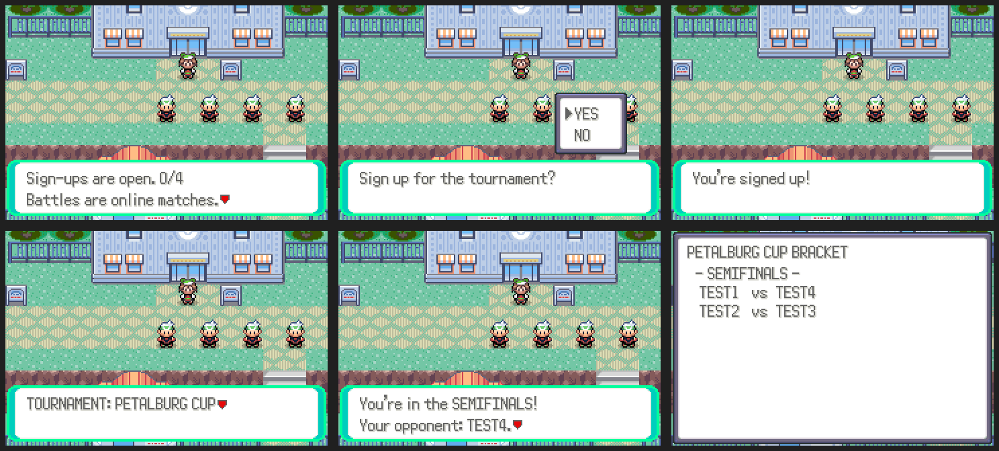
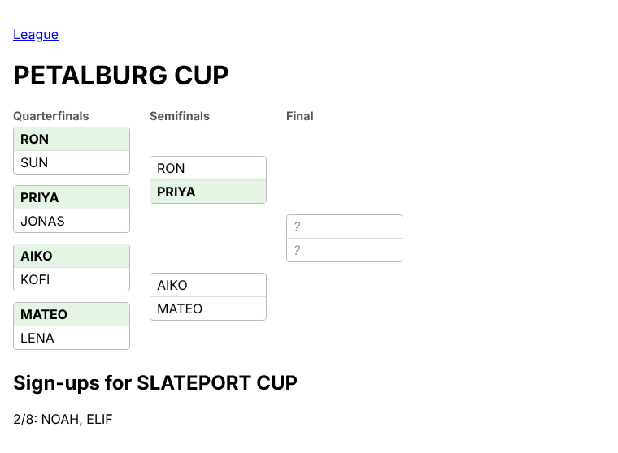

# Tournaments

**START > ONLINE > COMMUNITY > TOURNAMENT** shows the cup that's open for
sign-ups and where you stand, and lets you sign up, withdraw or see the
bracket.

- One cup is always open. It starts when it has `NETPLAY_TOUR_SIZE` players
  (8 by default), or once sign-ups have been open `NETPLAY_TOUR_SIGNUP_SECONDS`
  (10 minutes) with two or more. Only one cup runs at a time.
- The bracket is seeded by ladder rating; with an odd number the top seeds
  get byes.
- Matches are ordinary online battles. When two players who meet in the
  current round battle each other, the winner moves on (a draw is played
  again). Everyone with a match gets a popup naming their opponent, once per
  round.
- The champion gets a MASTER BALL and the runner-up a GOLD BOTTLE CAP the
  next time they open TOURNAMENT. Cups are named after Hoenn towns
  (PETALBURG CUP, SLATEPORT CUP...).
- The server's website has a live bracket at `/tournament`, linked from the
  league page:

Server: `server/community_tournament.py` (tables `tour_cups`,
`tour_entrants`, `tour_matches`). ROM: `src/community_tournament.c`,
`data/scripts/community/tournament.inc`.
