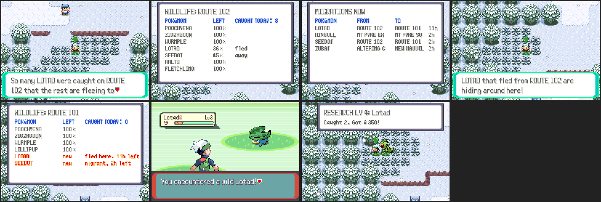

# Living ecosystem

Online, the wild Pokémon of every route are shared by everyone on the
server, and they react to what players and the living NPC trainers catch
(`server/online_eco.py`, `src/online_eco.c`).

- **Thinning**: every catch on a map lowers that species' population there
  (full is 100%; a player's catch takes 8%, a living NPC trainer's 3%). The
  game passes over thinned species when it picks a wild slot (the more
  thinned, the likelier), so the other species there show up more instead.
  Populations grow back by 4% an hour, full again within a day.
- **Fleeing**: when a species drops below 40% on a map, the rest flee to the
  nearest route or cave of the same kind (through towns). For 12 hours they
  turn up there in 15% of the encounters, even where they never live. The
  player whose catch did it gets a notice.
- **Migrations**: every day the server moves three herds from their home
  map to a nearby one where that species doesn't live, for the rest of the
  day: 25% of the encounters there, and the home map is thinned to 45%.
  The plan is the same for any server on a given day (`plan_migrations`).
- **Arrival notices**: the first time you come to a map with newcomers you
  get a notice ("A flock of SEEDOT has migrated here from ROUTE 102 for the
  day!" or "LOTAD that fled from ROUTE 102 are hiding around here!").
- **Living NPC trainers** take part: they meet thinned species less and
  migrants too, and their catches thin populations (`rovers.ECO`).
- **WILDLIFE REPORT** (START → ONLINE → HUB): this area's species with how
  many are left, newcomers in red, and how many were caught here today;
  then every migration going on now and how long it lasts.

Thinning counts for every kind of encounter (grass, caves, surfing, rock
smash, fishing); migrants and Pokémon that fled only turn up in grass and
caves. The weather's and events' own species (snow, contests) still win
over migrants.

## How it talks to the server

The status the game asks for every ten seconds (`OSTAT`) carries, for the
map the player is on (the server knows it from `POS`):

    S|ECO|group.num|sp:pop,sp:pop|sp:pop,sp:pop|sp:rate|sp:rate

up to four species below full and up to two newcomers with their share of
the encounters. On a new map the game asks again within a second and a half.
`ECO AREA` and `ECO MOVES` fill the report's two boards.

Settings (environment): `NETPLAY_ECO_MIGRATIONS` (herds a day, default 3;
the e2e tests set 0 so no arrival notice interrupts them),
`NETPLAY_ECO_MIGRANT_RATE` (25) and `NETPLAY_ECO_FLEE_RATE` (15).

## Tests and screenshots

- `python3 -m unittest server/test_online_eco.py`
- `python3 tools/online_shots/run.py tools/online_shots/eco.lua OUT 80000 2 tools/online_shots/eco_seed.py`
