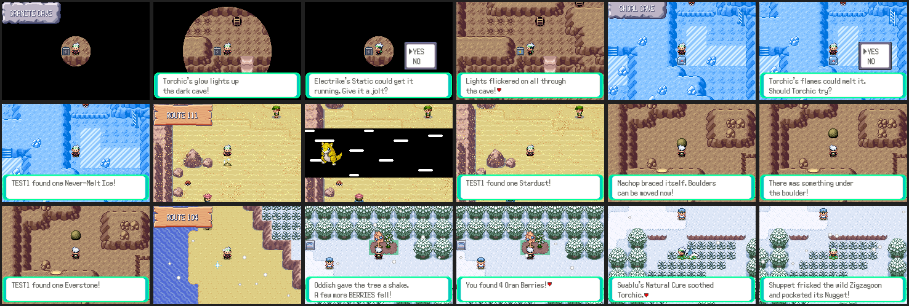

# Pokémon abilities in the overworld

Code: `src/field_ability.c`, `include/field_ability.h`, scripts in
`data/scripts/field_ability.inc`, sprites in `graphics/field_ability/` (drawn by
`tools/field_ability_shots/draw_sprites.py`).

"Lead" means the Pokémon walking with the player (the first healthy party
member). For the world spots, any Pokémon in the party can help.

| Ability | Who | What it does |
| --- | --- | --- |
| Living lantern | Fire-type lead, or Illuminate, Flame Body, Magma Armor, Flash Fire | Lights dark caves the way Flash does (Granite Cave, Victory Road, and new dark areas). |
| Power up | Electric type, or Static, Volt Absorb, Motor Drive, Lightning Rod, Plus, Minus | Restarts the dead generators in Granite Cave B1F and Victory Road B1F. The cave stays lit for good, and an item drops out. |
| Ice melter | Fire type, or Flame Body, Magma Armor, Flash Fire | Melts the ice blocks in Shoal Cave (two in the ice room, one in the lower room), each with an item frozen inside. |
| Dig spots | Ground type, or Sand Veil, Sand Rush, Sand Force | Digs up treasure at sparkling sand: three spots in the Route 111 desert and two on the Route 109 beach. They refill every day. |
| Strong arms | Fighting type, or Guts, Huge Power, Pure Power | Pushes Strength boulders without the move or badge. New boulders in Granite Cave 1F, Rusturf Tunnel and Meteor Falls hide an item underneath. |
| Sixth sense | Psychic-type lead, or Forewarn, Anticipation, Telepathy | Hidden items within a screen of the player sparkle, with the Itemfinder chime. |
| Frisk | Frisk, Pickpocket, Magician lead | When the player knocks out a wild Pokémon holding an item, the item goes in the bag. |
| Swift Swim | Swift Swim, Water Veil lead | Surfing at double speed. |
| Harvest | Harvest lead (+2), Grass-type lead (+1) | Berry trees give more berries. |
| Healer | Healer, Natural Cure lead | Every 64 steps, a 50% chance to cure a party member's status problem. |

## Engine hooks

- `SetDefaultFlashLevel` (overworld.c): lit caves and the lantern.
- `PlayerNotOnBikeMoving` (field_player_avatar.c): surf speed.
- `GetBerryCountByBerryTreeId` (berry.c) and `BerryTree_EventScript_CheckBerryFullyGrown`: extra berries and their message.
- `TryStartStepCountScript` (field_control_avatar.c): Healer.
- `EventScript_StrengthBoulder` (field_move_scripts.inc): Strong arms.
- `CreateBattleStartTask` (battle_setup.c), `World_OnWildBattleEnd`, `World_OverworldUpdate`, `World_TryInteract` (world.c).
- `ClearDailyFlags` (event_data.c): dig spots refill.

## Numbers used

- Flags `FLAG_UNUSED_0x940`–`0x95F` (`FLAG_FIELD_ABILITY_FIRST` + spot index). 13 are in use.
- Object local ids 150–169 (`LOCALID_FIELD_ABILITY_FIRST` + spot index), spawned from C, so no map files change.
- `OBJ_EVENT_GFX_FIELD_ICE_BLOCK`, `_GENERATOR`, `_GENERATOR_ON`, `_DIG_SPOT`, palette tag `OBJ_EVENT_PAL_TAG_FIELD_ABILITY` (0x8010).
- 16 bytes of EWRAM. No save data beyond the flags.

To add a spot, append it to `sFieldSpots` (never reorder: the index is the
flag). `tools/field_ability_shots/mapgrid.py MAP --corners MB_` and
`--open MB_SAND` list good tiles.

## Screenshots

`python3 tools/field_ability_shots/run.py tools/field_ability_shots/all.lua OUT 400000`
