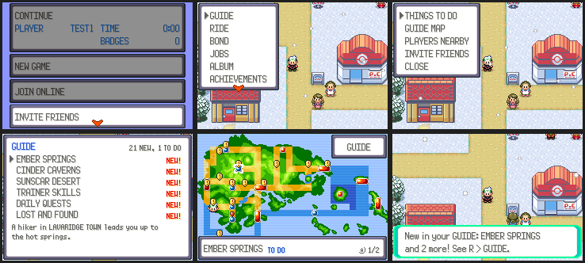
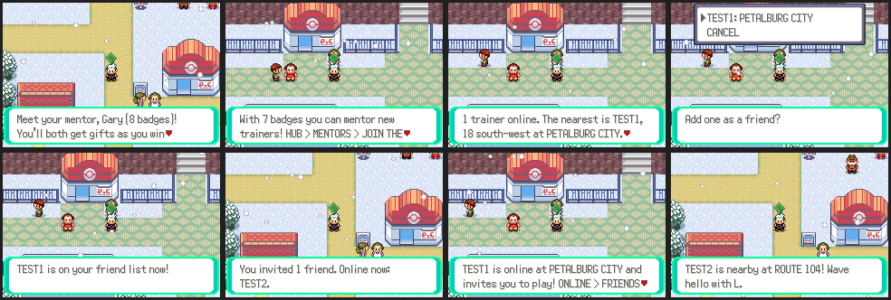
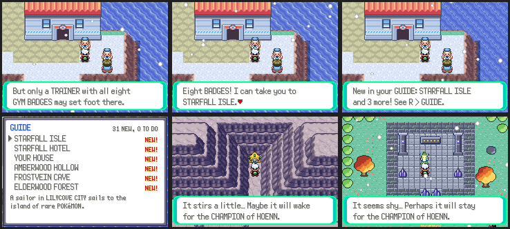

# The guide: things to do, a map, and playing with others



The game has a lot more in it than Hoenn's story. The guide helps players find
it, tells them when something new opens, and helps them find each other.

## R > GUIDE

GUIDE is the first row of the R menu. It has five rows:

- **THINGS TO DO** lists every new area and activity (`gGuideEntries` in
  `src/guide.c`), with a tag on each:
  - **NEW!** open, and the player hasn't been there or looked at it yet;
  - **TO DO** been there, its quest isn't finished;
  - **VISITED** a repeatable activity the player has met;
  - **DONE** its quest is finished;
  - **BADGE 4** / **CHAMPION** not open yet, and what it needs.

  New things come first, the ones just opened at the top. The bottom of the
  window says where it starts ("A hiker in LAVARIDGE TOWN leads you up to the
  hot springs.") and, when locked, what it needs. A shows it on the map.
- **GUIDE MAP** is the region map with a marker on every town or route
  where something waits: a yellow "!" for something new, a red pin for a
  quest to finish. Moving the cursor onto a marker names what's there; A
  goes through them when there are several.
- **PLAYERS NEARBY** and **INVITE FRIENDS**: see below.

Going to an area's map, or looking at an entry in the guide, marks it seen
(`struct GuideSaveData`, one bit per entry, in SaveBlock3). Everything else
comes from the flags the features already keep.

When a badge opens something, the game says so once the player is free:
"New in your GUIDE: EMBER SPRINGS and 1 more! See R > GUIDE."

### Adding an entry

One line in `gGuideEntries`: `AREA(name, where, mapsec, map, badges, doneFlag)`
or `ACTIVITY(name, where, mapsec, map, badges, startedFlag)`. `mapsec` is
where its marker goes (the town where it starts), `map` the place itself (going
there marks it seen), `badges` 0–8 or `GUIDE_CHAMPION`. Up to 64 entries.
Areas that live on other branches are wrapped in `#ifdef` on their quest flag,
so they show up once merged.

## Playing with others



These use the server (`server/guide_social.py`), through the same request
channel as the HUB (`ONL_REQ_GUIDE_*`, numbers from 200, table in
`src/guide_social.c`).

- **INVITE FRIENDS** on the title menu (under JOIN ONLINE) joins online and,
  as soon as the game is connected, tells everyone on your friend list (and
  everyone with you on theirs): "TEST1 is online at PETALBURG CITY and
  invites you to play! ONLINE > FRIENDS takes you there." Friends who are
  offline hear of it the next time they play. R > GUIDE > INVITE FRIENDS
  does the same in game.
- **PLAYERS NEARBY** lists the players online, nearest first on the region
  map, with where they are and whether they're busy. Picking one adds them as
  a friend, and they're told so they can add you back.
- **Nearby notices**: when another player comes within two region map
  squares, you hear of it ("TEST2 is nearby at ROUTE 104! Wave hello with
  L."), at most once every half hour for the same player.
- **Mentors pair up by themselves**: a trainer with fewer than six badges who
  has no mentor gets one from the mentor list as soon as they're online
  (online mentors first, then the least busy). Both are told. Saying goodbye
  to that mentor (HUB > MENTORS) stops it for good. A trainer who reaches six
  badges is told once that they can mentor.

## Pacing



ron approved this schedule on 2026-10-31:

| Badges | Opens |
| --- | --- |
| 0–3 | Activities in towns (as you reach them), the Sunfair Carnival, and the early areas still to come |
| 4 | Ember Springs, Cinder Caverns, Sunscar Desert |
| 5 | Skyrope Canyon |
| 6 | Elderwood Forest, Mirebough Marsh |
| 7 | Frostvein Cave, Hollowmere |
| 8 | Starfall Isle: the hotel, your house, regional forms, Amberwood Hollow |
| Champion | Jirachi, Celebi, Heatran, Team Eclipse, rematches, the rival, the Hall of Fame wall |

The Lilycove sailor sails to Starfall Isle once you have the Rain Badge;
Jirachi (Starfall Cave) and Celebi (Amberwood Hollow) wait for the Champion.

## Screenshots

```sh
python3 tools/areas/shots/run.py tools/guide/shots/guide.lua OUT 60000
python3 tools/areas/shots/run.py tools/guide/shots/pacing.lua OUT 30000
python3 tools/areas/shots/run.py tools/guide/shots/title.lua OUT 8000
python3 tools/online_shots/run.py tools/guide/shots/social.lua OUT 30000 2 tools/guide/shots/social_seed.py
python3 -m unittest server/test_guide_social.py
```

`tools/guide/draw_markers.py` draws the map markers (`graphics/guide/markers.png`).
