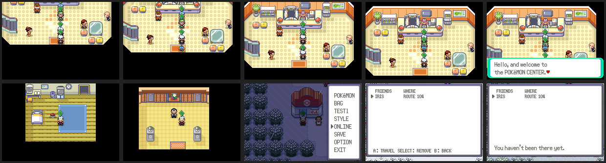
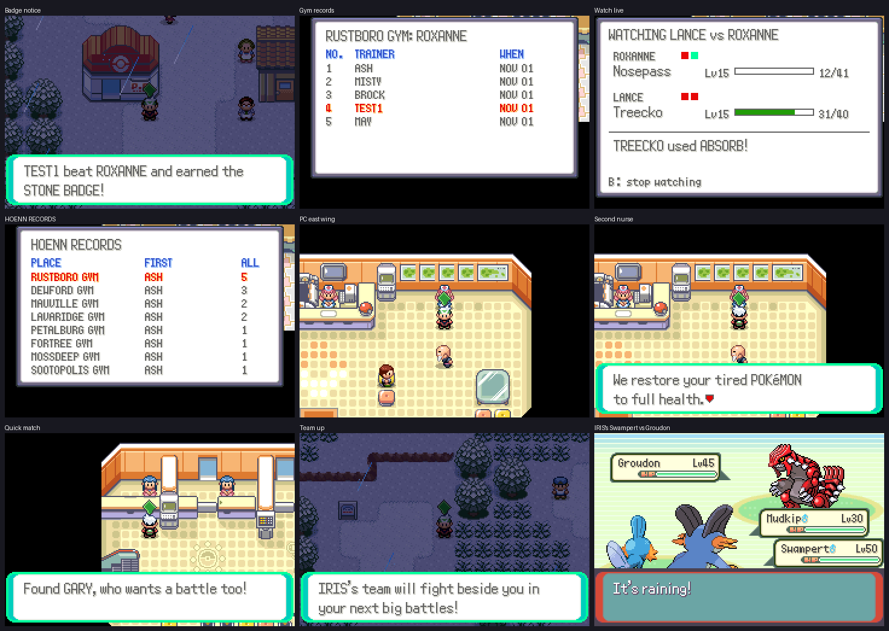

# Original Hoenn, adjusted for many players

The original story was made for one player. Every player has their own save,
so one-time events, gifts, single items and legendaries never run out: each
player gets their own. What did break with other players around is fixed
here (`src/hoenn_multi.c`).

## Walk through other players

Other players and their following Pokémon used to be solid, so one person
standing in a door, in front of the nurse or on a one-tile bridge blocked
everyone. Now nobody bumps into them (`HoennMulti_PassesThrough`, checked in
`GetObjectObjectCollidesWith`), and they don't block a trainer's line of
sight either. You can still face them and press A to talk.

## Places where you don't see other players

Some places are a copy of your own (`sPrivateMaps`): another player there
would stand in your bedroom, walk through gym gates that are shut for you, or
wander into the Champion's room in the middle of your battle. Other players
aren't drawn in:

- the moving truck and both Littleroot houses,
- secret bases,
- the eight gyms,
- the Elite Four rooms, the halls between them, the Champion's room and the
  Hall of Fame,
- the Trick House puzzles,
- the Battle Frontier's corridors and battle rooms (the lobbies stay shared)
  and the Trainer Hill floors.

They also disappear during your own cutscenes: once a script moves someone,
other players stay hidden until it ends, so nobody stands in the middle of
the scene, and the scene gets their object slots.

## Friend travel follows the story

ONLINE > FRIENDS could warp you to any friend outdoors, so a new player could
jump to Ever Grande City or Sootopolis. Now it only goes to maps you've
already been to ("You haven't been there yet."). The game keeps one bit per
map in the extended save (`SaveBlockExt.visitedMaps`), set whenever you stand
on a map (not during hide-and-seek or a race, which take you there and back).
Saves from before this count the towns and cities you can fly to.

## Shared milestones

The game tells the server which badges the player has and whether they're
Champion (`OEV MILESTONE mask champion fresh`, `UpdateMilestones`): once after
joining online, just for the records, then whenever it changes. A new badge
or becoming Champion reaches everyone else online as a notice ("MAY beat
ROXANNE and earned the STONE BADGE!", "The first trainer ever!" for the very
first). Catching a legendary is announced the same way (from the `CATCH`
report).

Each gym's two statues, after their own text, offer RECORDS (the first eight
trainers to clear that gym, with dates, and how many have) and WATCH LIVE
(below). HUB > HOENN RECORDS lists every gym and the League with who cleared
it first and how many have; the player's own rows are red.

## Bigger Pokémon Centers and the quick-match desk

The shared Pokémon Center 1F layout is four tiles wider: an east wing with a
second nurse, who heals without the machine
(`tools/hoenn_multi/widen_pokecenter.py` made the layout and moved every
center's people; run it once). The left desk upstairs (the link cable's
Wireless Club, which can't work online) is now the QUICK MATCH desk: A
BATTLE or A TRADE finds another trainer who asked for the same in the last
ten minutes, anywhere in Hoenn, and challenges them like talking to them
would. If nobody is waiting, the player goes on the list and the next one to
ask challenges them. LEAVE THE LIST takes them off.

## Team up for big fights

HUB > TEAM UP asks another online trainer for their team. If they say yes
(in their own HUB > TEAM UP), a snapshot of their party goes to the server;
the player then brings it along from HUB > TEAM UP. From then on it fights
beside them, played by the game, against TEAM AQUA and TEAM MAGMA (leaders
and admins), the rivals (May or Brendan and Wally) and any legendary
Pokémon: those battles become doubles with the partner's team next to the
player's (`HoennMulti_PrepareBattle`, using the same in-game partner path as
the roaming trainers). Winning tells the partner. Either side can end it
from HUB > TEAM UP. The team is kept until the game is turned off; HUB >
TEAM UP brings it again after that.

## Watch gym and League battles live

A battle against a gym leader, the Elite Four or the Champion while online
is reported like the host of a PvP battle reports theirs: the ROM sets
`battleReport.filler[0]` and writes the opponent's name to
`gNetplayMailbox.soloOpponent` (0x840); the bridge sends `SOLO name`, then
`BSTATE 0 ...` / `BTEXT 0 ...`, and `SOLO END` after. The server lists it
in `LIVE` as "TEST1 vs ROXANNE", so anyone can watch it from START > ONLINE
> WATCH or a gym statue's WATCH LIVE.

## Screenshots

`python3 tools/world_shots/hoenn_multi.py <out dir>` starts the server with
stand-in players around Hoenn (in the Oldale Pokémon Center aisle, at the
nurse and by the door, in Brendan's bedroom, in the Petalburg Gym, and a
friend on Route 104) and runs `tools/world_shots/hoenn_multi.lua`, which
fails if the player can't reach the nurse through them or if friend travel
goes somewhere new.

`python3 tools/online_shots/run.py tools/online_shots/hoenn.lua OUT 80000 2
tools/online_shots/hoenn_seed.py` covers the rest with seeded trainers:
milestone notices on both games, a gym statue's records and live battle,
HUB > HOENN RECORDS, the second nurse, the quick-match desk, and TEAM UP
with IRIS's team beside the player against Groudon. Server tests:
`python3 -m unittest server/test_hoenn.py`.
