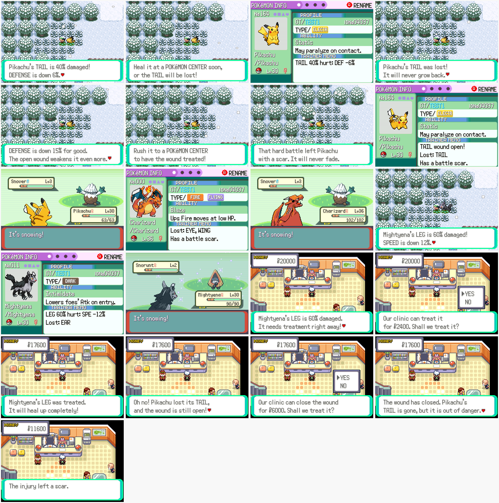

# Pokémon injuries

A Pokémon's body part (eye, leg/arm/fin, tail, wing, ear/horn/antenna) can be
hurt in battle. The damage is a percentage, and it lowers one stat while the
part is hurt. If the damage reaches 100%, the part is lost for good.

## How it works

- **Getting hurt** (your own Pokémon only, in every battle including online PvP
  and ladder battles):
  - when one of your Pokémon faints, there is a 30% chance that a part takes 20–40% damage;
  - when one of your Pokémon takes a critical hit, there is a 20% chance that a part takes 10–20% damage,
    and a 10% chance that it gets a scar.
  A Pokémon has one hurt part at a time. More damage goes to the same part.
  Battle Frontier, Safari Zone, Trainer Hill, recorded battles and tutorials never cause injuries.
- **Message**: on the first step after the battle you see which part is
  hurt, by how much, which stat is down, and a warning to heal it soon.
- **Getting worse**: an untreated part gains 4% damage every 128 steps.
  You get another warning at 50% and at 80%.
- **Lost part**: at 100% the part is gone for good. Its stat penalty is
  permanent, and the open wound takes 10% off every stat until it is treated.
- **Clinic**: after healing, the Pokémon Center nurse offers to treat each hurt
  Pokémon. The cost is damage% × (level + 10), or 1.5 times that for an open
  wound. Treating can leave a scar (30%, or 60% after a lost part).
- **Looks**: a lost part has its tip cut off and the stump bandaged, a lost
  eye gets an eye patch, and a scar is three claw marks. The game finds the
  part on the sprite itself, so this works for every species without new art.
  They show everywhere the Pokémon does: in battle (front and back), on the
  summary screen, on party menu, trade screen and PC box icons, in the PC's
  big picture, on the following Pokémon in the overworld, and on other
  players' following Pokémon online (the follower's marks go out with its
  look: `LOOK ... injury`, see `docs/world.md`). Marks are sized for the
  Pokémon, so on small icons and overworld sprites they are short dark claw
  marks and a small bandage. The summary's trainer memo lists the hurt part,
  the lost parts and the scar.

| Part | Stat | Lost |
|------|------|------|
| Eye | Sp. Atk | −20% |
| Leg / arm / fin / tentacle | Speed | −20% |
| Tail | Defense | −15% |
| Wing | Speed | −25% |
| Ear / horn / antenna | Attack | −15% |

While a part is hurt but not lost yet, the penalty is that much times the
damage % (a tail at 40% gives Defense −6%). Penalties add up to at most −60%.

Which parts a species has comes from its Pokédex body shape
(`src/data/injury_shapes.h`, generated by `tools/injury/gen_shapes.py` from
PokeAPI data). Flying types also get a wing.

## Data

Everything is stored in spare bits of the Pokémon's own box data, so it
survives the PC, trades and online battles, and it uses no extra EWRAM:

| Field | Bits | Where |
|-------|------|-------|
| `injuryDamage` (2% units) | 6 | substruct 0 (was `unused_02`) |
| `injuryFlags` (scar, message pending, new scar) | 3 | substruct 0 (was `unused_04`) |
| `lostParts` | 5 | substruct 1 (was `unused_04`) |
| `injuredPart` | 3 | substruct 1 (was `unused_06`) |

In link battles the rolls use `Random2()`, which is not part of the
battle RNG, so the two games stay in sync.

## Screenshots

`python3 tools/injury/run.py <out dir>` (needs a built ROM and libmgba-dev).
Outside battle: `python3 tools/injury/scars.py <out dir>` (follower, party
menu, summary and PC) and `python3 tools/injury/scars.py <out dir> online`
(two players see each other's marked followers). Both need the mGBA fork
(`emulator/build.sh headless`).
