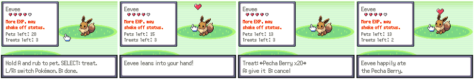
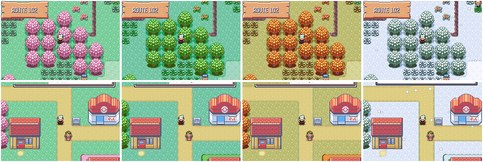

# Fifth batch: bonding, seasons, jobs, mining, photo safari, Team Eclipse, auctions, ghost trainers

Features that give players more to do with their Pokémon, offline and
online. Each has its own section; screenshots are made with
`tools/life_shots/` (below).

Numbers this batch owns (agreed with the other feature threads):
flags `0x290`–`0x2AF`, vars `0x4091`, `0x409B`, `0x409D`, `0x40A1`,
object local ids 216–229, and its own EWRAM mailbox (`gLifeMailbox`,
magic `PKMNLIF1`). Saved state is `struct LifeSaveData` in SaveBlock3
(`include/life_save.h`). Scripts live in `data/scripts/life/`, included
from `data/scripts/life.inc`; script→C calls use `callnative`.

## Bonding



R > **BOND** picks a party Pokémon and opens a bonding screen on a grassy
field (`src/life_bond.c`). Move the hand with the D-pad, then hold A and rub
the Pokémon to pet it; SELECT gives it a berry from the bag; L/R switches to
another party Pokémon.

- Each pet adds 1 friendship, up to 20 a day per Pokémon.
- A treat (up to 3 a day) adds 4 friendship, 8 if the berry's strongest
  flavor is one the Pokémon's nature likes, and 1 if it dislikes it.
- The hearts are the expansion's affection levels (`GetMonAffectionHearts`),
  and the battle bonuses are its `B_AFFECTION_MECHANICS`: three hearts and
  up may hang on to a knockout hit with 1 HP, four give 1.2× EXP and a 20%
  chance to shake off a status at the end of the turn, five add critical
  hits and some evasion. They never apply in link, Frontier or secret base
  battles, so PvP stays even.

The counters are kept per Pokémon (by personality) and reset each day.

## Seasons



The real-world month (the cartridge clock) picks the season
(`src/life_seasons.c`): spring is March to May, summer June to August,
autumn September to November, winter December to February.

- **Scenery.** On outdoor maps that use the general tileset (all of
  Hoenn's towns and routes), the tree and grass colours of the tileset's
  palette 2 change: cherry blossom in spring, Emerald's own greens in
  summer, red and gold leaves on yellowed grass in autumn, snow-covered
  trees and ground in winter (`Seasons_TintPrimaryPalettes`, called from
  `LoadTilesetPalette` in `fieldmap.c`, before the day/night tint).
- **Snow.** In winter, outdoor maps with clear skies get light snow. Story
  weather, ash, sand, fog and the roaming rain fronts are left alone.
- **Seasonal Pokémon.** 15% of wild encounters outdoors are the season's
  Pokémon, at the map's level (evolved when the level is past the official
  evolution level). The last two of each list are rare.

  | Season | Pokémon | Rare |
  | --- | --- | --- |
  | Spring | Deerling (Spring), Cherubi, Flabébé, Combee, Budew | Cutiefly, Comfey |
  | Summer | Deerling (Summer), Sunkern, Volbeat, Illumise, Dewpider | Heracross, Yanma |
  | Autumn | Deerling (Autumn), Sewaddle, Pumpkaboo, Phantump, Foongus | Applin, Zorua |
  | Winter | Deerling (Winter), Snover, Cubchoo, Bergmite, Snom | Delibird, Frigibax |
- **Forms.** Deerling and Sawsbuck in the party change to the season's
  form, as in the main series.
- The first time the player steps outside in a new season, a notice says
  so ("Winter: Snow is falling in Hoenn!").

## Screenshots

```sh
python3 tools/life_shots/run.py tools/life_shots/bond.lua out/bond
python3 tools/life_shots/run.py tools/life_shots/seasons.lua out/seasons 400000
```

`run.py` is `tools/world_shots/run.py` with this batch's symbols added, so
scenarios use the same Driver (`Driver.scene` and friends). They can also
write `gLifeShowcase` (`src/life.c`): byte 1 sets the lead's friendship,
then byte 0 = 1 applies it on the next overworld frame. Byte 2 is the
season plus one (0 uses the clock); it applies on the next warp.

Art: `tools/life_shots/draw_art.py` draws this batch's sprites into
`graphics/life/`.
