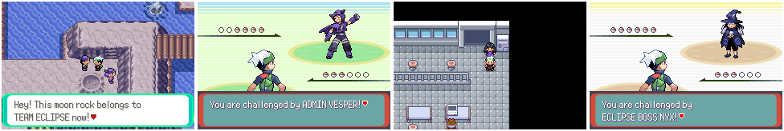
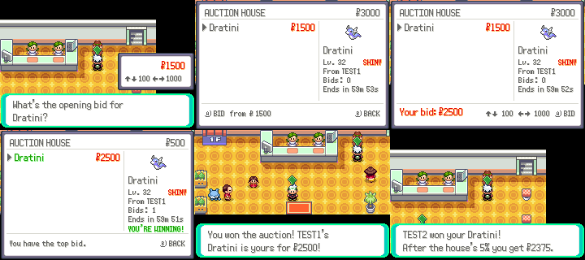
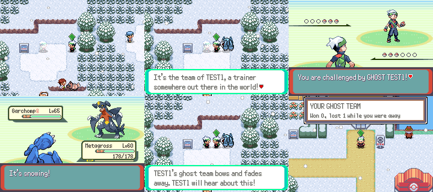

# Fifth batch: bonding, seasons, jobs, mining, photo safari, Team Eclipse, auctions, ghost trainers

Features that give players more to do with their Pokémon, offline and
online. Each has its own section; screenshots are made with
`tools/life_shots/` (below).

Numbers this batch owns (agreed with the other feature threads):
flags `0x290`–`0x2AF`, vars `0x4091`, `0x409B`, `0x409D`, `0x40A1`,
object local ids 216–229, and its own EWRAM mailbox (`gLifeMailbox`,
magic `PKMNLIF1`). Saved state is `struct LifeSaveData` in SaveBlock3
(`include/life_save.h`). Scripts live in `data/scripts/life/`, included
from `data/scripts/life.inc`; script→C calls use `callnative`.

## Bonding


R > **BOND** picks a party Pokémon and opens a bonding screen on a grassy
field (`src/life_bond.c`). Move the hand with the D-pad, then hold A and rub
the Pokémon to pet it; SELECT gives it a berry from the bag; L/R switches to
another party Pokémon.

- Each pet adds 1 friendship, up to 20 a day per Pokémon.
- A treat (up to 3 a day) adds 4 friendship, 8 if the berry's strongest
  flavor is one the Pokémon's nature likes, and 1 if it dislikes it.
- The hearts are the expansion's affection levels (`GetMonAffectionHearts`),
  and the battle bonuses are its `B_AFFECTION_MECHANICS`: three hearts and
  up may hang on to a knockout hit with 1 HP, four give 1.2× EXP and a 20%
  chance to shake off a status at the end of the turn, five add critical
  hits and some evasion. They never apply in link, Frontier or secret base
  battles, so PvP stays even.

The counters are kept per Pokémon (by personality) and reset each day.

## Seasons


The real-world month (the cartridge clock) picks the season
(`src/life_seasons.c`): spring is March to May, summer June to August,
autumn September to November, winter December to February.

- **Scenery.** On outdoor maps that use the general tileset (all of
  Hoenn's towns and routes), the tree and grass colours of the tileset's
  palette 2 change: cherry blossom in spring, Emerald's own greens in
  summer, red and gold leaves on yellowed grass in autumn, snow-covered
  trees and ground in winter (`Seasons_TintPrimaryPalettes`, called from
  `LoadTilesetPalette` in `fieldmap.c`, before the day/night tint).
- **Snow.** In winter, outdoor maps with clear skies get light snow. Story
  weather, ash, sand, fog and the roaming rain fronts are left alone.
- **Seasonal Pokémon.** 15% of wild encounters outdoors are the season's
  Pokémon, at the map's level (evolved when the level is past the official
  evolution level). The last two of each list are rare.

  | Season | Pokémon | Rare |
  | --- | --- | --- |
  | Spring | Deerling (Spring), Cherubi, Flabébé, Combee, Budew | Cutiefly, Comfey |
  | Summer | Deerling (Summer), Sunkern, Volbeat, Illumise, Dewpider | Heracross, Yanma |
  | Autumn | Deerling (Autumn), Sewaddle, Pumpkaboo, Phantump, Foongus | Applin, Zorua |
  | Winter | Deerling (Winter), Snover, Cubchoo, Bergmite, Snom | Delibird, Frigibax |
- **Forms.** Deerling and Sawsbuck in the party change to the season's
  form, as in the main series.
- The first time the player steps outside in a new season, a notice says
  so ("Winter: Snow is falling in Hoenn!").

## Pokémon jobs


A job agent in the **Mauville Pokémon Center** (left of the counter)
sends a party Pokémon out on a timed errand (`src/life_jobs.c`). Up to
three Pokémon can be out at once; while out, they are kept in
`struct LifeSaveData.jobs` and leave the party (you can't send your last
Pokémon that can battle, or an Egg). R > **JOBS** shows who is out and how
long is left.

| Job | Hours | Best types | Pay | Can bring back |
| --- | --- | --- | --- | --- |
| Berry farm help | 1 | Grass, Bug, Ground | ¥300 | Oran, Pecha, Sitrus, Lum Berries |
| Parcel delivery | 2 | Flying, Normal, Electric | ¥900 | Poké, Great, Repeat Balls, Potions |
| Lifeguard duty | 2 | Water, Ice | ¥700 | Pearl, Big Pearl, Heart Scale, Dive Balls |
| Power plant shift | 4 | Electric, Steel, Fire | ¥1,600 | PP Up, Elixir, Thunder Stone, Cell Battery |
| Cave survey | 4 | Rock, Ground, Fighting | ¥1,200 | Hard Stone, Nugget, Star Piece, Everstone, Fire/Water/Leaf Stone |
| Night watch | 8 | Dark, Ghost, Psychic | ¥2,500 | Dusk Balls, Dusk Stone, Moon Stone, Rare Candy, Spell Tag |

When the time is up (by the clock, so it keeps going while the game is
off), talk to the agent: each Pokémon comes back with the pay, one of the
job's items (1–4), 3 friendship and EXP (hours × level × 20, plus 100).
A Pokémon of one of the job's types is "a natural": double items, double
pay and 1.5× EXP. If the party is full it goes to the PC. Levels gained on
a job don't teach moves or evolve the Pokémon (use the move relearner, or
level it once in battle).

## Underground mining


Rocks with a glint in them sit in six caves: Granite Cave 1F and B1F,
Rusturf Tunnel, Fiery Path, Meteor Falls and Victory Road 1F
(`LifeMining_*` in `src/life_mining.c`, object scripts
`Life_EventScript_DigSpot0`–`5`). They need the digging tools, which the
digger next to the Rusturf Tunnel rock gives away. Each rock can be dug
once a day.

Digging opens a wall of rock, 13×6 cells, one to three layers deep, with
two to four treasures buried in it (the items' own icons). Move the cursor
with the D-pad:

- **A, the pick**: two layers off the cell, one off the four cells around it.
  Adds 2 cracks.
- **B, the hammer**: two layers off the cell, one off the eight around it.
  Adds 4 cracks and shakes the wall.
- **START** stops digging.

The wall gives way at 70 cracks. Every treasure that was completely
uncovered by then goes in the bag. Treasures (weighted): Red, Blue, Yellow
and Green Shards, Hard Stone, Everstone, Heart Scale, Star Piece, Nugget,
Oval Stone, the evolution stones (Fire, Water, Thunder, Leaf, Moon, Sun,
Ice, Dusk, Dawn, Shiny), Fire/Water/Electric/Grass Gems, and, rarer and 3×3
cells big, Root Fossil, Claw Fossil (both revived at the Devon lab) and Rare
Bone. The digger keeps count of what you've found.

The wall and treasures are drawn on BG1 (rock, in 16×16 blocks from
`graphics/life/mine_tiles.png`, drawn by `tools/life_shots/draw_art.py` in
the browns of Emerald's caves) over BG2 (earth); the treasure icons are
sprites between the two, so they show through as the rock is cleared.

## Photo safari


A photographer stands at the Safari Zone entrance on Route 121
(`Life_EventScript_PhotoRanger`, `src/life_photo.c`). For ¥500 they lend a
camera with 12 shots and send you into the Safari Zone. With the camera
there are no wild battles; instead up to four Pokémon from the area's
grass table roam around the player (object local ids 216–219, 1 in 64
shiny). Talking to one reminds you to use the camera.

**R** takes a photo of the best subject up to five tiles straight ahead
(a little to either side counts too, more the further away it is). The
photo opens full screen, framed by a viewfinder, with the score:

| | |
|---|---|
| Distance | 1 tile 350, 2 tiles 400, 3 tiles 300, 4 tiles 200, 5 tiles 100 |
| Framing | centered +200, one tile off +100 |
| Pose | facing you +300, on the move +200, side view +100, from behind 0 |
| Group | +150 for every other Pokémon of its kind in the shot |
| Rarity | catch rate 45 or less ×3, 120 or less ×2; shiny ×2 |

The picture follows the shot: close Pokémon are big, a Pokémon seen from
behind shows its back, a side view is turned, and a group stands
together. The best photo of each species goes in the album (R > **ALBUM**,
24 pages; a new species replaces the lowest-scoring page when it's full).

When the film runs out the player is walked back to the entrance (leaving
the Safari Zone any other way also ends the safari). The photographer
adds up the safari's score and gives a prize: a Nugget for 12000 or more,
an Ultra Ball for 7000, a Great Ball for 3500, otherwise a Poké Ball.

## Team Eclipse (postgame chapter)



A new villain team for after the Champion battle (`src/life_eclipse.c`,
`data/scripts/life/eclipse.inc`). Team Eclipse wants to launch a shade into
orbit from the Mossdeep Space Center and leave Hoenn in endless night.

1. **Mossdeep Space Center 1F**: a scientist (shown once the game is beaten)
   says Eclipse copied the launch data and went for moon rock.
2. **Meteor Falls 1F**: two grunts.
3. **Mt. Pyre summit**: a grunt and Admin **Vesper** (Honchkrow, Gengar,
   Bisharp, Weavile, levels 64–66, held items, smart AI).
4. **Space Center 2F**: a grunt and Leader **Nyx** (Umbreon, Malamar,
   Spiritomb, Absol, Tyranitar, Hydreigon, levels 68–70, perfect IVs).
5. Back to the scientist for the reward: an Ability Patch and 5 Dusk Balls.

`VAR_LIFE_ECLIPSE` (0x4091) is the step. Each trainer's object has a
`FLAG_LIFE_ECLIPSE_HIDE_*` flag (0x290–0x295, scientist 0x296) that
`LifeEclipse_UpdateObjects` sets on every map load, so a trainer shows only
during its step until beaten (`FLAG_LIFE_ECLIPSE_BEATEN_*`, 0x298–0x29D).
Beaten trainers leave; beating both trainers of a step moves the chapter on.

**Battles without trainer ids.** `TRAINERS_MAX` is full, so the Eclipse
trainers are `struct Trainer`s in `life_eclipse.c`. `LifeBattle_Start`
(`src/life_battle.c`) sets `gLifeTrainer`, which `GetTrainerStructFromId`
(`include/data.h`) returns while the battle runs, so name, class, picture,
AI and prize money come from it. `BattleSetup_StartLifeTrainerBattle`
(`battle_setup.c`) starts it without touching trainer flags; a loss whites
out as usual. Ghost trainers use the same path.

**Art.** Three new trainer classes (TEAM ECLIPSE, ADMIN, ECLIPSE BOSS, with
the Aqua/Magma battle and victory music), four battle pictures and four
overworld sprites. They're Emerald's Team Aqua grunts, a Magma Admin's
hooded outfit and the Hex Maniac redressed in midnight violet and gold, with
the Aqua and Magma emblems painted over with a gold crescent moon
(`tools/life_shots/draw_art.py` makes `graphics/life/eclipse_*.png`; the
overworld sprites share `graphics/life/eclipse_ow.pal`).

## Auction house (online)



Players put Pokémon up for auction and bid on each other's
(`src/life_auction.c`, `data/scripts/life/auction.inc`,
`server/life_auction.py`). Open it from START → ONLINE → AUCTION, or talk to
the auctioneer in the Lilycove Department Store 1F. It's separate from the
fixed-price market (`server/market.py`): here the price is set by bidding
and every listing runs for a set time.

- **SELL**: pick a Pokémon (not an egg or your last one), an opening bid
  (₽100 to ₽999,999; ↑↓ change it by 100, ←→ by 1,000) and a length (1, 8
  or 24 hours). It leaves your party right away. Up to 3 auctions each.
- **BROWSE**: the board lists open auctions, soonest to end first, with the
  picked one's Pokémon, level, seller, bid count and a live countdown. Your
  own auctions are blue and ones you're winning are green. A on someone
  else's opens the bid picker, starting at the lowest bid it takes: the
  opening bid, or the top bid plus 5% (at least ₽100), rounded up to 100.
  A on your own auction takes it back while nobody has bid.
- **Money is held.** A bid comes out of your money once the server takes
  it. If someone outbids you, it comes back the next time you open the
  auction house, with who outbid you.
- **No sniping.** A bid in the last 5 minutes moves the end to 5 minutes
  from then.
- **When it ends** the winner collects the Pokémon (to the party, or the PC
  if the party is full) and the seller collects the price less the house's
  5%. A Pokémon nobody bid on goes back to its seller. Everything waiting is
  handed over each time you open the auction house.

It uses the Online Plaza's request channel (`docs/netplay_ext.md`) with its
own request table: `NetplayExt_RunRequest` runs a `struct NpxRequest` from
another file. The server module answers `AUCTION LIST | POST | BID |
CANCEL | COLLECT`, closes auctions whose time is up on every request, and
keeps everything waiting for a player in `auction_inbox`. Tests:
`python3 -m unittest server/test_life_auction.py`.

## Ghost trainers (online)



While you're online your team is kept on the server, and other players meet
it on their routes as a see-through "ghost" of you
(`src/life_ghosts.c`, `data/scripts/life/ghosts.inc`, `server/life_ghosts.py`).

- **Your ghost.** The team goes up when you come online, whenever it
  changes (a Pokémon joins, leaves or levels up; checked every 5 seconds)
  and every 10 minutes. Each Pokémon keeps its species, level, moves,
  held item, ability, nature, IVs, EVs, nickname, gender, shininess and
  friendship. Teams not uploaded for 30 days stop appearing.
- **Meeting one.** On entering a route while online there's a 1 in 4
  chance (at most one every 3 minutes) that another player's ghost appears
  a few steps away, three steps ahead if there's room. It's drawn
  see-through, as Brendan or May to match its owner. Talk to it to see
  whose team it is and its record, then battle it or let it fade away.
- **The battle** is a normal trainer battle against class GHOST, with the
  owner's name and the rival battle music. So a strong team doesn't flatten
  a new player, its levels are capped at your best Pokémon's level plus 5.
  Win and you get prize money; lose and you white out as usual.
- **The owner hears about it.** The result goes to the server, and the next
  time the owner's team uploads they get a toast like "YOUR GHOST TEAM: Won
  2, lost 1 while you were away".

All requests run in the background over the Online Plaza's channel, between
other requests, so they never hold the player up. The battle uses the same
`LifeBattle_Start` path as Team Eclipse (`CB2_EndLifeTrainerBattle` tells
`LifeGhost_OnBattleEnd` how it went). Server words: `GHOST PUT | GET |
RESULT`; table `ghosts`. Tests: `python3 -m unittest server/test_life_ghosts.py`.

## Screenshots

```sh
python3 tools/life_shots/run.py tools/life_shots/bond.lua out/bond
python3 tools/life_shots/run.py tools/life_shots/seasons.lua out/seasons 400000
python3 tools/life_shots/run.py tools/life_shots/jobs.lua out/jobs
python3 tools/life_shots/run.py tools/life_shots/mining.lua out/mining
python3 tools/life_shots/run.py tools/life_shots/photo.lua out/photo
python3 tools/life_shots/run.py tools/life_shots/eclipse.lua out/eclipse 700000
# two games online; run from tools/netplay_bridge so the bridge loads its
# extensions, and let the scenario move the server's auction clock
(cd tools/netplay_bridge && LIFE_AUCTION_SKEW_FILE=/tmp/auction/clock_skew \
    python3 ../life_shots/run.py ../life_shots/auction.lua /tmp/auction 60000 2)
(cd tools/netplay_bridge && python3 ../life_shots/run.py ../life_shots/ghosts.lua /tmp/ghosts 80000 2)
```

`run.py` is `tools/world_shots/run.py` with this batch's symbols added, so
scenarios use the same Driver (`Driver.scene` and friends). They can also
write `gLifeShowcase` (`src/life.c`): byte 1 sets the lead's friendship,
then byte 0 = 1 applies it on the next overworld frame. Byte 2 is the
season plus one (0 uses the clock); it applies on the next warp. Byte 3
= 1 finishes every Pokémon job. Bytes 4–8 pose a photo subject in the
Safari Zone during a photo safari: species (u16), tiles away, the
direction it faces (`DIR_*`, 0 = toward the player) and how many stand
side by side. Byte 9 is the Team Eclipse step plus one: it beats the game
(all badges, the story's visitors to those maps gone, the party healed,
battle style SET) and puts the chapter at that step. Byte 10 sets the
player's money to that many thousand. Byte 11 = 1 asks the server for a
ghost trainer right away, wherever the player is.

Art: `tools/life_shots/draw_art.py` draws this batch's sprites into
`graphics/life/`.
