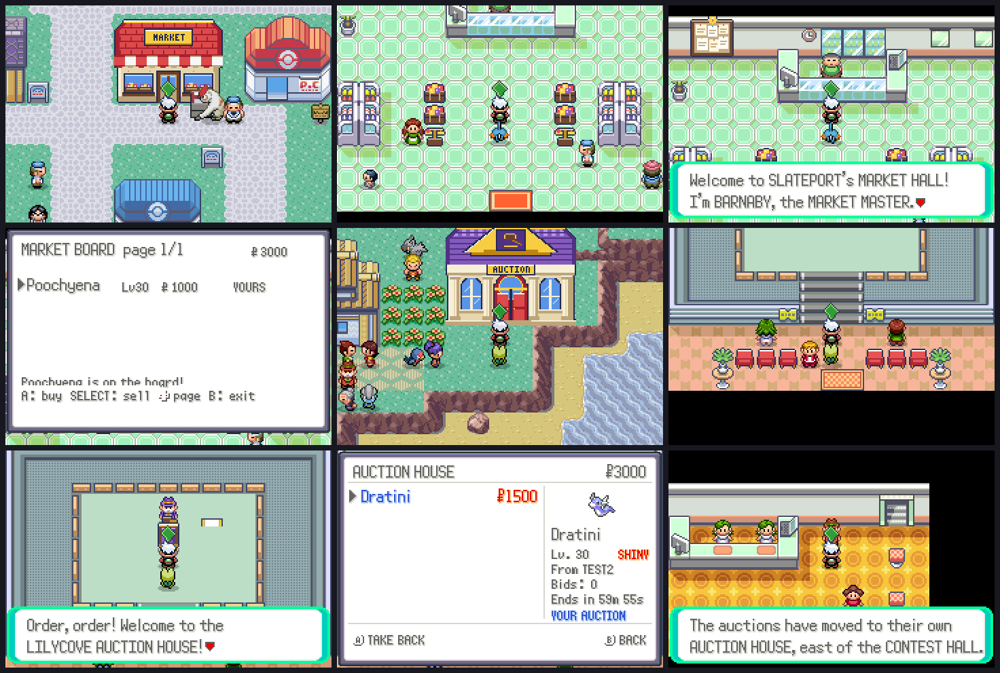

# Market Hall and Auction House



The online market and the auction each have their own building now, with an
NPC who runs it.

## Market Hall (Slateport City)

A red-roofed hall with a striped awning and fruit in the shop windows,
between Slateport's Pokémon Center and the street (the door is at 14, 19).
Inside: fruit stalls, shelves, a notice board on the back wall and the
MARKET MASTER, BARNABY, in a green grocer's apron behind the counter.

* Talking to BARNABY opens the market board (`Netplay_EventScript_MarketBoard`,
  `src/netplay.c`): the same listings, buying and selling as before.
* The notice board on the back wall opens it too.
* The board on every Poké Mart wall still works, so nothing is lost.

## Auction House (Lilycove City)

A columned building with a purple roof and a gold gavel on the pediment,
east of the Contest Hall (doors at 47–48, 23). Inside is the old R/S contest
hall Emerald left unused: red curtains, a raised stage, a podium where
GAVIN the AUCTIONEER stands in a purple suit, two LOTS boards and rows of
bidders' chairs.

* Talking to GAVIN runs the auction (`Life_EventScript_AuctionCollect`,
  `src/life_auction.c`): collect won lots and sales, then BROWSE / SELL.
* The LOTS boards open the same menu.
* START > ONLINE > AUCTION still works anywhere.
* The auctioneer who stood in the Lilycove Department Store now tells you the
  auctions moved, and where to find the new house.

Rovers (living NPC trainers) keep selling and bidding through the same server
commands, so their listings and lots show up in both buildings.

## Files

* `tools/markets/art.py`: the pixel art (both buildings, the notice board,
  produce crates, scales, the podium, the LOTS boards, the chairs) added to
  the Slateport, Lilycove, Shop and Contest tilesets in palette 12, which none
  of them used. It starts from the tilesets as imported (`git show e55ba59f`),
  so it can be re-run. Also writes the two NPCs' palettes
  (`graphics/markets/`): BARNABY reuses the fat man's frames, GAVIN the
  gentleman's, in new colours.
* `tools/markets/build.py`: puts the buildings into the towns and makes the
  two rooms (`SlateportCity_MarketHall`, `LilycoveCity_AuctionHouse`), their
  NPCs and scripts.
* `tools/markets/shots.lua` + `run.py`: the in-game screenshots (two players
  online: one lists on the market, one puts a Pokémon up for auction).

```
python3 tools/markets/art.py && python3 tools/markets/build.py && make
cd tools/netplay_bridge && python3 ../markets/run.py ../markets/shots.lua /tmp/shots 60000 2
```
