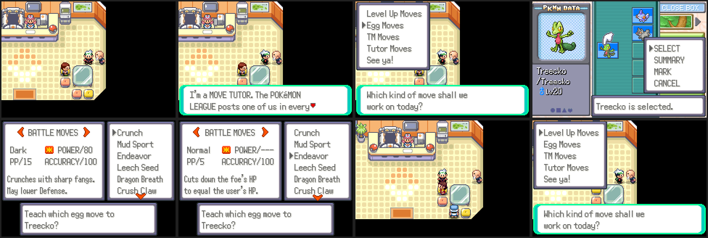
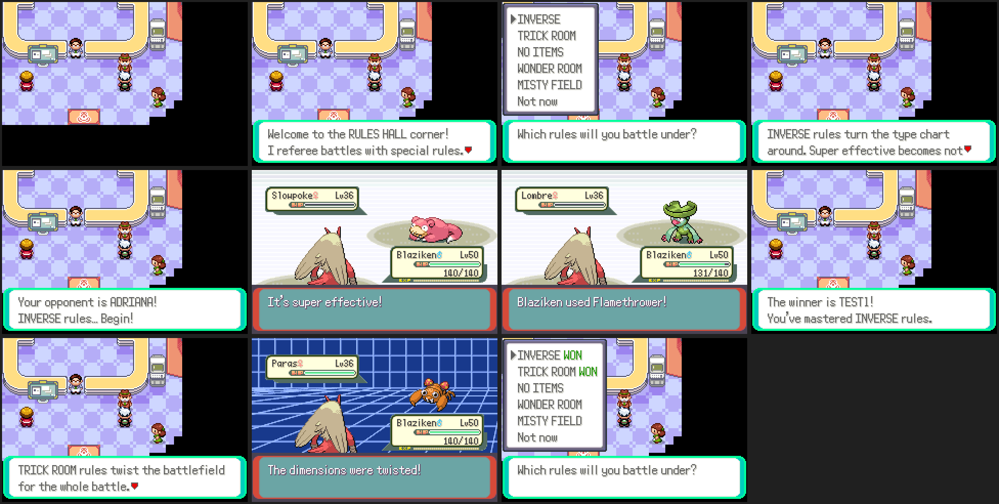
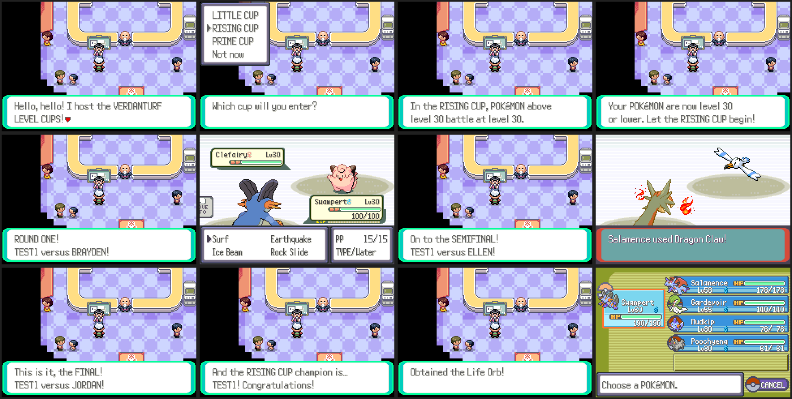
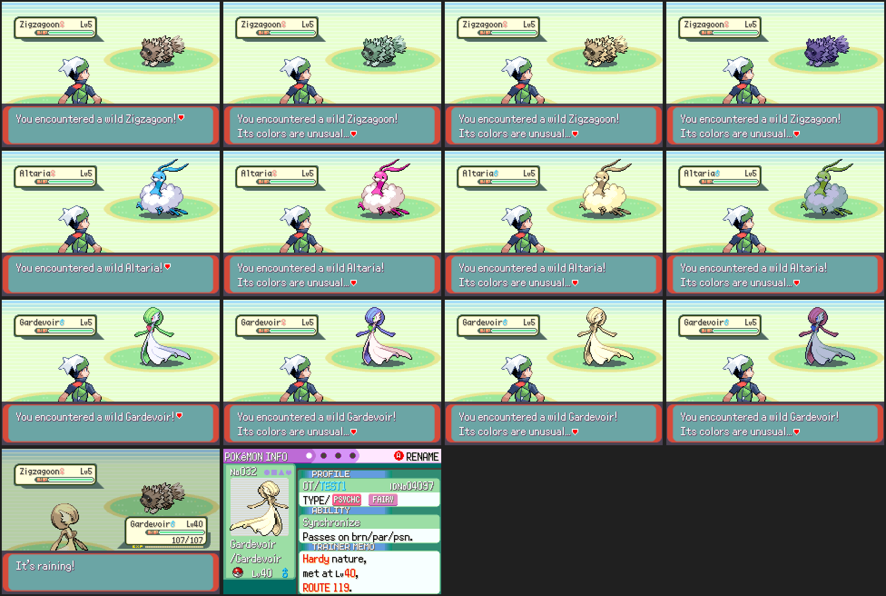
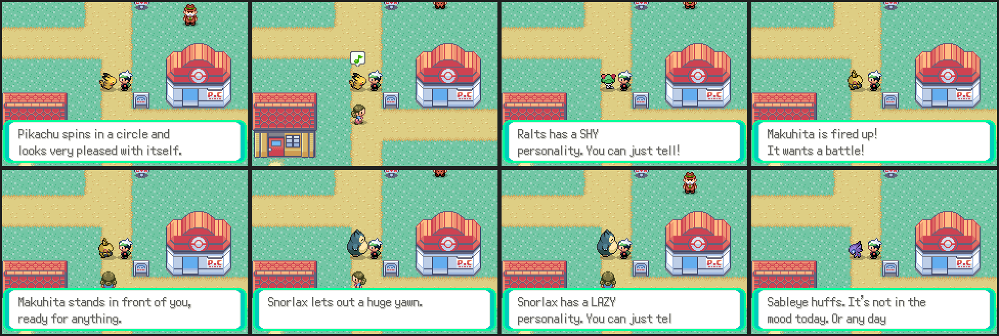
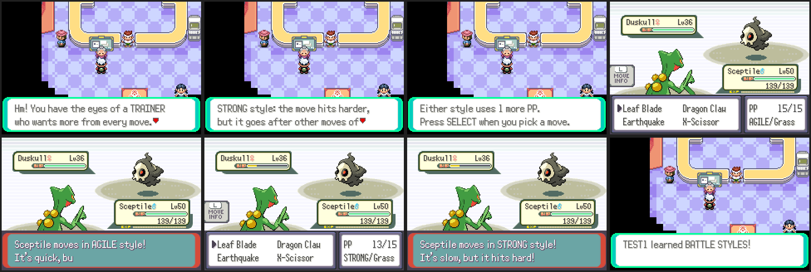
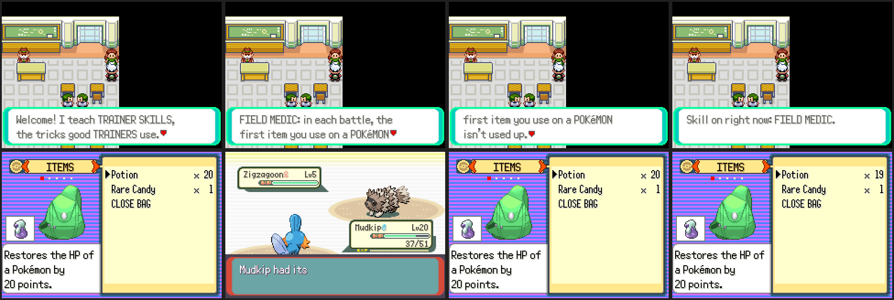
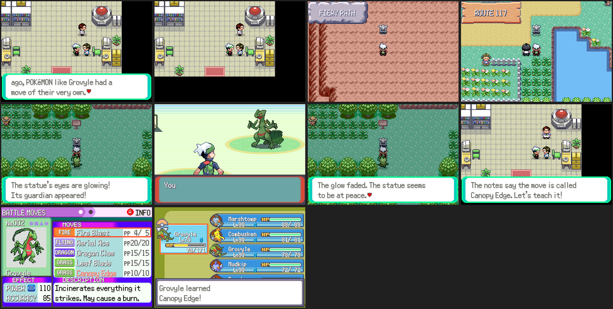
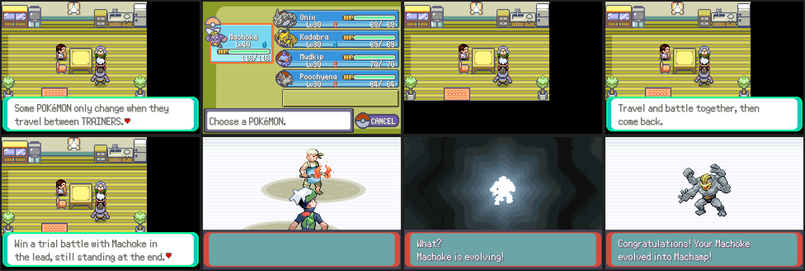

# Battle and Pokémon mechanics

New battle rules and Pokémon mechanics: move tutors, rule sets, level-capped
tournaments, color variants, personalities, battle styles, trainer skills,
signature moves, evolution quests, cave bosses, battle commentary and the
storm-calming quest. Each has its own section; screenshots are made with
`tools/mechanics_shots/` (below).

The code lives in `src/mechanics*.c`, scripts in `data/scripts/mechanics/`.
`src/mechanics.c` has the overworld hooks the world features' hooks in
`src/world.c` call (`Mechanics_Update`, `Mechanics_TryInteract`) and puts
people on existing maps from C (`sMechNpcs`), so no map files change.

Numbers this thread owns (agreed with the other feature threads): flags
`0x881`–`0x887` and `0x8E5`–`0x8EF`, object local ids 190–199.

## Move tutor in every Pokémon Center



A MOVE TUTOR stands by the right wall of every Hoenn Pokémon Center. He
uses the expansion's move relearner menu (`Common_EventScript_MoveRelearner`
in `data/scripts/move_relearner.inc`), free of charge:

- **Level Up Moves**: moves the Pokémon could have learned by now.
- **Egg Moves**: its species' Egg Moves.
- **TM Moves**: TMs it can learn that are in the bag.
- **Tutor Moves**: the tutor moves it can learn.

`P_ENABLE_MOVE_RELEARNERS` is on, so the summary screen's relearn option
also offers all four kinds.

## Rule sets (inverse battles and more)



A referee in the Slateport Battle Tent lobby runs battles under special
rules (`src/mechanics_battle.c`, `data/scripts/mechanics/rules.inc`):

| Rule set | What changes |
| --- | --- |
| INVERSE | The type chart is turned around (`B_FLAG_INVERSE_BATTLE`). |
| TRICK ROOM | Trick Room for the whole battle. |
| NO ITEMS | Magic Room for the whole battle, and the Bag can't be used. |
| WONDER ROOM | Wonder Room (Defense and Sp. Def swapped) for the whole battle. |
| MISTY FIELD | Misty Terrain for the whole battle. |

The opponent is a Battle Frontier trainer with three of their Pokémon, at
the average level of the player's three strongest. Battles play like the
Battle Tower: no EXP, no prize money, no whiting out, and the party is
healed before and after. Rule sets won are marked WON
(`gSaveBlock3Ptr->mechanics.rulesWon`); winning all five gives an Ability
Patch.

**Online PvP.** `Mechanics_SetBattleRules(RULESET_*)` (include/mechanics.h)
sets a rule set up for the next battle, and `Mechanics_ClearBattleRules()`
undoes it. For a link battle both games must set the same rule set before
the battle starts.

`Mechanics_StartFacilityBattle()` starts a battle against any Battle
Frontier trainer whose party is already in `gParties[B_TRAINER_OPPONENT_A]`
(`Mechanics_FillFacilityParty` makes one); the script gets the outcome in
`VAR_RESULT`. No trainer ids are used, so `TRAINERS_MAX` stays as it is.

## Level-capped tournaments



A host in the Verdanturf Battle Tent lobby runs level cups
(`src/mechanics_cups.c`, `data/scripts/mechanics/cups.inc`): three rounds
in a row against Battle Frontier trainers, each a little stronger.

| Cup | Level | Who may enter | First-win prize |
| --- | --- | --- | --- |
| LITTLE CUP | 5 | Pokémon that haven't evolved but still can | Eviolite |
| RISING CUP | 30 | anyone | Life Orb |
| PRIME CUP | 50 | anyone | Choice Scarf |

For the cup, the player's Pokémon above the level are brought down to it
(EXP, level and stats), and only those that may enter fight. The real party
comes back after the cup, won or lost. Little Cup opponents are first-stage
Pokémon at level 5 (`sLittleCupSpecies`); the other cups use Battle
Frontier sets. Cups won are marked WON (`gSaveBlock3Ptr->mechanics.cupsWon`).

**Online PvP.** `Mechanics_ApplyLevelCap(level)` caps the party for a
battle and `Mechanics_RestoreParty()` puts it back.

## Rare color variants



About 1 Pokémon in 340 has rare colors, separate from (and rarer to stack
with) being shiny (`src/mechanics_colors.c`):

| Variant | Look |
| --- | --- |
| AURORA | hues turned a third of the way round |
| DUSK | warm sepia gold |
| MIDNIGHT | hues turned the other way, darker |

The variant comes from the personality value, so it never changes, is kept
through trades and needs no save data. `GetMonSpritePalFromSpeciesAndPersonality`
(src/pokemon.c) returns the shifted palette, so it shows in battle (front
and back), the summary screen, the PC, evolution, hatching and contests. A
wild one is announced: "Its colors are unusual…". Overworld followers and
party icons keep their normal colors (they don't know the personality).

## Pokémon personalities



Every Pokémon has one of eight personalities: PLAYFUL, SHY, PROUD, LAZY,
CURIOUS, BRAVE, GENTLE or GRUMPY (`src/mechanics_personality.c`). Like
color variants it comes from the personality value (mixed so it doesn't
follow the nature), so it needs no save data. It shows on the Pokémon
following you:

- Talking to it: 2 times in 5 it says one of its own three lines (or "has
  a SHY personality. You can just tell!") with its own emote and
  animation; otherwise the usual follower message, but with the moods its
  personality favours picked more often.
- Standing still for 4 seconds: PLAYFUL and BRAVE ones jump, CURIOUS and
  SHY ones look around, the others show their mood emote.

Hooks: `GetFollowerAction` and `ObjectEventEmote` (made public) in
src/event_object_movement.c; `Mechanics_UpdatePersonaFollower` runs from
the overworld update.

## Battle styles (AGILE and STRONG)



The style master in the Fallarbor Battle Tent lobby explains styles and
gives a practice battle (two Pokémon each, her student uses styles too).
Win it and the player can use styles in every battle
(`FLAG_MECH_BATTLE_STYLES`, `src/mechanics_styles.c`).

On the move menu, SELECT switches the move between normal, AGILE and
STRONG; the type box shows `AGILE/Grass`. A style costs 1 extra PP and is
announced at the start of the turn ("Sceptile moves in AGILE style!").

| Style | Power | Order |
| --- | --- | --- |
| AGILE | 0.75x | first among moves of the same priority |
| STRONG | 1.33x | last among moves of the same priority |

The choice travels with the move in the controller's return value
(`STYLE_RET_MASK`, bits 5-6), so it would survive a link battle, but styles
are off in link battles so online PvP stays fair. Hooks in shared files:
the move menu (battle_controller_player.c), turn order, the announcement and
clearing (battle_main.c), base power (battle_util.c), PP (battle_move_resolution.c).
`STRINGID_MECH_MESSAGE` prints `Mechanics_GetBattleMessage(gBattleTextBuff3[0])`
through `BattleScript_MechanicsMessage`; later mechanics reuse it.

## Trainer skills



The teacher in the Rustboro Pokémon School teaches a skill for every second
badge (`src/mechanics_skills.c`). One skill is on at a time
(`MechanicsSaveData.skill`); talk to her to switch.

| Skill | Badge | Effect |
| --- | --- | --- |
| FIELD MEDIC | 1 | in each battle, the first item used on a Pokémon from the Bag isn't used up |
| BALL EXPERT | 3 | Poké Ball catch odds x1.25 |
| BIG EARNER | 5 | prize money x1.25 |
| SECOND WIND | 7 | after each trainer battle won, the party gets back 20% HP |

Skills are off in link battles. Hooks: `ItemUseCB_BattleScript`
(party_menu.c), the catch odds and `Cmd_getmoneyreward`
(battle_script_commands.c), `World_OnTrainerBattleEnd` (world.c).

## Starter signature moves



Each Hoenn starter line has a move of its own (`src/mechanics_signature.c`,
appended after the Gen 9 moves in include/constants/moves.h):

| Line | Move | Data |
| --- | --- | --- |
| Treecko | Canopy Edge | Grass, physical, 90, 100%, high crit, 20% lowers Def |
| Torchic | Blaze Rush | Fire, physical, 85, 100%, raises the user's Speed |
| Mudkip | Mire Crash | Water, physical, 90, 100%, 30% lowers Speed |

The quest: with three badges, Birch's aide in the lab tells the player about
an old statue of their starter's final form: Petalburg Woods (Treecko),
the Fiery Path (Torchic) or Route 117's pond (Mudkip). The statue shows up
while the first starter in the party is of that line. Talking to it starts
a battle with its guardian, the final form at the starter's level + 3 (at
least 30), which can't be caught. Beat it and the aide teaches the move
(the usual move tutor menu; only that line can learn it, through a hook in
`CanTeachMove`, party_menu.c).

## Evolution quests



Pokémon that only evolve by trading (Kadabra, Machoke, Graveler, Haunter,
Onix with a Metal Coat, Feebas with a Prism Scale, Karrablast and Shelmet
and the rest) can evolve without a trade (`src/mechanics_evolution.c`).
The sage in Mauville City's house (the one with the scientist) checks the
Pokémon the player picks:

1. If its trade evolution needs a held item, it has to hold it.
2. Its friendship has to be at least 160.
3. A trial battle against two Battle Frontier Pokémon at its level, with
   it in the lead (the sage swaps it there) and still standing at the end.

Then it evolves on the spot, as if traded (held items are used up the same
way; Karrablast and Shelmet get the partner they need).

## Screenshots

```sh
python3 tools/mechanics_shots/run.py tools/mechanics_shots/move_tutor.lua out/
python3 tools/mechanics_shots/run.py tools/mechanics_shots/rules.lua out/ 120000
python3 tools/mechanics_shots/run.py tools/mechanics_shots/cups.lua out/ 300000
python3 tools/mechanics_shots/run.py tools/mechanics_shots/colors.lua out/
python3 tools/mechanics_shots/run.py tools/mechanics_shots/personality.lua out/ 100000
python3 tools/mechanics_shots/run.py tools/mechanics_shots/styles.lua out/ 200000
python3 tools/mechanics_shots/run.py tools/mechanics_shots/skills.lua out/ 60000
python3 tools/mechanics_shots/run.py tools/mechanics_shots/signature.lua out/ 150000
python3 tools/mechanics_shots/run.py tools/mechanics_shots/evolution.lua out/ 150000
```

The runner is `tools/world_shots/run.py` plus `Driver.fastText()` and
`Driver.step(key, name)`, `Driver.fight(name, shotEvery)` (battles with the
first move) and `Driver.mech{...}` (gMechanicsShowcase in src/mechanics.c:
fix moveless party Pokémon, set the lead's moves, give a lead or wild Pokémon with a chosen color variant and personality). It needs a built `pokeemerald.gba` and
`libmgba-dev`.
