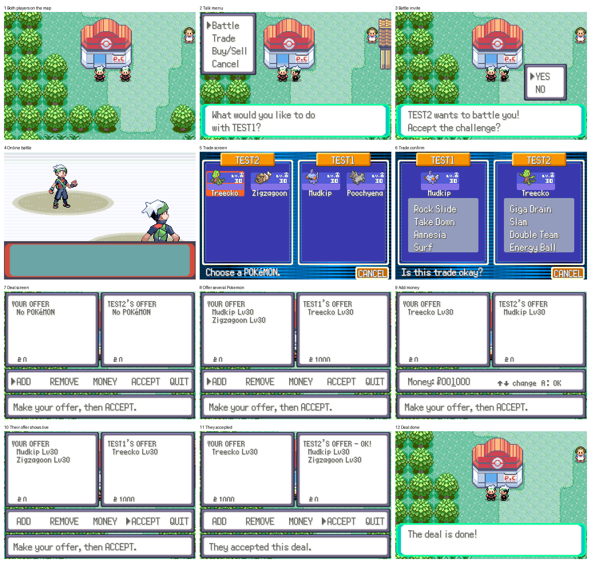
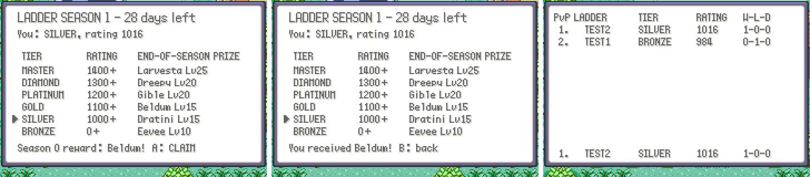
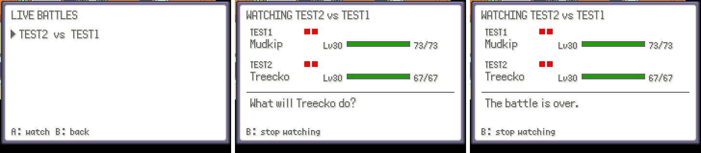
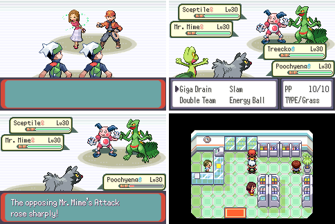
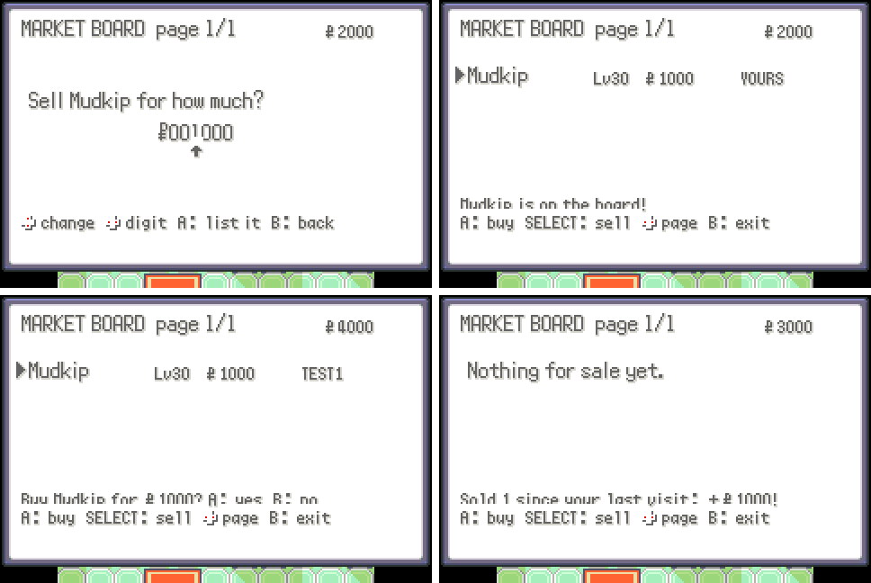

# Netplay

Online multiplayer for the game: players see each other on the overworld, can
challenge each other to battles or trade, and battle results feed a league
leaderboard.



How the original Hoenn was adjusted for many players (walking through other
players, places where you don't see them, friend travel that follows the
story) is in [hoenn_multi.md](hoenn_multi.md).

```
 ROM (gNetplayMailbox in EWRAM)  <->  mGBA Lua bridge  <->  TCP  <->  server/
```

- **ROM** keeps a small shared-memory mailbox up to date (own position, requests,
  outgoing link packets) and reads what the bridge writes into it (other
  players, invites, incoming link packets).
- **Bridge** (`tools/netplay_bridge/netplay_bridge.lua`) runs inside mGBA 0.10+,
  copies the mailbox to and from the server once per frame.
- **Server** (`server/netplay_server.py`) relays positions between players on
  the same map, pairs players for battles and trades, relays their link
  packets, and keeps the leaderboard in SQLite.

## Running

```sh
python3 server/netplay_server.py --port 7777 --db league.sqlite3
```

Ladder seasons last 28 days; `--season-days N` (or `NETPLAY_SEASON_DAYS`)
changes that.

Add `--http-port 8080` for the leaderboard page, which also serves the bridge
script with the server's address filled in. To run it on a real server
(Docker or systemd), see `deploy/README.md`.

The server JOIN ONLINE connects to is built into the game: set
`NETPLAY_SERVER_HOST` / `NETPLAY_SERVER_PORT` in `include/config/netplay.h`
(the **Build game** workflow can set it for you). Players then:

1. Load `tools/netplay_bridge/netplay_bridge.lua` in mGBA (*Tools → Scripting… →
   File → Load script*).
2. Pick **JOIN ONLINE** on the title menu (it replaces MYSTERY GIFT).
   CONTINUE plays offline: the bridge doesn't connect.

On a phone, the Android and iOS apps in `mobile/` (see `mobile/README.md`)
run the same bridge inside the app: no script to load, JOIN ONLINE just
works.

`NETPLAY_HOST`/`NETPLAY_PORT` globals set before loading the script override
the address in the game (the copy downloaded from the leaderboard page does
this).

In game, START → **STYLE** picks the trainer's look (Brendan, May, Red or
Leaf; saved, and seen by other players). START → **ONLINE** (when you joined
online) opens the online screens (`gNetplayOnlineMenu` in `src/netplay_menu.c`;
new features add a row there):

- **LADDER**: the PvP ladder, the top 10 by rating with each player's tier,
  and your own rank.
- **SEASON**: the current ladder season, days left, your tier, and the
  prize for each tier. When a season ends, everyone who played a rated
  battle gets their tier's Pokémon; press A here to claim it (it needs a free
  party slot, and the game saves). Tiers by rating: BRONZE (Eevee Lv10),
  SILVER 1000+ (Dratini Lv15), GOLD 1100+ (Beldum Lv15), PLATINUM 1200+
  (Gible Lv20), DIAMOND 1300+ (Dreepy Lv20), MASTER 1400+ (Larvesta Lv25).
  A new season halves everyone's distance from 1000 and clears W-L-D.

  
- **FRIENDS**: your friend list (up to 10) with where each friend is right
  now. A travels to an online friend who is outdoors in a town, city or on a
  route (not while they are surfing or in a battle, trade or deal); SELECT
  twice removes one. Add friends by talking to a player → *Add friend*. The
  list is one-way, like following, and kept by the server.
- **WATCH**: PvP battles going on right now (the list refreshes itself). A
  watches one: both trainers' active Pokémon with level and HP, a ball per
  party Pokémon (red while it can still fight), and the battle's messages as
  they happen. The host of each battle reports it, so spectators see the
  host's side of the text ("What will Treecko do?").

  

**Co-op battles:** talk to another player → *Co-op battle*. If they accept,
the two of you team up in a double battle (three Pokémon each) against two
Battle Frontier trainers, picked from the session id so both games agree.
Their Pokémon are set to the host's highest party level. It runs on the
game's own Battle Tower link-multi mode over the network link; nothing is
won or lost, and both parties are healed and put back afterwards.



**L** opens the emote wheel (`docs/qol.md`): three pages of eight, sixteen emotes
that pop up above your head and eight quick phrases (HI!, GG!, BATTLE?, TRADE?,
THANKS!, BYE!, FOLLOW ME!, NICE!) that also show in a box with your name.
Everyone on the same map sees them.

The **market board** is on the back wall of every Hoenn Poké Mart (right of
the counter; face the wall and press A). It lists Pokémon other trainers put
up for sale, five per page (◀▶ turns pages). A buys (it needs a free party
slot and the money); on your own listing, A takes it back. SELECT sells:
pick a party Pokémon (not your last one, not an egg) and set a price up to
¥999,999. Listings stay up while you're offline (up to 5 each), and the money
from sales is paid out the next time you open any board. Every change saves
the game.



## Releases

GitHub → Actions → **Build game** → Run workflow. It runs only when started by
hand, builds the ROM (optionally with a server address), builds the original
Emerald from pret/pokeemerald to compare against, and publishes a GitHub
release with a BPS patch (`tools/make_bps.py`) and the bridge script. The ROM
itself is never published; players patch their own Pokémon Emerald (USA).

Tests: `python3 -m unittest discover -s server` and
`lua5.4 tools/netplay_bridge/test_bridge.lua`.

End-to-end: `python3 tools/netplay_bridge/e2e/run_e2e.py` (needs a built
`pokeemerald.gba`, `libmgba-dev` 0.10 and gcc). It runs two headless games
against a fresh server: they meet in Oldale Town, player 1 changes into Red
with the Style menu (player 2 checks it sees that), they battle (player 1 forfeits),
trade their lead Pokémon, and then make a deal on the deal screen: player 2
gives both its Pokémon for player 1's lead Pokémon and ¥1,000. Last, player 2
opens the ladder and must be first of two. It checks the leaderboard, both
parties and both wallets. Screenshots and
logs go to `--out`.

## Mailbox layout (version 3)

All values little-endian. The bridge finds the mailbox by scanning EWRAM
(`0x02000000`–`0x0203FFFF`, 4-byte aligned) for the magic. "ROM" / "bridge"
says who writes the field; the other side only reads it.

| Offset | Size | Writer | Field |
|-------:|-----:|--------|-------|
| 0x000 | 8 | ROM | magic `"PKMNNET1"` |
| 0x008 | 1 | ROM | version (3) |
| 0x009 | 1 | bridge | state: 0 offline, 1 connecting, 2 online |
| 0x00A | 2 | bridge | local player id assigned by the server |
| 0x00C | 8 | ROM | player name, game charset, `0xFF` terminated; empty until the player is in the overworld |
| 0x014 | 2 | ROM | trainer id (low 16 bits) |
| 0x016 | 1 | ROM | map group |
| 0x017 | 1 | ROM | map number |
| 0x018 | 2 | ROM | x (s16, map coordinates) |
| 0x01A | 2 | ROM | y (s16) |
| 0x01C | 1 | ROM | facing direction (`DIR_*`) |
| 0x01D | 1 | ROM | elevation |
| 0x01E | 2 | ROM | avatar graphics id (`OBJ_EVENT_GFX_*`) |
| 0x020 | 8×20 | bridge | remote players (below) |
| 0x0C0 | 8 | ROM | request (below) |
| 0x0C8 | 8 | bridge | event (below) |
| 0x0D0 | 1 | ROM | event ack: ROM copies the event seq here once handled |
| 0x0D1 | 1 | test driver | test boot (see `Netplay_TryTestBoot`) |
| 0x0D2 | 1 | ROM | join online: the bridge connects only once this is 1 |
| 0x0D3 | 1 | — | padding |
| 0x0D4 | 4 | ROM/bridge | link TX ring: u8 head (ROM), u8 tail (bridge), 2 pad |
| 0x0D8 | 16×20 | ROM | link TX packets |
| 0x218 | 4 | bridge/ROM | link RX ring: u8 head (bridge), u8 tail (ROM), u16 held senders (ROM, below) |
| 0x21C | 16×20 | bridge | link RX packets |
| 0x35C | 40 | ROM | server host, ASCII, NUL-terminated |
| 0x384 | 2 | ROM | server port |
| 0x386 | 2 | — | padding |
| 0x388 | 180 | bridge | PvP ladder (below) |
| 0x43C | 204 | bridge | friend list (below) |
| 0x508 | 16 | bridge | ladder season (below) |
| 0x518 | 200 | both | market board (below) |
| 0x5E0 | 92 | ROM | battle report, by the host of a PvP battle (below) |
| 0x63C | 196 | bridge | spectating: live battles and the battle watched (below) |
| 0x700 | | | end |

The C definition is `struct NetplayMailbox` in `include/netplay.h`.

**Remote player slot (20 bytes):** u16 id (0 = empty slot), u8 map group,
u8 map number, s16 x, s16 y, u8 facing, u8 elevation, u16 graphics id,
u8 name[8]. The bridge only fills slots with players on the same map as the
local player, and keeps each player in the same slot while they stay.

**Request (ROM → bridge, 8 bytes):** u8 seq, u8 type, u16 target id,
u16 session id, u16 arg. The ROM fills the fields, then increments `seq`, at
most once per frame; the bridge acts once per new `seq`.

| type | meaning | fields used |
|-----:|---------|-------------|
| 1 | challenge to a battle | target id |
| 2 | offer a trade | target id |
| 3 | accept invite | session id |
| 4 | decline invite | session id |
| 5 | report battle result | session id, arg: 1 won, 2 lost, 3 draw |
| 6 | leave or cancel a session | session id |
| 7 | offer a deal (buy/sell) | target id |
| 8 | fetch the PvP ladder | — |
| 9 | emote | arg: emote (0–7 and 14–21 icons, 8–13 and 22–23 phrases; `include/emote_wheel.h`) |
| 10 | fetch the friend list | — |
| 11 | add a friend | target id |
| 12 | remove a friend | arg: index in the last friend list |
| 13 | fetch the ladder season | — |
| 14 | claim the oldest season reward | — |
| 15 | fetch a market board page | arg: page |
| 16 | list a Pokémon on the market | (market fields below) |
| 17 | buy a listing | arg: index on the page |
| 18 | take back your listing | arg: index on the page |
| 19 | collect money from sales | — |
| 20 | list live battles | — |
| 21 | watch a battle | arg: index in the live list |
| 22 | stop watching | — |
| 23 | invite to a co-op battle | target id |

**Ladder (bridge → ROM):** u8 seq (bumped when a new ladder is in place),
u8 count, u16 my rank (0 = no rated battles yet), my entry, then 10 entries.
An entry is 16 bytes: u8 name[8] (game charset), u16 rating, wins, losses,
draws.

**Friend list (bridge → ROM):** u8 seq (bumped when a new list is in place),
u8 count, u8 add seq (bumped when the server answers an add), u8 add result
(1 ok, 2 list full), then 10 entries of 20 bytes: u8 name[8], u16 player id
(0 = offline), u8 map group, u8 map number, s16 x, s16 y, u16 graphics id,
u8 busy, 1 pad.

**Season (bridge → ROM):** u8 seq (bumped on each SEASON answer), u8 reward
tier (0 BRONZE … 5 MASTER, 0xFF none), u16 season, u16 days left, u16 rating,
u8 rated, u8 claim seq (bumped on each CLAIMED answer), u8 claimed tier
(0xFF nothing), 1 pad, u16 reward season, 2 pad.

**Market:** u8 seq (bumped when a page is in place), u8 count, u8 page,
u8 pages, u8 answer seq (bumped on each MLISTED/MBOUGHT/MCANCELED/MCOLLECT),
u8 answer (1 ok, 2 gone, 3 full, 4 your own), u16 sales, u32 money (price
paid, or money collected), then 5 listings of 16 bytes (u16 species,
u8 level, u8 mine, u32 price, u8 seller[8]); then, written by the ROM
before a sell: u32 price, u16 species, u8 level, 1 pad; then a
`struct Pokemon` (100 bytes) holding the Pokémon being sold, or the one
bought or taken back.

**Battle report (ROM → bridge):** u8 seq (bumped on each change), 3 pad,
two sides (host, then guest) of 12 bytes: u16 species, u8 level, u8 Pokémon
still able to fight, u16 HP, u16 max HP, u8 party size, 3 pad; then the
latest battle message, 64 bytes in the game charset. Only the host of a PvP
battle writes it.

**Spectating (bridge → ROM):** u8 list seq, u8 count, u8 ended (the watched
battle is over), 1 pad, 5 live battles of 20 bytes (u16 session id,
u8 host[8], u8 guest[8], 2 pad), then the watched battle, laid out like the
battle report; its seq is bumped on every change.

**Event (bridge → ROM, 8 bytes):** u8 seq, u8 type, u16 peer id,
u16 session id, u8 kind (1 battle, 2 trade, 3 deal, 4 co-op), u8 role (0 host, 1 guest). The
bridge writes a new event only after the ROM has acked the previous one.

| type | meaning |
|-----:|---------|
| 1 | invite received from peer |
| 2 | session started; open the link with `role` |
| 3 | our invite was declined (or the player was busy or gone) |
| 4 | session ended (peer left, canceled, or disconnected) |
| 5 | our invite was sent; this is its session id |
| 6 | a player on our map emoted: peer id, kind = emote |

**Link rings:** a packet is 20 bytes: u8 kind (1 data, 2 handshake,
3 handshake ack, 4 deal offer chunk, 5 deal answer, 6 deal commit), u8 sender
(the link role; deal offers use it for the chunk index), u16 (deal offer
revision), then 16 bytes: one link
command (`CMD_LENGTH` = 8 u16) or deal data (see Deals below). A ring is empty when `head == tail`; indices wrap at 16. The writer
fills `packets[head]`, then advances `head`; the reader consumes
`packets[tail]`, then advances `tail`. On `START` the bridge empties both rings.

## Link over the network

While a session is running, `link.c` uses the rings instead of the serial port
(`Netplay_LinkHandshake` and `Netplay_LinkTransfer` in `src/netplay.c`):

- **Players.** Two games, or four for a 2v2 team battle (session kind
  `multi`). Each game's link role (0 to 3, from `START`) is its multiplayer
  id and its battler id; role 0 is the master, and roles 0 and 2 are a team.
  The server sends each `LINK` to every other game of the session.
- **Handshake.** When the link opens, the master sends a handshake packet and
  every other game answers with a handshake ack; the master is connected once
  it has them all, the others once they've seen the handshake. Packets that
  arrive before that are left over from an earlier link and are dropped.
- **Transfer.** Every frame each game sends exactly one data packet: its next
  queued link command, or zeros. Each player's packets wait in their own FIFO,
  and the k-th packet of every player is delivered together as one entry of
  the receive queue, which is what a serial transfer does. Network delay only
  delays entries; it never reorders them.
- **Holding back.** A player far ahead of the others could fill the RX ring
  with their packets and hide everyone else's behind them. So after reading
  the ring the ROM sets a bit per player whose FIFO couldn't take another full
  ring (the RX ring's u16), and the bridge keeps those players' data packets
  back until the bit clears, passing the others' on in order.
- **Wired.** Pokémon Centers would turn on wireless mode (the Union Room
  check, `OW_UNION_DISABLE_CHECK` is TRUE for this), and the battle and link
  setup always switch to wired mode before opening the link.

Battles and trades then run on Emerald's own link code: a battle uses each
player's whole party (healed, and restored afterwards like a cable club
battle), a 2v2 team battle the first three Pokémon of each (a cable club
multi battle), and a trade uses the normal trade screen.

## Deals (buy/sell)

"Buy/Sell" in the talk menu starts a deal session. It doesn't open a link.
Both players get the deal screen: their own offer on the left, the other
player's on the right, and ADD / REMOVE / MONEY / ACCEPT / QUIT below. An
offer is up to 6 Pokémon and any amount of money the player has, and each side
sees the other's offer change live.

- Every change to an offer bumps its revision and is sent whole as 38 deal
  offer chunks (filler1: chunk index, filler2: revision): u32 money, u8 count,
  3 padding, then 6 × the 100-byte `struct Pokemon`.
- A deal answer packet says whether that player accepts, with both offer
  revisions they saw. Any change to either offer clears both accepts.
- When a game sees both players accepting the same two revisions, it sends a
  deal commit with those revisions and stops taking input. It applies the deal
  once it has the other player's commit for the same revisions: it removes
  what it gave, adds what it got (marking the Pokémon as caught in the
  Pokédex), moves the money, and saves.
- A deal can't be accepted if it would leave a party empty or with more than
  6 Pokémon. Deals never touch the leaderboard.

## Server protocol

TCP, one command per line, fields separated by single spaces.

Client → server:

```
HELLO <name> <trainer id>
POS <map group> <map num> <x> <y> <facing> <elevation> <gfx>   (players see only those on the same map
                                    and in the same room: a guild hall has one room per guild)
REQ <battle|trade|deal|coop|double|multi> <target id> (answered with PENDING, then START or DECLINED;
                                    multi: the target's team, and both teams' partners come too)
ACCEPT <session id>
DECLINE <session id>
LINK <session id> <hex>
RESULT <session id> <win|loss|draw>
QUIT <session id>                   (leave a session, or cancel an invite)
BOARD
MYRANK
FRIEND ADD <player id>              (answered with FRIENDADD)
FRIEND DEL <name> <trainer id>
FRIENDS                             (answered with FRIEND lines, then FRIENDSEND)
EMOTE <emote 0-31>                  (to everyone else on the map; bursts of more than 4 are dropped)
MARKET LIST <page>                  (answered with MITEM lines, then MARKETEND)
MARKET SELL <species> <level> <price> <mon hex>   (answered with MLISTED)
MARKET BUY <listing id>             (answered with MBOUGHT)
MARKET CANCEL <listing id>          (answered with MCANCELED)
MARKET COLLECT                      (answered with MCOLLECT)
LIVE                                (answered with LIVE lines, then LIVEEND)
WATCH <session id>                  (answered with WATCHING, WSTATE, WTEXT, ... WEND)
UNWATCH
BSTATE <session id> <host: species level hp max-hp alive party> <guest: same>   (battle host only)
BTEXT <session id> <text>           (battle host only)
SEASON                              (answered with SEASON)
CLAIM                               (answered with CLAIMED)
```

Server → client:

```
WELCOME <id>
PENDING <session id>
PLAYER <id> <name> <map group> <map num> <x> <y> <facing> <elevation> <gfx>
GONE <id>
INVITE <session id> <kind> <from id>
START <session id> <kind> <peer id> <link role: 0 host, 1 guest, 2 host's partner, 3 guest's partner>
DECLINED <session id>
ENDED <session id>
LINK <session id> <hex>
EMOTE <player id> <emote>
FRIENDADD <ok|full> <name>
FRIEND <name> <tid> <player id or 0> <map group> <map num> <x> <y> <gfx> <busy 0|1>
FRIENDSEND
RANK <position> <name> <rating> <wins> <losses> <draws>
BOARDEND
SEASON <season> <days left> <rated 0|1> <rating> <reward tier or -1> <reward season>
CLAIMED <tier or -1> <season>
LIVE <session id> <host> <guest>
LIVEEND
WATCHING <session id>
WSTATE <session id> <same fields as BSTATE>
WTEXT <session id> <text>
WEND <session id>
MITEM <listing id> <seller> <species> <level> <price> <mine 0|1>
MARKETEND <page> <pages>
MLISTED <ok|full> <listing id>
MBOUGHT <ok|gone|self> <price> <mon hex or ->
MCANCELED <ok|gone> <mon hex or ->
MCOLLECT <money> <sales>
MYRANK <rank, 0 if unranked> <rating> <wins> <losses> <draws>
ERR <message>
```

## League rules

- Players are identified by name + trainer id. New players start at 1000 Elo.
- A battle counts once **both** players report matching results (win/loss or
  draw/draw); rating moves with K = 32.
- Mismatched reports are recorded as disputed and do not change ratings.
- If a player disconnects during a battle, the remaining player's report is
  accepted on its own, so leaving a losing battle counts as a loss.
- Trades, deals and the market never touch the leaderboard.
- Seasons: when one ends, each player with games gets a reward for the tier
  of their final rating (claimed in game, oldest first), ratings move halfway
  back to 1000, and W-L-D starts over.

## Bridge extensions

Features with their own mailbox can ride on the same connection. List their
Lua files in `extensions.txt` next to `netplay_bridge.lua` (one per line);
the bridge loads them after it starts. They get a global `NetplayBridge`:

```lua
NetplayBridge.addHook({
    onLine = function(args, line) return args[1] == "MYCMD" end, -- true: handled
    onFrame = function(mem) end, -- each frame while online
})
NetplayBridge.send("MYCMD 1")    -- one line to the server (dropped while offline)
NetplayBridge.connected()        -- online and welcomed
```
