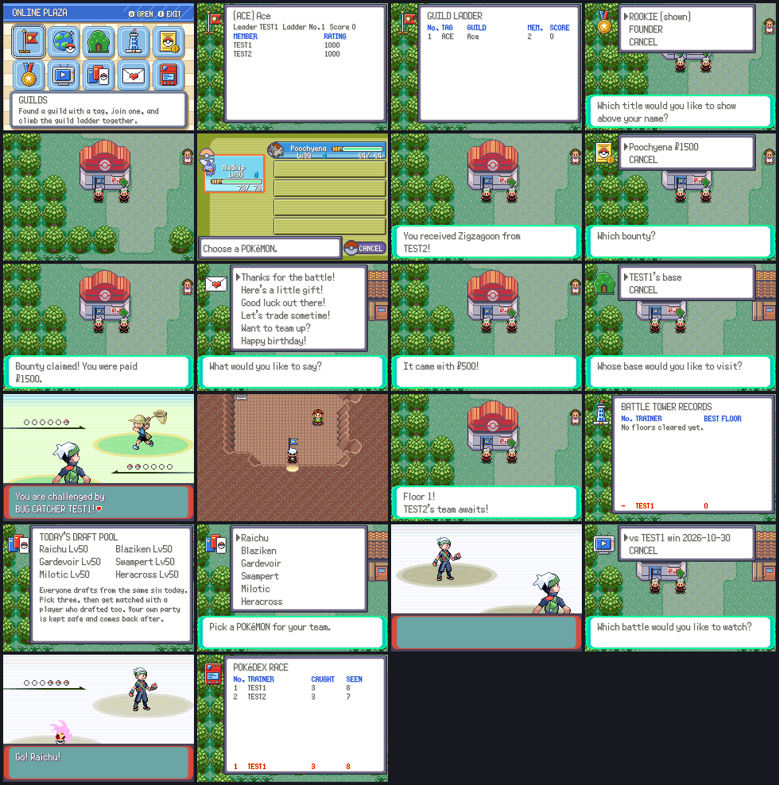

# Online Plaza: the second batch of online features

The **Online Plaza** gathers ten online features on one screen. Open it from
START → ONLINE → PLAZA once you've picked JOIN ONLINE on the title screen.

| Feature | What it does |
| --- | --- |
| Guilds | Found a guild with a 2–4 letter tag and a name, or join one. Guilds are ranked on a guild ladder by the average rating of their members. |
| Wonder Trade | Send a Pokémon off and get a random player's Pokémon back. If nobody else is trading, yours waits and you collect the swap on a later visit. |
| Secret bases | Share your secret base and team. Others can go inside it, or battle your stored team while you're offline. |
| Battle Tower | Each floor is another player's stored team. Lose once and the climb ends; the best floors are on a records board. |
| Bounties | Post a reward for a Pokémon you've seen but not caught. Anyone can hand one in for the money, and you collect the Pokémon later. |
| Titles | Earned titles (ROOKIE, CHAMPION, FOUNDER, TYCOON…) show as a badge above your head, and other players see it. |
| Replays | Your online battles upload in the background. Watch the last ten from the list. |
| Draft battles | Everyone drafts three Pokémon from the same six each day (level 50) and gets matched with another drafter. Your own party is kept safe and comes back after. |
| Mail | Send a phrase to a player you know, with money or an item attached. New mail plays a chime. |
| Pokédex race | A leaderboard of everyone's caught and seen counts. |

Starfall Isle has NPCs for the Battle Tower (`Netplay_EventScript_OpenTower`)
and the bounty board (`Netplay_EventScript_OpenBountyBoard`).

## How it talks to the server

The batch uses its own mailbox, `gNetplayExtMailbox` (magic `PKMNEXT1`, see
`include/netplay_ext.h`), so it never shares offsets with the core netplay
mailbox. The game makes one request at a time:

1. The game writes the request text (`WONDER SEND 25`) and any binary data (a
   100-byte Pokémon, a secret base, a replay part) and bumps `reqSeq`.
2. The bridge extension (`tools/netplay_bridge/netplay_ext.lua`, loaded by
   the bridge through `extensions.txt`) sends the data as
   `XD <hex>` lines of 100 bytes, then `X <seq> <request>`.
3. The server answers `XR <seq> <status> <hex>`: status 0 is ok, 1 is a refusal
   whose text the game shows, 2 is a malformed request. Text answers are rows
   of `|`-separated fields; binary data follows a NUL.
4. `XNOTE MAIL` tells an online player that mail arrived.

On the server, `server/ext.py` registers `X` and `XD` in
`Server.extra_commands` and routes each request word to a module:
`guilds.py`, `wondertrade.py`, `bases.py`, `tower.py`, `bounties.py`,
`titles.py`, `replays.py`, `draft.py`, `mail.py` and `dexrace.py` (and
`adventure_hof.py`, the Hall of Fame wall from `docs/adventure.md`). Each has a
`COMMANDS` dict of `fn(ctx, args, data) -> bytes` and keeps its tables in the
league database.

In the game, `src/netplay_ext.c` holds the mailbox, the request task, boards,
list menus and title badges; `src/netplay_ext_features.c` builds each request
and applies each answer; `src/netplay_ext_plaza.c` is the plaza screen; the
scripts are in `data/scripts/netplay_ext.inc`.

## Art

All art is original and drawn in Emerald's style (1px dark outlines, 2–3 tone
shading lit from the top left, colors from the game's own palettes). It is
generated by `tools/netplay_ext_art/make_art.py` into `graphics/netplay_ext/`:
the ten feature icons, thirteen title badges, the plaza cursor and the plaza
background.

## Tests

- `python3 -m unittest server/test_ext.py`: the server side.
- `python3 tools/netplay_bridge/e2e/run_ext_e2e.py`: two headless games and a
  real server go through every feature (guilds, titles, Wonder Trade, bounties,
  mail, secret base battle and visit, Battle Tower, a draft battle, watching
  its replay, the Pokédex race) and save screenshots of each step.

## Engine fixes this needed

- `GetTrainerStructFromId` returns the blank trainer for the secret base, link
  and Union Room opponents instead of tripping the debug assert (secret base
  battles hit it).
- The parties saved for recorded battles live in EWRAM, not on the heap, since
  `CB2_InitBattle` resets the heap; playing a recording crashed at the end.
