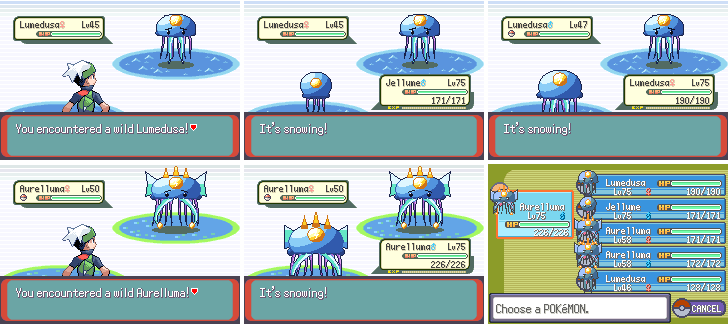

# Brand-new Pokémon

Original Pokémon made for this game, with their own Pokédex numbers after
Pecharunt (No. 1026 on). The first line is a test of the look; more lines
follow once it is approved.

## The Jellume line (Water/Electric)

| No. | Name | Evolves | HP/Atk/Def/SpA/SpD/Spe | Where |
|---|---|---|---|---|
| 1026 | Jellume | Lumedusa at Lv. 16 | 45/30/40/55/50/60 | Route 208, fishing (Old Rod) |
| 1027 | Lumedusa | Aurelluma at Lv. 36 | 65/45/60/80/70/85 | Route 208, surfing (30%) |
| 1028 | Aurelluma | | 85/55/80/110/90/115 | Route 208, surfing (4%) |

Abilities: Static, Water Absorb, and Electric Surge (hidden). They follow the
player like any other Pokémon, have shiny colours, and use Chinchou's and
Lanturn's TM and egg moves. Level-up moves are their own (Aurelluma learns Tail
Glow, Thunder and Hydro Pump).

## Adding another species

1. Draw it: add a function to `tools/new_species/draw.py` (shapes from
   `raster.py`, shaded from the top left with dark outlines) and run
   `python3 tools/new_species/draw.py`. It writes `graphics/pokemon/<name>/`:
   the 2-frame front, back, icon (on a shared icon palette), 6-frame
   overworld sheet and the normal and shiny palettes.
2. Give it `SPECIES_<NAME>` before `SPECIES_CUSTOM_END` in
   `include/constants/species.h` and `NATIONAL_DEX_<NAME>` at the end of the
   list in `include/constants/pokedex.h`, and move `NATIONAL_DEX_COUNT` to it.
3. Add its graphics and moves to `src/data/pokemon/new_species.h` and its
   entry to `src/data/pokemon/species_info/new_species.h`.
4. Put its dex number in the three lists in `src/data/pokemon/pokedex_orders.h`
   (by name, weight and height).
5. Add it to wild tables in `src/data/wild_encounters.json`, then run
   `python3 tools/rovers/make_rover_world.py` and
   `python3 tools/online/gen_ids.py`. Update `COMPLETE` in `server/dexrace.py`.

Saves: the research Pokédex keeps its first 1026 entries where they were and
stores dex numbers past 1025 in `SaveBlockExt.researchMore` (64 places), and
the Pokédex seen/caught flags have room up to No. 1031. Going past 1031 needs
those flags moved too.

Screenshots: `python3 tools/world_shots/run.py tools/new_species/shots.lua <out> 250000`.
