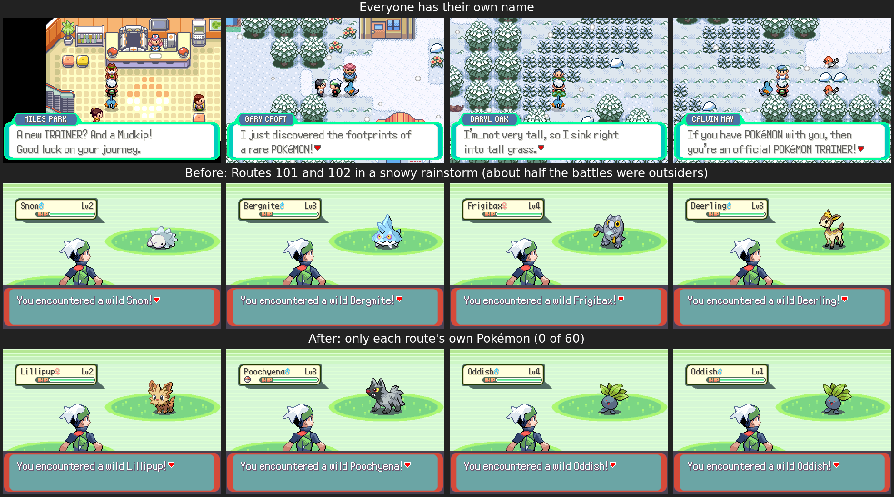

# Everyone's own name, and wild Pokémon that stay home

## Names

Every person on every map has a name of their own, shown in a name box above
everything they say (`src/npc_names.c`).

- Story characters keep their story names (PROF. BIRCH, MR. BRINEY, STEVEN,
  the gym leaders...), the same on every map they turn up on.
- Route trainers use the name their battle shows. When more than one
  trainer has it (two CALVINs), they also get a surname (CALVIN MAY). Names
  that are really a role (GRUNT) are replaced by a full name.
- Everyone else gets a first name and a surname that nobody else in the
  game has (MILES PARK, GARY CROFT). Women's outfits get women's names.
- The living NPC trainers show their own names too.
- Lines that are the game talking ("{PLAYER} received ...") have no name.

The names come from `tools/npc_names/make_names.py`, which the Makefile runs
whenever a map changes, so a person added to a map later gets a name
without anyone writing it. It writes `src/data/npc_names.h` (not committed).
A name is picked by hashing the map and the person's place on it, so adding
someone never renames anyone else. 3,393 people, all different apart from
story characters met in several places.

## Wild Pokémon stay in their own areas

Weather (`world_weather.c`, a third of the encounters in rain, sand or
snow), the seasons (`life_seasons.c`, 15%) and online migrants
(`online_eco.c`) swapped encounters for Pokémon that weren't on the map's
list anywhere in Hoenn, so Snom, Bergmite and winter Deerling showed up on
Route 101. Now (`src/habitat.c`):

- A visitor needs a home on the map: it must share a type with a Pokémon
  that lives there.
- The starting area (Routes 101 to 104 and Petalburg Woods) only ever has
  its own Pokémon.
- The server only sends herds and fleeing Pokémon where they fit
  (`fits` in `server/online_eco.py`), and never to the starting area.
- Birds hopping around towns and flying over are picked from the area's own
  fliers (a town counts the routes next to it), instead of Pidgey, Starly
  and Pidove from other regions. No night birds where none live.
- Charging wild Pokémon, rampaging ones and the ones the roaming trainers
  fight only come out of grass or a cave floor, never a path.

Measured with `tools/npc_names/wild_tally.lua` (30 battles each in a snowy
rainstorm, run twice): before, 11 to 15 of 30 on Route 101 and 16 of 30 on
Route 102 were outsiders; after, none of 120.

Screenshot runs: `tools/npc_names/shots.lua` (names) and
`tools/npc_names/wild_tally.lua`, both through `tools/world_shots/run.py`.
