# Online hub: the sixth batch of online features

The sixth batch lives under START → ONLINE → **HUB** (`data/scripts/online.inc`).
Each feature has a section below.

## Catch goals

Every Pokémon caught online counts towards the week's server-wide goals
(`server/online_goals.py`):

| Goal | Target | Reward |
| --- | --- | --- |
| Catch Pokémon | 300 | 10 Ultra Balls |
| Fish up Pokémon | 100 | 10 Dive Balls |
| Catch the week's featured Pokémon (Zigzagoon, Wingull, Taillow…) | 40 | 3 Rare Candies |
| Find shiny Pokémon | 3 | 1 Master Ball |

When a goal is reached, everyone online gets a notice. Everyone who caught at
least one Pokémon that week can collect the reward from HUB → CATCH GOALS.
Goals start over every week.

## Legend sightings

When a player meets a roaming Pokémon or any legend in a wild battle, the
game reports it (`OEV SIGHT species mapGroup mapNum roaming`). Everyone else
online gets a notice ("TEST1 spotted LATIOS at ROUTE 117!"), at most once
every ten minutes per player and species, and HUB → LEGEND SIGHTINGS shows
where each one was last seen, by whom and how long ago
(`server/online_sightings.py`).

## Website: live map and shiny gallery

The server's web page (`--http-port`) links two new pages
(`server/online_web.py`):

- **/map**: the game's own Hoenn region map with every player online on
  it (red), and the legends seen in the last day (purple). It refreshes
  every five seconds from `/map.json`.
- **/shinies**: every shiny Pokémon caught online, newest first, with who
  caught it, where and when. Each catch also tells everyone else online.
  The pictures are the game's own sprites (`/sprite/<species>.png`): the
  front picture with its shiny palette swapped in.

`tools/online/gen_ids.py` draws `server/static/hoenn.png` from the region
map's tiles and finds each species' picture and shiny palette. The Docker
image now copies `graphics/pokemon`, `server/static` and every bridge
script (the Online Plaza's `netplay_ext.lua` was missing from it).

## Fishing tournaments

Every two hours, for half an hour, the server runs a fishing tournament
(`server/online_fishing.py`, `src/online_fishing.c`). Everyone online is
told when one starts. While it's on:

- a third of the Pokémon that bite are one of the tournament's three rare
  species (Feebas, Relicanth, Luvdisc, Lapras, Dratini, Mantine…, a
  different three each time), at the level of the Pokémon they replace;
- every Pokémon landed with a rod scores its size in centimetres (the same
  size as R → RECORDS), plus 50 for a rare one, and the player is told how
  many points it got.

HUB → FISHING TOURNEY shows the live standings, or the last results and when
the next one starts. When it ends everyone online hears the top three, who
win 5 Rare Candies and ¥20,000, 3 Rare Candies and ¥10,000, and 10 Ultra
Balls and ¥5,000; everyone else who entered gets 3 Dive Balls. Prizes are
collected from the same board.

`NETPLAY_FISHT_PERIOD`, `NETPLAY_FISHT_LENGTH` and `NETPLAY_FISHT_START`
(seconds) change the schedule.

## Co-op fishing

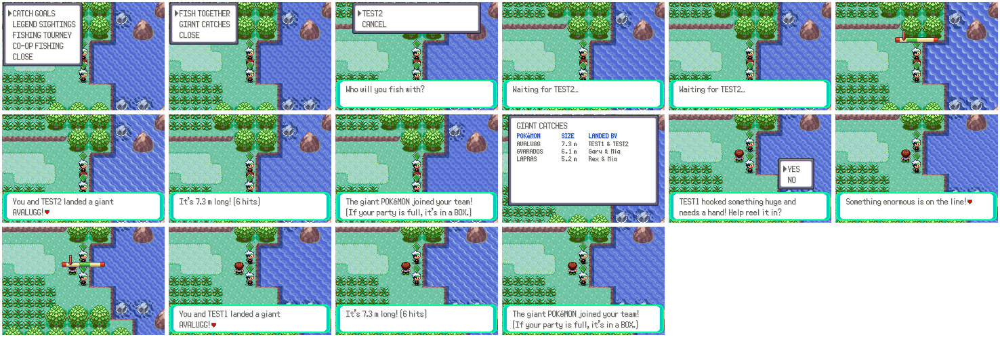

Two players on the same map can reel in a giant Pokémon together
(`server/online_coopfish.py`, `src/online_fishing.c`,
`data/scripts/online/coop_fishing.inc`). One faces the water and picks
HUB → CO-OP FISHING → FISH TOGETHER, then a player nearby; the other gets an
invitation as soon as they're free. Once both say yes, each plays three
rounds of the reeling meter. With four hits or more between them the giant
(Wailord, Gyarados, Lapras, Milotic, Kingdra, Dondozo, Avalugg…) is landed
and both get one at level 45 (shiny one time in 64). The biggest giants
landed are on HUB → CO-OP FISHING → GIANT CATCHES.

## Player shops

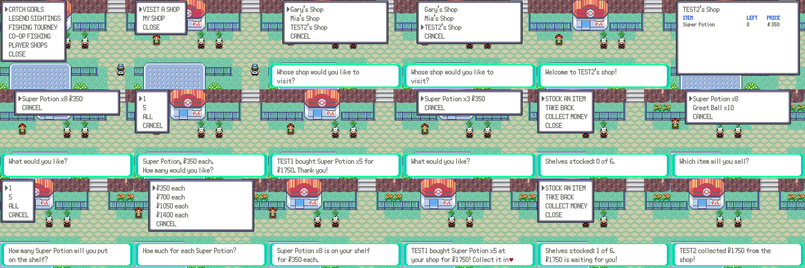

Every player can run a shop with up to six shelves of items
(`server/online_shops.py`, `src/online_shops.c`,
`data/scripts/online/shops.inc`). HUB → PLAYER SHOPS:

- **VISIT A SHOP** lists the other players' shops, best sellers first.
  Opening one shows its shelves; pick a shelf, then 1, 5 or ALL. The money
  is taken and the items go in the bag (if there's room).
- **MY SHOP** → **STOCK AN ITEM** picks something from the bag's item,
  ball or berry pockets, how many, and a price: half, the same as, one and
  a half or twice the mart price. The items leave the bag. **TAKE BACK**
  empties a shelf, **COLLECT MONEY** pays out what has sold.

Shops stay open while their owner is offline; the money waits on the
server. An owner who is online hears of each sale. The market board and
the auction house sell Pokémon; shops sell items.

## Pokémon pageants

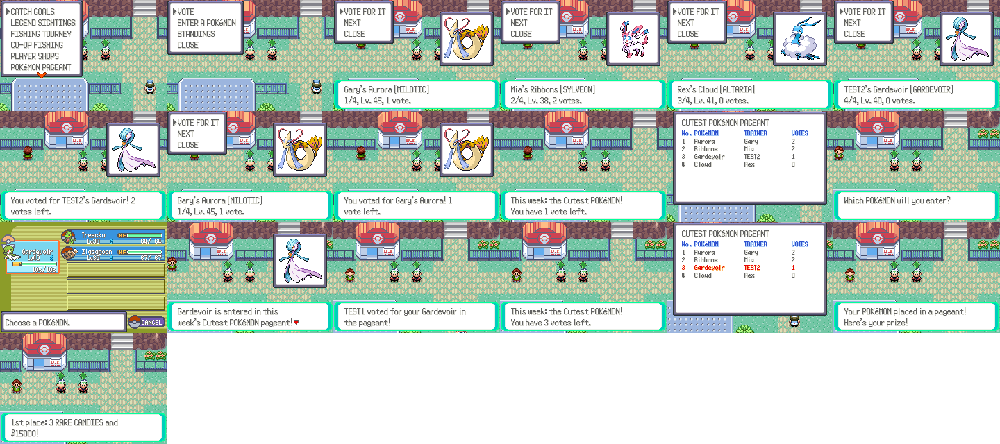

Every week there's a pageant with a theme after the contest categories
(Cutest, Coolest, Most Beautiful, Smartest, Toughest)
(`server/online_pageant.py`, `src/online_pageant.c`,
`data/scripts/online/pageant.inc`). HUB → POKéMON PAGEANT:

- **ENTER A POKéMON** enters one from the party (entering again swaps it,
  and its votes start over). Everyone online hears of it.
- **VOTE** goes through the other players' entries one at a time, each
  with its picture (shiny colours too), and **VOTE FOR IT** gives it one of
  your three votes for the week. Its owner hears of each vote.
- **STANDINGS** shows the week's board. When a week is over, its top three
  win 3, 2 or 1 Rare Candies and ¥15,000, ¥8,000 or ¥4,000, collected here.

## Duo quests

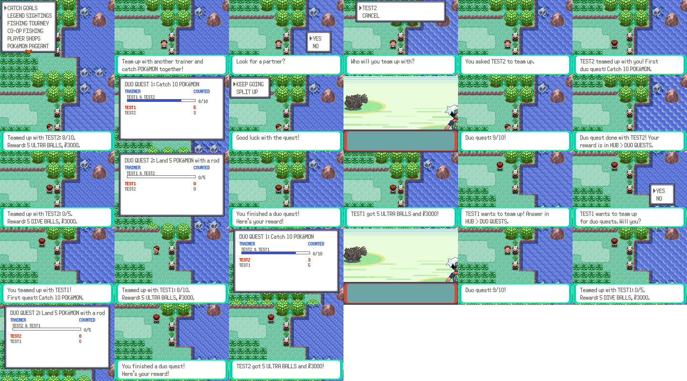

Two players team up and work on quests together (`server/online_duo.py`,
`data/scripts/online/duo.inc`). In HUB → DUO QUESTS a player without a
partner picks someone online; the other gets a notice and answers in the
same place. The pair's catches count together: catch 10 Pokémon, land 5
with a rod, catch 6 different species, catch in 4 different places,
catch 20, then round again with bigger targets. Both players hear when
they're halfway and one away. When a quest is done both collect its reward
(Ultra, Dive, Timer or Nest Balls, or Rare Candies, and money) and the next
one starts. The board shows each partner's share; SPLIT UP ends the pair.

## Mentors

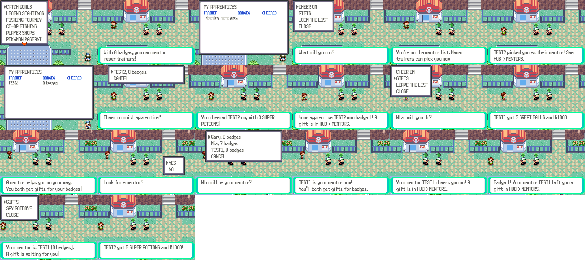

Trainers with six badges or more can mentor newer ones
(`server/online_mentors.py`, `src/online_mentors.c`,
`data/scripts/online/mentors.inc`). In HUB → MENTORS:

- A mentor joins (or leaves) the mentor list and sees their apprentices'
  badges. Once a day they can **CHEER ON** each apprentice, which sends
  3 Super Potions with the notice.
- A trainer with fewer than six badges picks a mentor from the list (up to
  four apprentices each), and can **SAY GOODBYE** later.
- Each badge the apprentice wins brings both a gift: Super Potions, Hyper
  Potions or Ultra Balls for the apprentice, Balls or a Rare Candy for the
  mentor, plus money. At eight badges the apprentice graduates: 5 Rare
  Candies for them, 3 for the mentor, and everyone online hears of it.

The game sends its badge count with every MENTOR request and reports it
(`OEV BADGES n`) whenever it changes.

## Player-made quests

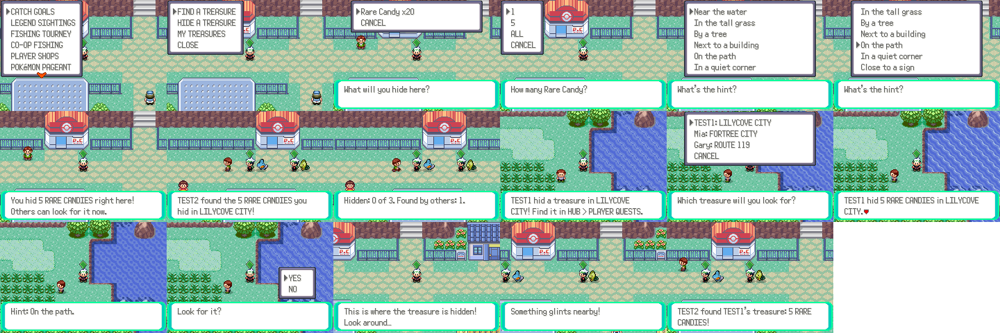

Players hide treasure for each other (`server/online_pquests.py`,
`src/online_pquests.c`, `data/scripts/online/pquests.inc`). In HUB →
PLAYER QUESTS:

- **HIDE A TREASURE** puts items from the bag (1, 5 or all of one kind) at
  the spot where the player stands, with a hint picked from a list ("On
  the path", "By a tree", "Near the water"…). Up to three at once;
  everyone online hears where.
- **FIND A TREASURE** lists the others' treasures by place; taking one
  shows who hid what, where, and the hint. Once the player is on that map
  the game says so, then that something glints when they're three steps
  away or closer, and on the very spot the treasure is theirs. The one who
  hid it hears who found it.
- **MY TREASURES** shows how many were found, and digs one up again.

The spot is the server's copy of the hider's position (the POS lines);
the quest the player took is in the status, so the game checks the spot
itself.

## Spectator betting

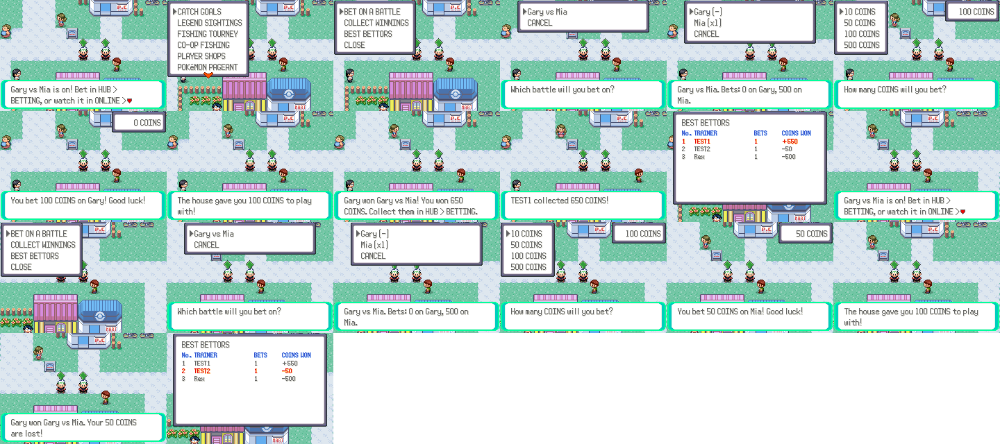

When a PvP battle starts, everyone else online hears of it and can bet
Game Corner COINS on either side for the first two minutes
(`server/online_betting.py`, `data/scripts/online/betting.inc`). In HUB →
BETTING → BET ON A BATTLE the player picks the battle, sees what's been
bet on each side with the payout per coin, picks a side and 10, 50, 100 or
500 COINS. One side per battle; more bets on the same side add up.

When the battle ends, those who backed the winner share the whole pool in
proportion to their bets, and collect it from COLLECT WINNINGS; the others
hear what they lost. After a draw, a dispute or when nobody backed the
winner, every bet comes back. A player with no COINS gets 100 from the
house once a day. BEST BETTORS ranks everyone by COINS won or lost. The
battle itself can be watched from ONLINE → WATCH as before.

The module wraps the plaza server's `cmd_accept` and `finish_battle`, so it
hears of every battle start and result without changing them.

## Ranked doubles

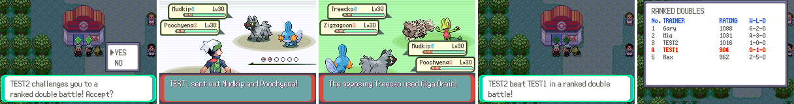

ONLINE → challenge a player → RANKED DOUBLE BATTLE starts a two-on-two
link battle: each player uses the first two Pokémon of their party, as in a
cable club double battle. It's a new plaza session kind, `double`
(`NETPLAY_KIND_DOUBLE`, bridge `REQ double`), linked the same way as single
battles; `Task_Linkup` now gives each game its battler id from the link
order, which the double battle intro needs for the opponent's name.

Results go to their own Elo ladder (`server/online_doubles.py`, table
`online_doubles`), separate from the singles league; the server announces
each winner, and HUB → DOUBLES LADDER shows the board. Spectator betting
takes double battles too.

## 2v2 team ladder

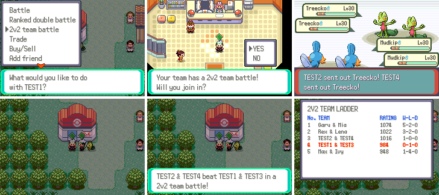

Two players form a team in HUB → TEAM LADDER (FORM A TEAM picks someone
online, who answers in the same place; SPLIT UP ends it). A team takes on
another by talking to one of its members and picking 2V2 TEAM BATTLE: the
other three are asked to join (a partner out of sight gets "Your team has a
2v2 team battle!"), and once all have said yes, all four games link up for a
multi battle, each player with the first three Pokémon of their party.

The link is the plaza's network link grown to four players (see
`docs/netplay.md`, Link over the network): session kind `multi`, link roles
0 to 3, a FIFO per player, and the bridge holding back a player who runs too
far ahead. Results go to the team's own Elo rating (`server/online_teams.py`,
table `online_teams`); a team's members have to agree on the result, and the
server announces the winners. Building it turned up that every Pokémon
Center switched the game to wireless mode (the Union Room check), which broke
any online link started indoors; that check is off now.

## Guild halls, clan wars and base raids

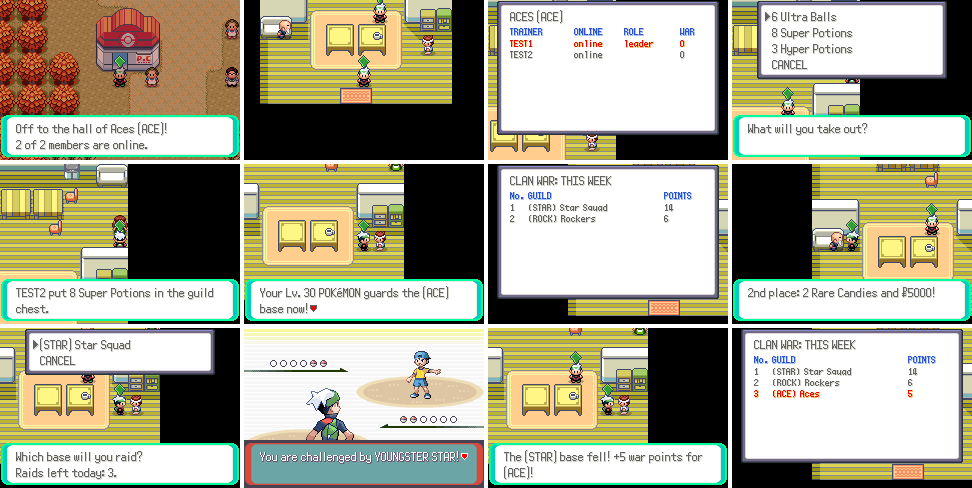

These build on the plaza's guilds (Online Plaza > GUILDS, `server/guilds.py`).

- **Guild hall.** HUB > GUILD HALL takes a member to their guild's hall
  (`MAP_ONLINE_GUILD_HALL`, map group `gMapGroup_Online`); its door leads
  back to where they were (a dynamic warp). Every guild has its own hall: on
  that map the server puts each player in a room named after their guild
  (`room_of` in `server/netplay_server.py`), and players only see others in
  the same room. The clerk shows the members (who's online, the leader, this
  week's war points) and keeps the guild chest: any member can put items in
  (up to 20 kinds, 99 each) and take a stack out.
- **Clan war.** Every week guilds score war points: 3 for a member who beats
  a member of another guild in a PvP battle or ranked double (2 each in a
  2v2), 5 for a won raid, 2 to the defending guild when a raid fails. The war
  officer shows the week's board; the three best guilds win prizes for every
  member (3/2/1 Rare Candies and $10000/$5000/$2500), collected from the
  officer the week after.
- **Base raids.** At the raid captain, GUARD OUR BASE uploads the player's
  team. A guild base's team is the best Pokémon of each defender, strongest
  first, up to six, with the guild's tag as the trainer's name. RAID A BASE
  lists the other guilds' bases; the raid is a battle like a secret base
  owner's (`NetplayExt_PrepStoredBattle`), and the result goes back as
  `RAID RESULT`. Three raids a day.

Server: `server/online_guilds.py` (tables `online_guild_chest`,
`online_guild_war`, `online_guild_war_claims`, `online_guild_defenders`,
`online_guild_raids`). Game: `data/scripts/online/guilds.inc`,
`data/maps/OnlineGuildHall/`, `src/online_guilds.c`.

## Mount racing

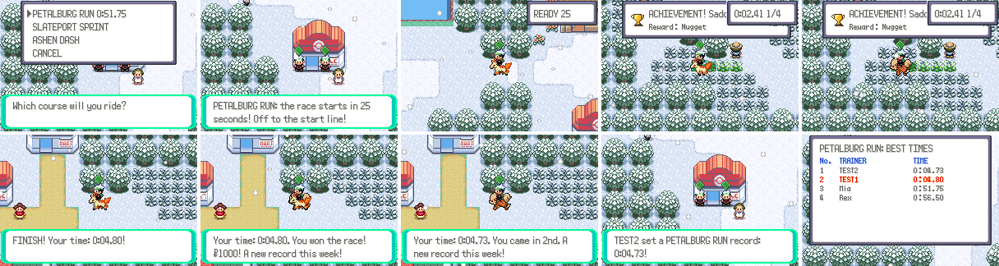

HUB > MOUNT RACING (with a Pokémon you can ride in the party) picks one of
three courses: PETALBURG RUN (Route 102, east to west), SLATEPORT SPRINT
(Route 110, south to north) and ASHEN DASH (Route 113, east to west).
Everyone who joins a course within the same 20 seconds races it together,
up to four, each from their own lane on the start line: the game warps them
there, puts them on their mount and counts down. A small window shows the
time and the gates passed; the last gate is the next town. Racers ride
through other players and the other things the game's extra features put on
the map (local ids 200 and up), wild Pokémon and trainers leave them alone
(the engine's `WE_FLAG_NO_ENCOUNTER` and `OW_FLAG_NO_TRAINER_SEE`, flags
`0x4C1` and `0x4C0`), and notices wait for the finish. At the finish the
time goes to the server, and the player goes back to where they joined.

The first racer across the line in a heat of two or more wins $1000 for
each racer beaten; when everyone is in, all of them get the results. Each
course has a board of the week's best times, and a new best is announced to
everyone online. Giving up (MOUNT RACING again during a race) takes the
player back.

Server: `server/online_racing.py` (heats in memory, table
`online_race_times`). Game: `src/online_racing.c` (courses, gates, the
timer), `data/scripts/online/racing.inc`.

## Hide and seek

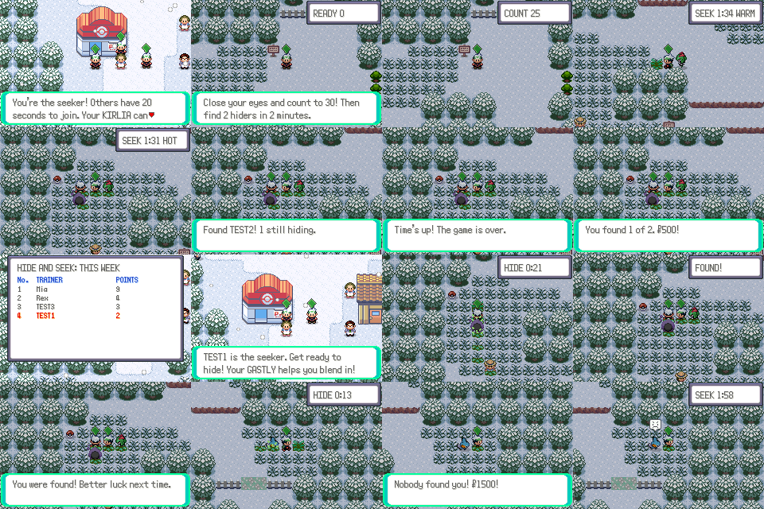

HUB > HIDE AND SEEK picks an arena (Petalburg Woods or Route 117). The
first to pick one seeks; anyone who joins it in the next 20 seconds hides,
up to five. The game warps everyone to the arena, counts the lobby down,
and then the hiders have 30 seconds to hide while the seeker counts with
their eyes closed. The seeker then has two minutes and finds a hider by
talking to them. While seeking they only see hiders within 3 tiles: the
server sends them the others as gone (`Server.can_see`). A hider who leaves
the arena's map is out. Wild Pokémon, trainers and the story's scenes leave
players alone during a game, as in a race, and notices wait for the end.

The lead Pokémon helps, from its ability or else its type:

| Lead | For a seeker | For a hider |
| --- | --- | --- |
| Keen Eye, Compound Eyes, Illuminate, Frisk | sharp eyes: sees hiders from 5 tiles | |
| Forewarn, Anticipation, Telepathy, or a Psychic type | senses hiders: the timer shows HOT (closest within 5 tiles), WARM (12) or COLD | |
| Sand Veil, Snow Cloak, Illusion, Infiltrator, or a Ghost type | | blends in: the seeker sees them from 2 tiles closer (at least 1) |

The server's clock runs the game: the status tells the game how many seconds
are left, so a clock that runs fast or slow keeps in step, and the game ends
when the server says so (or 20 seconds after its own clock runs out, if the
server is gone). The seeker wins $500 for each hider found and $1000 more
for finding everyone; a hider nobody found wins $1500. Points go on the
week's board: 2 for each find, 3 for staying hidden. Picking HIDE AND SEEK
again during a game stops playing.

Server: `server/online_hide.py` (games in memory, table
`online_hide_points`). Game: `src/online_hide.c` (arenas, the timer, the
talents), `data/scripts/online/hide.inc`; the racing and hide-and-seek
timer window is `src/online_hud.c`.

## Wildlife report and research leaders

HUB → **WILDLIFE REPORT** is the living ecosystem's window: how many of each
species are left in this area, what migrated or fled here, and every
migration going on (see [ecosystem.md](ecosystem.md)). HUB → **RESEARCH
LEADERS** ranks players by how many species' research they completed (see
[research.md](research.md)).

## How it talks to the server

These features use the Online Plaza's request channel (`NpxRpc_*` in
`src/netplay_ext.c`, `X` lines on the server, see `docs/netplay_ext.md`) with
their own request words, so they need no new mailbox or bridge code.

In the game, `src/online.c` sends a request from the table in
`src/online_requests.c` (`Online_Request`, VAR_0x8004 = `ONL_REQ_*`) and
handles every answer the same way:

| Rows of the answer | What the game does |
| --- | --- |
| row 0: `message\|code\|var1\|var2\|var3` | message to `gStringVar4` (`~` new line, `^` new page, `#` é), code to `VAR_0x800B`, vars to `gStringVar1`–`3`; `$` is the money sign, `>` itself |
| `+ITEM\|id\|n`, `-ITEM\|id\|n`, `+MONEY\|n`, `-MONEY\|n`, `+COINS\|n`, `-COINS\|n`, `+MON\|species\|level\|shiny` | applied right away |
| `N\|text` | a notice, shown once the player is free |
| `S\|key\|...` | the status of a live feature (`Online_Status`) |
| anything else | data rows (their count is in `VAR_0x800A`) for `Online_ShowBoard` and `Online_Choose` |

A board's data rows are its title, its columns (`x:LABEL` each), then its
lines; a line starting with `*` is the player's own (red), and
`%|percent|text|right text|count` is a progress bar.

In the background the game reports what happens (`OEV CATCH species shiny
mapGroup mapNum fished`, `OEV SIGHT ...`, `OEV FISH species size`) and asks for the live features' status (`OSTAT`)
every ten seconds; both answers bring any notices. An answer can end with
binary data after a NUL (`Npx_Binary`), like a raid's team.

On the server, `server/online.py` adds these words to the plaza's request
handlers. Each feature is a module `server/online_*.py` with `COMMANDS`,
and optionally `setup(db)`, `EVENTS` (reports it listens to) and
`status(ctx)`. `server/online_ids.py` has the game's item, species and map
numbers; `tools/online/gen_ids.py` writes it from the headers.

Numbers this batch owns (agreed with the other feature threads): flags
`0x4C0`–`0x4DF` (`0x4C0` and `0x4C1` are the no-trainers and
no-encounters switches of races and hide and seek, which also skip the
story's scenes), vars `0x40BB` and `0x40DB`, object local ids 241–248 on
shared maps.

## Tests and screenshots

- `python3 -m unittest server/test_online.py`
- `website.lua` with `website_seed.py` also screenshots the web pages with
  Playwright (`tools/online_shots/web_shot.js`) while both games are online.
- `python3 tools/online_shots/run.py tools/online_shots/goals.lua OUT 60000 2 tools/online_shots/goals_seed.py`
  runs two games against a fresh server; the seed plays other players first.
  `run.py` is `tools/world_shots/run.py` plus the seed and the bridge
  extensions; `tools/online_shots/lib.lua` has `Driver.openHub`,
  `Driver.catchWild` and `Driver.waitNotice`.
- A seed's `ENV` reaches the games too: `NETPLAY_FPS` (as `hide_seed.py`
  sets it, 60) makes the harness run at the game's real speed, for
  scenarios timed by the server's clock.
