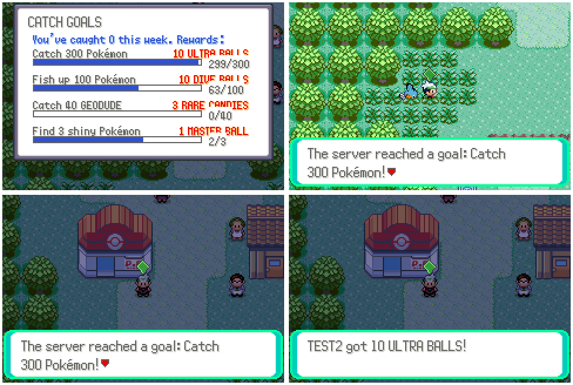
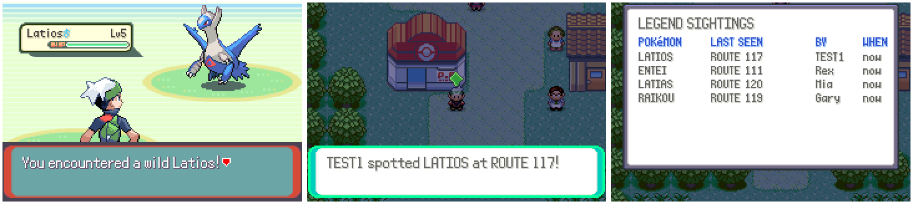
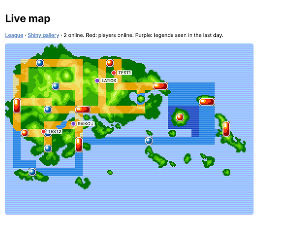
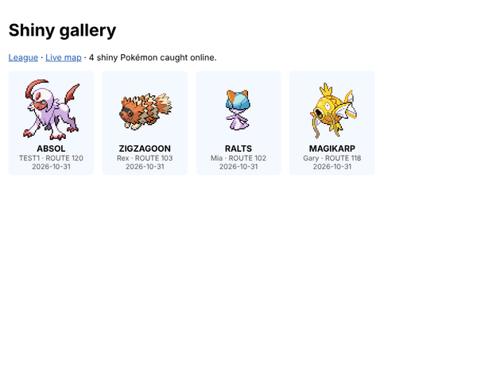
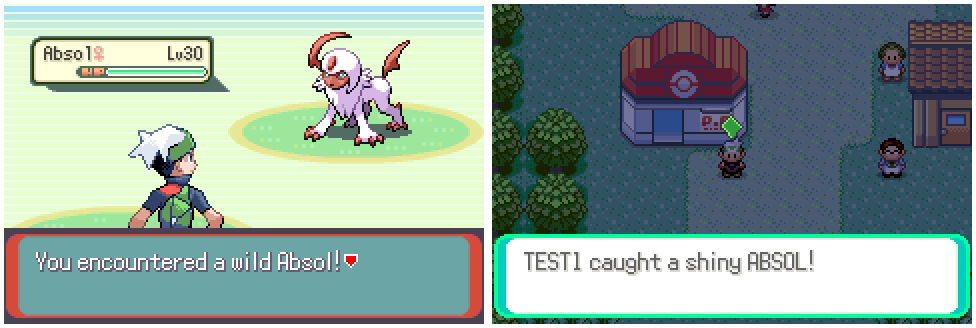
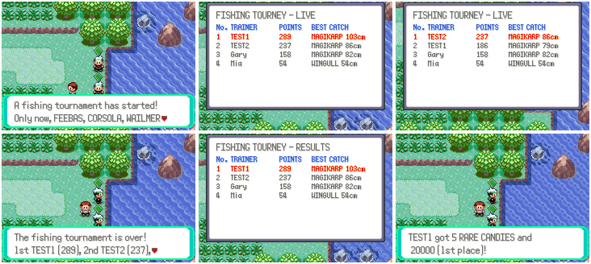

# Online hub: the sixth batch of online features

The sixth batch lives under START → ONLINE → **HUB** (`data/scripts/online.inc`).
Each feature has a section below.

## Catch goals

Every Pokémon caught online counts towards the week's server-wide goals
(`server/online_goals.py`):

| Goal | Target | Reward |
| --- | --- | --- |
| Catch Pokémon | 300 | 10 Ultra Balls |
| Fish up Pokémon | 100 | 10 Dive Balls |
| Catch the week's featured Pokémon (Zigzagoon, Wingull, Taillow…) | 40 | 3 Rare Candies |
| Find shiny Pokémon | 3 | 1 Master Ball |

When a goal is reached, everyone online gets a notice. Everyone who caught at
least one Pokémon that week can collect the reward from HUB → CATCH GOALS.
Goals start over every week.

## Legend sightings

When a player meets a roaming Pokémon or any legend in a wild battle, the
game reports it (`OEV SIGHT species mapGroup mapNum roaming`). Everyone else
online gets a notice ("TEST1 spotted LATIOS at ROUTE 117!"), at most once
every ten minutes per player and species, and HUB → LEGEND SIGHTINGS shows
where each one was last seen, by whom and how long ago
(`server/online_sightings.py`).

## Website: live map and shiny gallery

The server's web page (`--http-port`) links two new pages
(`server/online_web.py`):

- **/map**: the game's own Hoenn region map with every player online on
  it (red), and the legends seen in the last day (purple). It refreshes
  every five seconds from `/map.json`.
- **/shinies**: every shiny Pokémon caught online, newest first, with who
  caught it, where and when. Each catch also tells everyone else online.
  The pictures are the game's own sprites (`/sprite/<species>.png`): the
  front picture with its shiny palette swapped in.

`tools/online/gen_ids.py` draws `server/static/hoenn.png` from the region
map's tiles and finds each species' picture and shiny palette. The Docker
image now copies `graphics/pokemon`, `server/static` and every bridge
script (the Online Plaza's `netplay_ext.lua` was missing from it).

## Fishing tournaments

Every two hours, for half an hour, the server runs a fishing tournament
(`server/online_fishing.py`, `src/online_fishing.c`). Everyone online is
told when one starts. While it's on:

- a third of the Pokémon that bite are one of the tournament's three rare
  species (Feebas, Relicanth, Luvdisc, Lapras, Dratini, Mantine…, a
  different three each time), at the level of the Pokémon they replace;
- every Pokémon landed with a rod scores its size in centimetres (the same
  size as R → RECORDS), plus 50 for a rare one, and the player is told how
  many points it got.

HUB → FISHING TOURNEY shows the live standings, or the last results and when
the next one starts. When it ends everyone online hears the top three, who
win 5 Rare Candies and ¥20,000, 3 Rare Candies and ¥10,000, and 10 Ultra
Balls and ¥5,000; everyone else who entered gets 3 Dive Balls. Prizes are
collected from the same board.

`NETPLAY_FISHT_PERIOD`, `NETPLAY_FISHT_LENGTH` and `NETPLAY_FISHT_START`
(seconds) change the schedule.

## How it talks to the server

These features use the Online Plaza's request channel (`NpxRpc_*` in
`src/netplay_ext.c`, `X` lines on the server, see `docs/netplay_ext.md`) with
their own request words, so they need no new mailbox or bridge code.

In the game, `src/online.c` sends a request from the table in
`src/online_requests.c` (`Online_Request`, VAR_0x8004 = `ONL_REQ_*`) and
handles every answer the same way:

| Rows of the answer | What the game does |
| --- | --- |
| row 0: `message\|code\|var1\|var2\|var3` | message to `gStringVar4` (`~` new line, `^` new page, `#` é), code to `VAR_0x800B`, vars to `gStringVar1`–`3` |
| `+ITEM\|id\|n`, `-ITEM\|id\|n`, `+MONEY\|n`, `-MONEY\|n`, `+MON\|species\|level\|shiny` | applied right away |
| `N\|text` | a notice, shown once the player is free |
| `S\|key\|...` | the status of a live feature (`Online_Status`) |
| anything else | data rows (their count is in `VAR_0x800A`) for `Online_ShowBoard` and `Online_Choose` |

A board's data rows are its title, its columns (`x:LABEL` each), then its
lines; a line starting with `*` is the player's own (red), and
`%|percent|text|right text|count` is a progress bar.

In the background the game reports what happens (`OEV CATCH species shiny
mapGroup mapNum fished`, `OEV SIGHT ...`, `OEV FISH species size`) and asks for the live features' status (`OSTAT`)
every ten seconds; both answers bring any notices.

On the server, `server/online.py` adds these words to the plaza's request
handlers. Each feature is a module `server/online_*.py` with `COMMANDS`,
and optionally `setup(db)`, `EVENTS` (reports it listens to) and
`status(ctx)`. `server/online_ids.py` has the game's item, species and map
numbers; `tools/online/gen_ids.py` writes it from the headers.

Numbers this batch owns (agreed with the other feature threads): flags
`0x4C0`–`0x4DF`, vars `0x40BB` and `0x40DB`, object local ids 241–248 on
shared maps.

## Tests and screenshots

- `python3 -m unittest server/test_online.py`
- `website.lua` with `website_seed.py` also screenshots the web pages with
  Playwright (`tools/online_shots/web_shot.js`) while both games are online.
- `python3 tools/online_shots/run.py tools/online_shots/goals.lua OUT 60000 2 tools/online_shots/goals_seed.py`
  runs two games against a fresh server; the seed plays other players first.
  `run.py` is `tools/world_shots/run.py` plus the seed and the bridge
  extensions; `tools/online_shots/lib.lua` has `Driver.openHub`,
  `Driver.catchWild` and `Driver.waitNotice`.
