# Pastimes: minigames and side activities

Single-player activities around Hoenn. Each one has its own file in
`src/pastime_*.c` and `data/scripts/pastime/`, its saved state in
`struct PastimeSaveData` (`include/pastime_save.h`, at the end of
SaveBlock3), and a log under **R > PASTIMES** when it has one.

## How activities place NPCs

Activities don't edit `map.json` or use event flags. Each lists its NPCs
and objects as `struct PastimeSpot` (`include/pastime_spots.h`): map,
position, graphics, script, and an `isShown(arg)` check. `src/pastime.c`
spawns the spots of the current map while they are in view and their check
passes, with local ids 170 to 189, and talking to one runs its script with
`VAR_0x8004 = arg`. Add a new list to `sSpotLists` in `src/pastime.c`.

Hooks into shared code: `Pastime_Update`, `Pastime_TryInteract`,
`Pastime_OnCatch` and `Pastime_OnTrainerBattleEnd` from `src/world.c`, the
talk script in `src/field_control_avatar.c`, and the PASTIMES row of the R
menu (`data/scripts/world/menu.inc`).

## Screenshots

`tools/pastime_shots/run.py <scenario.lua> <out dir>` boots the ROM headless
and runs a scenario (same driver as `tools/world_shots/`), with helpers that
write a scene straight into `struct PastimeSaveData`.

## Lost and found

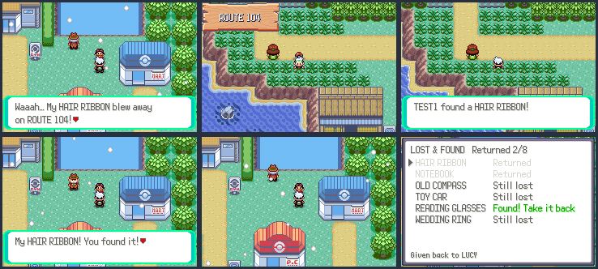

Eight people in Hoenn towns lost something on a nearby route. The lost things
lie in plain sight as item balls; pick one up and bring it back to its owner
for a reward. A thing found before meeting its owner says whose it is.

| Owner | Town | Lost | Where | Reward |
|---|---|---|---|---|
| Lucy | Petalburg City | Hair Ribbon | Route 104, flower beds | Soothe Bell |
| Evan | Rustboro City | Notebook | Petalburg Woods | Lucky Egg |
| Sailor Hank | Slateport City | Old Compass | Route 109 beach | Mystic Water |
| Timmy | Mauville City | Toy Car | Route 110 | Magnet |
| Gramps Otto | Fallarbor Town | Reading Glasses | Route 113 | Wise Glasses |
| Wren | Fortree City | Bird Whistle | Route 119 | Sharp Beak |
| Mrs. Diane | Lilycove City | Wedding Ring | Route 121 | Big Nugget |
| Kai | Dewford Town | Shell Charm | Route 104, north | Shell Bell |

**R > PASTIMES > LOST & FOUND** lists the owners met and the things found,
with where each was lost. Screenshots: `tools/pastime_shots/lost_found.lua`.

## Museum donations

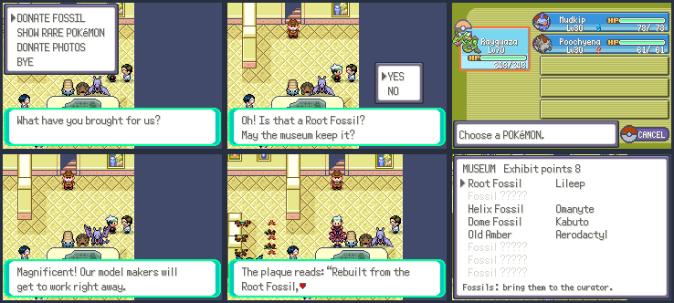

The Lilycove Museum opens a natural history wing. Its curator (by the
stairs on 1F) takes three kinds of donations:

- **Fossils**: any of the 15 fossil items (Root, Claw, Helix, Dome, Old
  Amber, Skull, Armor, Cover, Plume, Jaw, Sail and the four Galar
  fossilized parts). The fossil leaves the bag.
- **Rare Pokémon**: show a legendary, mythical, Ultra Beast, Paradox,
  shiny or pseudo-legendary (Dragonite, Tyranitar, Salamence, Metagross,
  ...). It stays in the party; the museum records up to 12.
- **Photos** taken with R > PHOTO; the photo wall grows at 5, 15 and 30.

The first four fossils and first three rare Pokémon stand in the hall as
life-size models (overworld Pokémon sprites), each with a plaque. Every
fossil, rare Pokémon and photo wall section is an exhibit point; at 1, 3,
5, 8, 12, 16 and 22 points the curator gives a Nugget, Rare Candy, PP Max,
Big Nugget, Comet Shard, Ability Patch and finally a Master Ball.
**R > PASTIMES > MUSEUM** lists the exhibits. Screenshots:
`tools/pastime_shots/museum.lua`.

## Delivery jobs

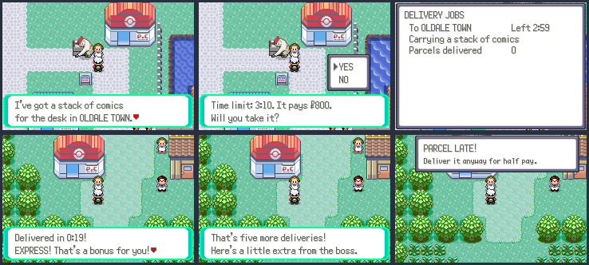

HOENN EXPRESS has a PARCEL DESK outside the Pokémon Center in Oldale,
Petalburg, Rustboro, Slateport, Mauville, Fallarbor, Fortree and Lilycove
(plus a VIGOROTH mover at the Slateport head office). A desk offers a
parcel for another of those towns you've already visited. The time limit is
90 seconds plus 20 per step of distance on the region map, counted in play
time; pay is ¥300 plus ¥100 per step.

- Delivered in half the time: **EXPRESS**, +50% pay.
- In time: full pay. Late: half pay (a notice pops up when time runs out).
- Every fifth parcel also earns an item (Great Ball, Hyper Potion, Rare
  Candy, PP Up, Nugget, Ultra Ball, Big Nugget, in turn).

**R > PASTIMES > DELIVERY** shows the parcel, where it goes, the time left
and the parcels delivered. Talking to another desk while carrying one lets
you give the job up. Screenshots: `tools/pastime_shots/delivery.lua`.

## Mail courier routes

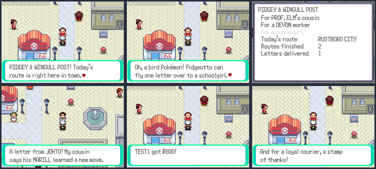

The PIDGEY & WINGULL POST runs one route a day, rotating through Rustboro,
Slateport, Mauville and Lilycove (by the day of the clock). Its postmaster
(in each of those towns) tells you where today's route is; in that town
they hand out three letters for people around town, who only show up while
you carry their letter. With a Pidgey, Pidgeotto, Pidgeot, Wingull or
Pelipper in the party, the bird flies one letter over by itself and the
route pays a ¥200 tip on top of ¥600. Every third route also earns a stamp
of thanks (a feather, then Rare Candy). **R > PASTIMES > MAIL ROUTE** shows
today's letters and the totals. Screenshots: `tools/pastime_shots/mail.lua`.

## Battle quiz hall

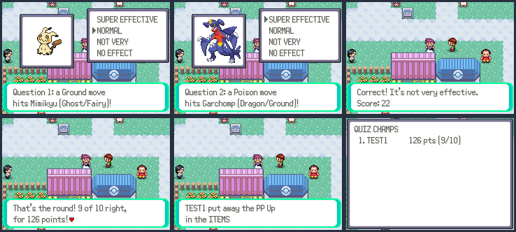

The QUIZMASTER in Mauville City runs ten-question rounds on type matchups:
"A FIRE move hits FERROTHORN (GRASS/STEEL)!", with the defender's picture,
answered SUPER EFFECTIVE, NORMAL, NOT VERY or NO EFFECT. The answers come
from the battle engine's own type chart (`GetTypeModifier`), and defenders
are 40 well-known Pokémon with a spread of types. A right answer scores 10
plus twice the current streak. The first round each day that scores 40, 80,
120 or 160 wins a Great Ball, Ultra Ball, PP Up or Rare Candy.

Each round's score goes to the server's **QUIZ CHAMPS** leaderboard (world
board 16 in `server/world.py`); **R > PASTIMES > QUIZ HALL** has MY RECORDS
(best score, rounds, perfect rounds, today's prize) and QUIZ CHAMPS.
`Pastime_ShowMonPic` is a picture box that can share the screen with a
multichoice menu (`showmonpic` can't). Screenshots:
`tools/pastime_shots/quiz.lua` (two players online).

## Pokémon hotel

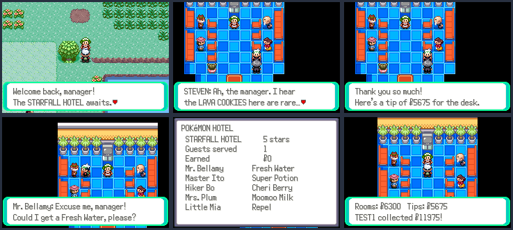

You're the new manager of the STARFALL HOTEL on Starfall Isle. The bellhop
in the plaza (south of the houses) takes you into the lobby, a new map
`MAP_STARFALL_ISLE_HOTEL` that reuses the Battle Frontier lounge layout;
leaving puts you back next to the bellhop (a warp arrival point added to
Starfall Isle).

Each day, two guests plus one per star sit in the lobby, each wanting
something (Fresh Water, Soda Pop, a Berry, a Potion, a Repel...). Give it
to them from your bag for a tip. At the front desk, collect the day's room
money (the star rate per guest, double for guests you served) and tips;
the guests then check out and new ones come the next day. The desk also
renovates the hotel for ¥3,000, ¥8,000, ¥20,000 and ¥45,000 up to five
stars: more guests and better rates, and at five stars STEVEN checks in,
asks for a Lava Cookie and gives a Metal Coat and a big tip.
**R > PASTIMES > HOTEL** shows the stars, totals and today's guests with
what they want. Screenshots: `tools/pastime_shots/hotel.lua`.

## Pokémon cafe

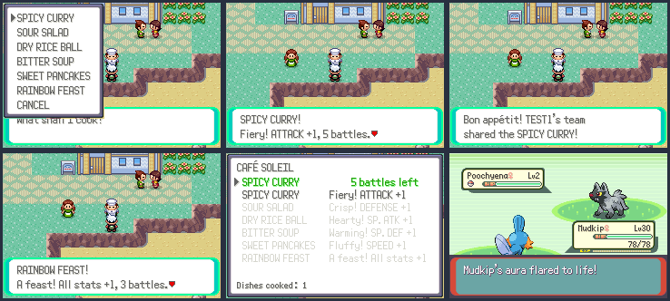

The chef of CAFÉ SOLEIL stands on the Lilycove waterfront, east of the
Department Store. Bring Berries (and Moomoo Milk) and pick a dish:

| Dish | Ingredients | Effect |
| --- | --- | --- |
| Spicy Curry | 2 Cheri, 1 Oran | Attack +1 for 5 battles |
| Sour Salad | 2 Aspear, 1 Oran | Defense +1 for 5 battles |
| Dry Rice Ball | 2 Chesto, 1 Oran | Sp. Atk +1 for 5 battles |
| Bitter Soup | 2 Rawst, 1 Oran | Sp. Def +1 for 5 battles |
| Sweet Pancakes | 2 Pecha, 1 Moomoo Milk | Speed +1 for 5 battles |
| Rainbow Feast | 1 Sitrus, 1 Lum, 1 Moomoo Milk | every stat +1 for 3 battles |

The boost uses the totem-aura queue (`gQueuedStatBoosts`): at the start of
each of your next battles your lead Pokémon (and its partner in doubles)
gets the boost with the "aura flared to life" message. Online (link),
recorded, Battle Frontier and Safari battles don't count. The hook is
`Pastime_OnBattleStart()` in `CreateBattleStartTask` (`src/battle_setup.c`).
A new dish replaces the old one. **R > PASTIMES > CAFE** shows the dish in
effect, battles left, and every recipe (grey when you're missing an
ingredient). Screenshots: `tools/pastime_shots/cafe.lua`.

## Cooking contests

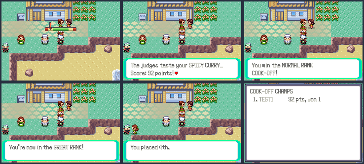

The COOK-OFF judge stands next to the CAFÉ SOLEIL chef in Lilycove and runs
one contest a day. Pick one of the cafe's dishes (its ingredients are used
up), then chop, stir and plate: three rounds of the timing meter
(`src/world_meter.c`). The judges score 30 for the dish (40 for the Rainbow
Feast), 20 for each step done well and up to 10 for taste, against three
rival chefs. Win to move up a rank and get its prize:

| Rank | Meter | Rivals score | Prize |
| --- | --- | --- | --- |
| NORMAL | wide zone, slow | 45 to 60 | Rare Candy |
| GREAT | 3 tiles, faster | 57 to 72 | PP Max |
| ULTRA | 3 tiles, fast | 69 to 84 | Leftovers |
| MASTER | 2 tiles, fast | 80 to 95 | Ability Capsule (then Rare Candy) |

The best score goes to the server's **COOK-OFF CHAMPS** leaderboard (world
board 17 in `server/world.py`). **R > PASTIMES > COOK-OFF** has MY RECORDS
(rank, best score, wins, entries, today's contest) and COOK-OFF CHAMPS.
Screenshots: `tools/pastime_shots/cooking.lua` (two players online).

## Bug-catching contest

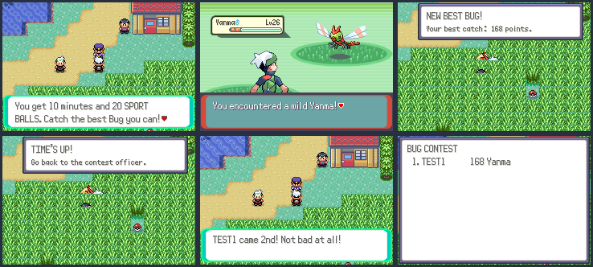

The contest officer stands at the north edge of Route 119's big field of
tall grass (below the Weather Institute). Once a day, enter to get 20 Sport
Balls and 10 minutes on the clock (overworld time; battles and menus pause
it). While the contest is on, every wild Pokémon in Route 119's grass is a
Bug type: common ones (Caterpie, Weedle, Wurmple, Ledyba, Spinarak,
Kricketot, Sewaddle, Nincada, Blipbug), uncommon ones (Venonat, Paras,
Surskit, Volbeat, Illumise, Combee, Yanma, Cutiefly, Nymble) and rare ones
(Scyther, Pinsir, Heracross, Karrablast, Shelmet, Larvesta). You keep
everything you catch.

Each Bug caught scores 20, 50 or 100 for rarity, 3 a level, half its IV
total and 50 if it's shiny; your best one counts ("NEW BEST BUG!"). One
minute before the end, and when time's up, a notice tells you to go back
to the officer (or end early by talking to him). The judges compare your
best Bug with three rivals: 1st wins a Sun Stone, 2nd an Everstone, 3rd a
Sitrus Berry, 4th an Oran Berry. Leftover Sport Balls are collected.

The score goes to the server's **BUG CONTEST** board (world board 18 in
`server/world.py`). **R > PASTIMES > BUG CONTEST** shows the clock, your
best catch, best ever, wins and entries, and the board. Hooks:
`Pastime_ModifyWildSpecies` in `World_ModifyWildSpecies` (`src/world.c`);
the wild Pokémon is read at battle start (`Pastime_OnBattleStart`).
Screenshots: `tools/pastime_shots/bug_contest.lua` (two players online).

## Trading post

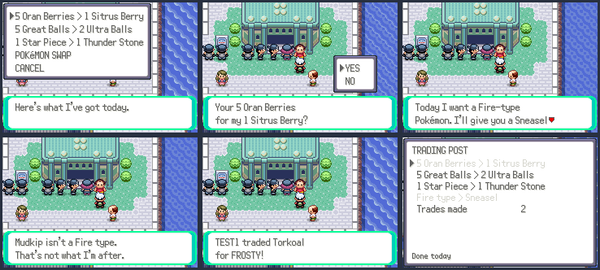

The trader stands at the end of the Slateport market row. Each day he has
three barters from a pool of 18 (5 Oran Berries for a Sitrus Berry, 5 Great
Balls for 2 Ultra Balls, a Star Piece for a Thunder Stone, 2 Heart Scales for
a Fire Stone...), each once a day. He also makes one **Pokémon swap** a
day: bring a Pokémon of the type he wants and he trades you a Pokémon from
another region at level 20, holding a gift (a Fire type for SNEASEL "FROSTY"
with a Quick Claw, a Water type for GROWLITHE "EMBER" with Charcoal, a
Flying type for DRATINI "NOODLE" with a Dragon Fang, and six more). The
traded Pokémon has OT TRADER and goes in the same party slot; the Pokédex
marks it caught. **R > PASTIMES > TRADING POST** lists today's offers (grey
once done) and the trades made. Screenshots: `tools/pastime_shots/trading.lua`.

## Battle dojo

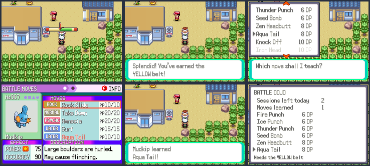

The DOJO MASTER stands outside Dewford Gym. **TRAIN**: three sessions a
day, each five timing meter drills; every good drill earns 2 Dojo Points
(DP). Points earned in total raise your belt: WHITE, YELLOW (20), GREEN
(60), BLUE (120), BLACK (200), and the meter gets faster with it.

**LEARN A MOVE**: 16 moves the Pokémon Center relearner doesn't teach, from
6 to 16 DP, the stronger ones locked behind belts: Fire/Ice/Thunder Punch
and Seed Bomb (WHITE); Zen Headbutt, Aqua Tail, Knock Off (YELLOW); Iron
Head, Drain Punch, Hyper Voice (GREEN); Earth Power, Heat Wave, Gunk Shot
(BLUE); Stealth Rock, Superpower, Body Press (BLACK). Any Pokémon of the
move's type can learn it here, as well as any that has it on its tutor
list: `Pastime_CanLearnTeachableMove` is checked first in
`CanLearnTeachableMove` (`src/pokemon.c`), and only while the master is
teaching that move. It uses the usual tutor box and "forget a move" screens.
**R > PASTIMES > BATTLE DOJO** shows the belt, points, sessions left, moves
learned and the move list with prices. Screenshots: `tools/pastime_shots/dojo.lua`.

## Ranger missions

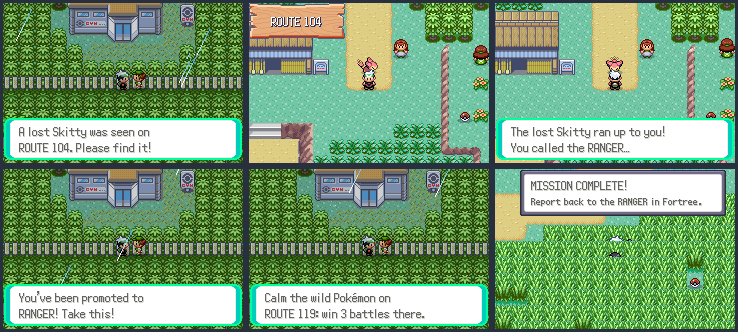

The RANGER stands outside Fortree Gym and gives one mission at a time, up
to three a day, from a pool of 15 picked by the day:

- **Rescue**: a lost Pokémon (Skitty on Route 104, Plusle on Route 110,
  Azurill on Route 117, Whismur on Route 116, Spinda on Route 113) appears
  on its route only while the mission is on. Find it and talk to it.
- **Calm**: wild Pokémon are rampaging on a route (119, 110, 117, 104, 113);
  win 3 or 4 wild battles there.
- **Survey**: catch 1 to 3 Pokémon of a type (Water, Grass, Bug, Flying,
  Electric) anywhere.

Progress notices pop up as you go ("1 of 3 done", "MISSION COMPLETE!").
Report back for 3 to 5 Ranger Points. Points raise your rank, and each
promotion comes with a prize: RANGER at 10 points (Ultra Ball), AREA RANGER
at 30 (Exp. Share), TOP RANGER at 60 (Master Ball). **R > PASTIMES > RANGER**
shows the rank, points, missions done today and the current mission. Hooks:
`Pastime_OnWildBattleEnd` in `World_OnWildBattleEnd` (`src/world.c`) and
`Pastime_OnCatch`. Screenshots: `tools/pastime_shots/ranger.lua`.

## Trainer school

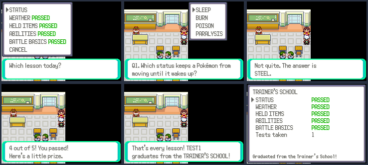

A new teacher at the Rustboro Trainer's School (by the window, right of
the old teacher) gives five lessons: STATUS, WEATHER, HELD ITEMS, ABILITIES
and BATTLE BASICS. Each is a five-question multiple-choice test ("Which
type can never be burned?", "LEFTOVERS restore how much max HP each
turn?", "A critical hit does how much damage?"); a wrong answer shows the
right one. Four right passes. The first pass of each lesson wins a prize
(Full Heal, Damp Rock, Shell Bell, Bottle Cap, Expert Belt), and passing all
five graduates you, for an Amulet Coin. Tests can be retaken any time.
**R > PASTIMES > TRAINER SCHOOL** shows the lessons passed and tests taken.
Screenshots: `tools/pastime_shots/school.lua`.

## Community garden and berry mutations

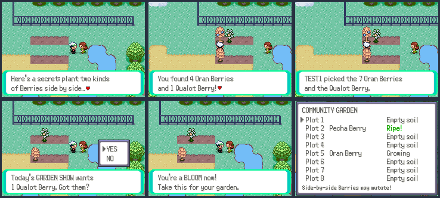

Eight Berry plots at the north end of Route 104 (just south of Rustboro),
tended by the GARDENER, who gives 5 Oran and 5 Pecha Berries to start. The
plots are berry trees 112 to 119 (`GARDEN_TREE_FIRST`), spawned from code
like the other pastime NPCs (a new `onSpawn` hook in `struct PastimeSpot`
sets each one's tree id) with soft soil laid under them at runtime.

Berry mutations are on (`OW_BERRY_MUTATIONS` in `include/config/overworld.h`):
two different Berries growing side by side can give a new one when picked,
e.g. Oran + Pecha = Qualot, Aspear + Leppa = Hondew, Lum + Sitrus = Tamato,
Chesto + Persim = Kelpsy (the expansion's table in `src/berry.c`; its
"and 1 <mutation>" text named the wrong Berry, fixed here). Picking uses the
world's berry-picking meter as usual.

Each day the **GARDEN SHOW** asks for some Berries, often a mutated kind
(1 Qualot, 10 Oran, 1 Tamato, 3 Sitrus...). Bringing them earns 2 to 6
Garden Points; ranks: SPROUT, BLOOM at 10 (Miracle Seed), GREEN THUMB at 30
(Big Root), MASTER GARDENER at 60 (Leaf Stone). **R > PASTIMES > GARDEN**
shows each plot's Berry and stage, the rank and today's show.
Screenshots: `tools/pastime_shots/garden.lua`.

## Weather lab

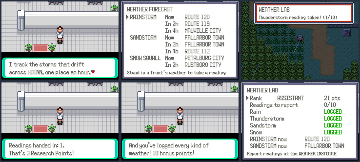

A researcher at the Route 119 Weather Institute (1F) tracks the three
roaming weather fronts (the rainstorm, sandstorm and snow squall of
`src/world_weather.c`). **FORECAST** shows where each front is now and in
2 and 4 hours (`RoamingWeather_GetFrontMap`, a small addition to
`world_weather.c`). After signing up, standing a few seconds in a front's
weather takes a reading, one an hour, up to 10 waiting; story weather (the
Route 119 cycle, Groudon/Kyogre) doesn't count. A toast says so.

**REPORT READINGS** turns them into Research Points: 1 for light rain, 3 for
a thunderstorm, sandstorm or snow, plus a one-off 10 for logging all four
kinds. Ranks: TRAINEE, ASSISTANT at 10 (Heat Rock), RESEARCHER at 30
(Smooth Rock), METEOROLOGIST at 60 (Icy Rock). **R > PASTIMES > WEATHER
LAB** shows the rank, readings waiting, the kinds logged and where the
fronts are now. Screenshots: `tools/pastime_shots/weather.lua`.

## Star map and meteor shower nights

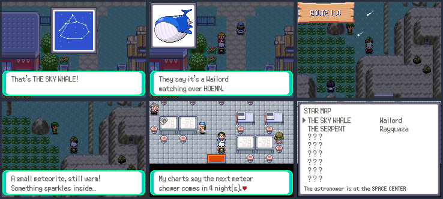

At night (20:00 to 4:59) a stargazer stands at eight lookouts: Lilycove,
Route 120, Fallarbor, Fortree, Route 113, Mossdeep, Route 114 and Dewford.
Looking through their telescope draws a constellation star by star in a
small chart window (THE SKY WHALE, THE SERPENT, THE WISHING STAR...), then
shows the Pokémon it's named after, and adds it to the **STAR MAP**. The
astronomer at the Mossdeep Space Center gives a prize at 2, 4, 6 and 8
constellations (Stardust, Star Piece, Moon Stone, Comet Shard) and says how
many nights until the next meteor shower.

Every fifth night is a **meteor shower**: shooting stars (original sprite,
`graphics/pastime/meteor.png`) streak across the sky on outdoor maps, a
meteorite lands on each of Routes 111, 113, 114, 115 and 120 (one find each
a night, mostly Stardust), and a quarter of the land encounters on those
routes are Pokémon from space (Clefairy, Minior, Beldum, Elgyem, Solrock,
Lunatone). **R > PASTIMES > STAR MAP** lists the constellations found, the
next shower and the meteorites found. Screenshots:
`tools/pastime_shots/stars.lua`.

## Carnival games

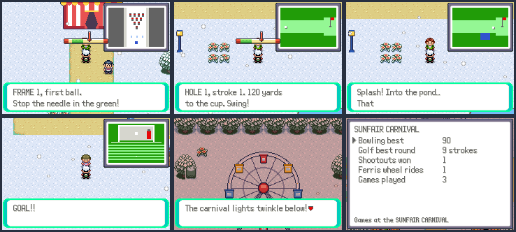

Four games at the Sunfair Carnival (the map comes from the areas work,
`tools/areas/carnival.py`; its hosts' scripts in
`data/scripts/areas/carnival_games.inc` go to `Pastime_EventScript_<game>`).
Bowling, golf and soccer play on the timing meter, now with
`TimingMeter_GetLastOffset` (how far from the middle of the zone the needle
stopped), and draw the lane, green or goal in a small window as the game
goes.

- **Bowling** (host at 9,13): five frames, two balls each. Dead centre is a
  strike, in the zone 7 to 9 pins, near it 4 to 6. Strikes add 10, spares 5.
  80 or more wins a Muscle Band once, 50 or more a Protein.
- **Mini golf** (39,26): three holes of 120, 160 and 200 yards, par 3. A
  perfect shot from 130 yards or closer is a hole in one; putts from 8
  yards. Missing the meter on the third hole lands in the pond (a penalty
  stroke). Under par wins a Scope Lens once, par an Iron.
- **Soccer shootout** (12,26): five kicks each. Pick LEFT, MIDDLE or RIGHT
  and stop the needle; a perfect shot beats any keeper. Then dive to save.
  A win gives a Quick Claw once, a draw a Carbos.
- **Ferris wheel** (29,12): ¥100 a ride. The camera rises over the wheel;
  from the top you spot one of the carnival's hidden items (and the lights
  at night).

**R > PASTIMES > CARNIVAL** shows the best scores, wins and rides.
Screenshots: `tools/pastime_shots/carnival.lua` (this branch's R menu has
the extra BOND, JOBS and ALBUM rows, so it sets `Driver.PASTIMES_ROW`).

## Pokémon orchestra

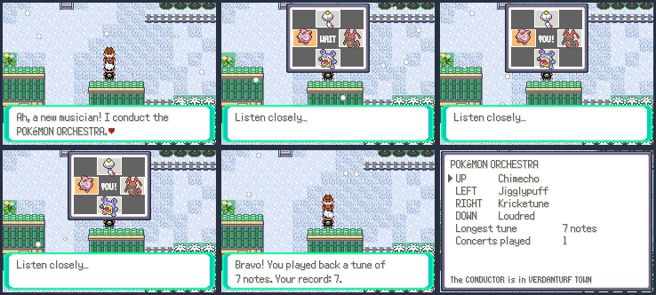

The CONDUCTOR in Verdanturf Town (17,10) leads a quartet of Pokémon
musicians, one on each direction of the + Control Pad: Chimecho (UP, high
C), Jigglypuff (LEFT, E), Kricketune (RIGHT, G) and Loudred (DOWN, C). A
stage window shows their pads and icons; the quartet plays a tune (each pad
lights up, its icon hops and its note plays), then the player plays it back.
Each tune right adds a note, from 3 up to 12. A wrong note or a long pause
ends the concert. The longest tune is the record; reaching 5, 8 and 12 notes
gives a Metronome, a Soothe Bell and a Throat Spray. **R > PASTIMES >
ORCHESTRA** shows the quartet, the record and concerts played.
Screenshots: `tools/pastime_shots/orchestra.lua`.

## Art studio

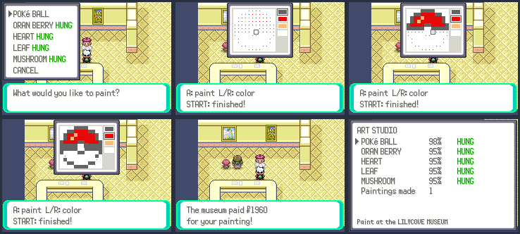

A painter at the Lilycove Museum (1F, 5,8) runs paint-by-numbers classes:
POKé BALL, ORAN BERRY, HEART, LEAF and MUSHROOM, each a 12 x 12 picture
(original pixel art in `src/pastime_art.c`). The canvas window shows a dot
of the right color in every blank cell; the + Control Pad moves the brush,
A paints (hold it to paint while moving), L and R (or SELECT) pick the
color, with white as the eraser, and START finishes. 90% right or better
and the painting is hung in the gallery and the museum pays ¥20 per
percent; hanging all five gives a Shiny Stone. **R > PASTIMES > ART
STUDIO** shows each painting's best score. Screenshots:
`tools/pastime_shots/art.lua`.

## Detective cases

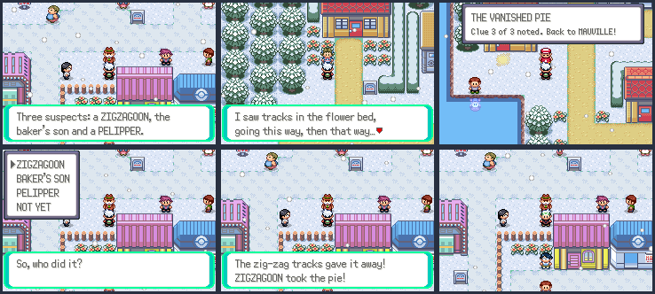

The DETECTIVE in Mauville City (17,10) hands out four cases in turn: THE
VANISHED PIE (Petalburg), THE LOST WIND CHIME (Fortree), THE SOAKED
LAUNDRY (Slateport) and THE MIDNIGHT HOWL (Lavaridge). Opening a case
brings out three witnesses in its town (only while it's open); each gives a
clue, and a toast counts them. Back at the agency the player names the
culprit from three suspects. Right solves the case (Nugget, PP Up, Big
Pearl, Lucky Egg) and raises the rank (ROOKIE, SLEUTH, INSPECTOR, ACE
DETECTIVE); wrong closes it unsolved, to be opened again from the start.
**R > PASTIMES > CASE FILES** shows each case and the clues found.
Screenshots: `tools/pastime_shots/detective.lua`.

## Monthly reward track

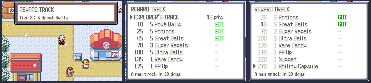

Everything earns Track Points: the first visit of each day (5), each
Pokémon caught (2) and each trainer beaten (3). The month's track has ten
tiers, from 10 to 325 points, and each one pays out as it's reached,
straight to the bag with a toast (if the bag is full it waits for room).
A month is 30 days of the game clock; when it turns the points start over
on the next track: the EXPLORER'S (Poké Balls up to a Master Ball), the
BATTLER'S (potions, vitamins, Bottle Caps) and the COLLECTOR'S (Stardust,
Pearls, a Gold Bottle Cap) take turns. **R > PASTIMES > REWARD TRACK**
lists the tiers, what's been paid and the days left. Screenshots:
`tools/pastime_shots/track.lua`.

## New Game+

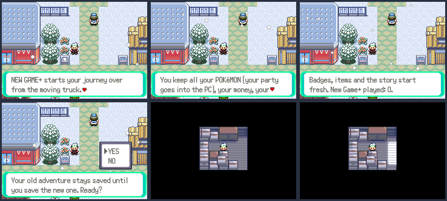

Once the player is CHAMPION (`FLAG_SYS_GAME_CLEAR`), **R > PASTIMES > NEW
GAME+** starts the story over from the moving truck (after two
confirmations). It keeps every Pokémon (the PC boxes, with the party moved
into them), the money, the Pokédex, the Trainer ID (so the Pokémon stay the
player's own), and the pastime and world records and achievements
(`PastimeSaveData`, `WorldSaveData`); badges, items, the story and the other
features' progress start fresh. The first New Game+ adds a Shiny Charm and
an Exp. Charm. Nothing is written until the player saves, so the old save
stays until then. The carry-over is put back by `NewGamePlus_AfterInit`,
called in `CB2_NewGame` just after `NewGameInitData`. Screenshots:
`tools/pastime_shots/new_game_plus.lua` (its `checks.txt` shows the party,
the PC and the records before and after).

## Seasonal festivals

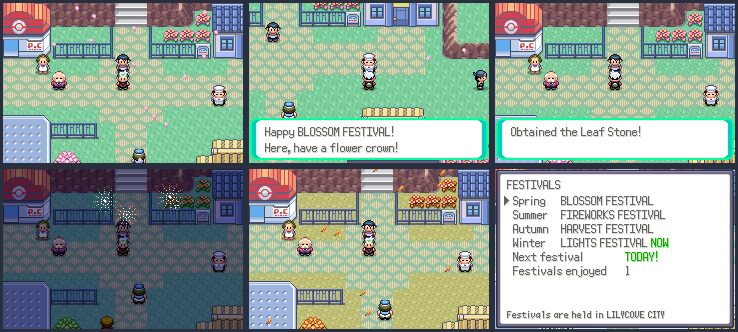

Each season (the seasons of `src/life_seasons.c`) has its festival in
Lilycove City, held on the last two days of every 7-day week of the game
clock: the BLOSSOM FESTIVAL in spring, the FIREWORKS FESTIVAL in summer, the
HARVEST FESTIVAL in autumn and the LIGHTS FESTIVAL in winter. While one is
on, a host stands by the Pokémon Center and three stalls around town each
hand out something seasonal and stamp the player's card. A full card earns the
host's prize, once per festival: a Leaf Stone, a Fire Stone, a Sitrus Berry
or an Ice Stone. Petals drift over Lilycove in spring and leaves in autumn,
and on summer festival nights (19:00 to 2:00) fireworks burst in three
colors. **R > PASTIMES > FESTIVALS** lists the festivals, the days until the
next one and the festivals enjoyed. Screenshots:
`tools/pastime_shots/festival.lua`.
