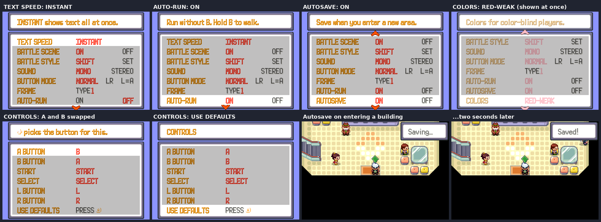
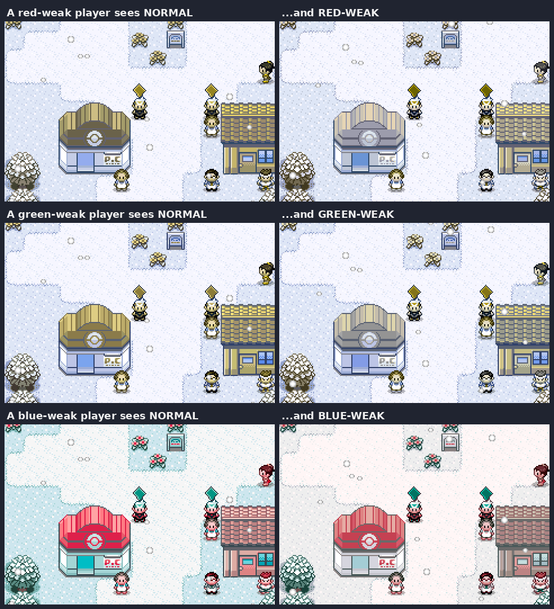
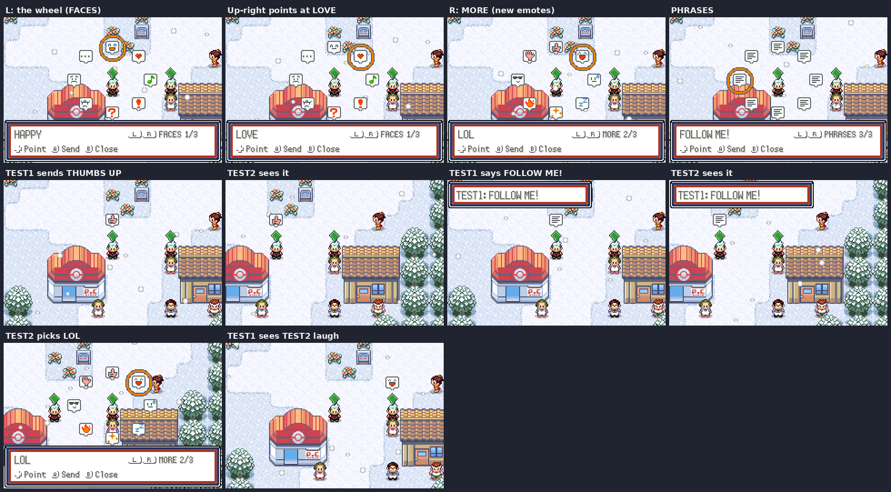

# Quality-of-life options and the emote wheel

## OPTION menu

The OPTION menu now scrolls (the arrows at the top and bottom show there is
more). Below the usual options are four new ones, and the header explains the
row the cursor is on.

| Option | What it does |
| --- | --- |
| TEXT SPEED | Gains INSTANT: messages appear all at once. |
| AUTO-RUN | ON: you run without holding B (once you have the Running Shoes); hold B to walk. |
| AUTOSAVE | ON: the game saves when you walk into a new area (at most once a minute) and every five minutes in one area, whenever you are standing still with nothing else going on. A small box says "Saving…", then "Saved!". It never saves over a different save file, so a new game must be saved by hand once first. It also stays off in the Safari Zone, the Battle Frontier, the Trainer Hill, the Union Room and during online battles, trades and deals. |
| COLORS | NORMAL, RED-WEAK, GREEN-WEAK or BLUE-WEAK. The colour-blind modes change every colour on screen so colours that would look alike to a player with that colour vision stay apart. The change shows at once, in the menu. |
| CONTROLS | Opens a list of the six buttons (A, B, START, SELECT, L, R). Left and right pick which key does each button's job; the job that had that key swaps over, so every job always has a key. USE DEFAULTS puts them back. The D-pad never moves. |

How it works:

- The options are in `SaveBlock2` next to the old ones: `optionsAutoRun`,
  `optionsAutosave` and `optionsColorMode` use the four spare option bits and
  `optionsKeyMap` the two padding bytes after them, so the save layout does not
  change and old saves read as "everything off, usual buttons".
- `src/qol.c` has the logic. `QoL_RemapKeys` runs in `ReadKeys` (`src/main.c`),
  so remapped buttons work in every screen. The key map is a permutation packed
  in 15 bits (`QoL_DecodeKeyMap`), 0 being the usual layout.
- `QoL_WantsToRun` replaces the B check for running in `field_player_avatar.c`.
- `QoL_TryAutosave` runs every overworld frame while the player has control
  (`DoCB1_Overworld`). Saving takes about two seconds (the flash chip and the
  extended save), so the notice goes up first.
- Colours: `tools/qol/make_cvd_tables.py` builds one 32768-entry table per mode
  (`graphics/qol/cvd_*.bin`): it simulates the colour vision deficiency
  (Machado et al. 2009, in linear light) and moves the lost difference into the
  colours that are still seen (daltonization). `TransferPlttBuffer`
  (`src/palette.c`) sends each colour through the table on its way to the
  screen, including the extended sprite and BG palettes. The palette buffers
  keep the real colours, so fades and day and night are unchanged.

## Emote wheel

**L** in the overworld while online opens the emote wheel. Eight emotes sit in
a ring around you: point at one with the D-pad (diagonals too) and press A to
send it, or B to close. L and R turn the page:

- FACES: happy, love, music, wow, huh, angry, sad, hmm.
- MORE (new art): thumbs up, LOL, phew, sleepy, sparkle, fired up, cool, wave.
- PHRASES: HI!, GG!, BATTLE?, TRADE?, THANKS!, BYE!, FOLLOW ME!, NICE!

The emote pops up in a bubble above your head for everyone on the map.
Phrases show a speech bubble and the line of text with your name, as before.
The wheel opens on the page and emote you used last.

How it works: `src/emote_wheel.c` (wheel and bubbles), with the network side
unchanged in `src/netplay.c` (`NETPLAY_REQ_EMOTE`, `EMOTE` on the server, which
already accepted ids up to 31). Emote ids 0-13 are the old ones; 14-23 are
new, and older games ignore ids they don't know. The new icons are drawn by
`tools/qol/draw_emotes.py` in the speech-bubble style and palette of the
follower emotes. The sprites use tile sheets loaded straight into VRAM rather
than per-frame image copies, because the copy queue (64 requests) can be full
when many objects are on screen.

## Screenshots

`python3 tools/world_shots/run.py tools/qol/shots.lua <out> 200000 2` takes
them with two players. Set `NETPLAY_CLOCK_UTC_OFFSET` for daylight.
