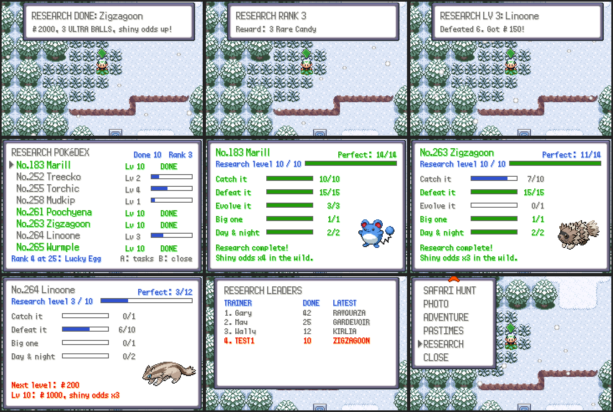

# Research Pokédex

Every Pokémon species has research tasks. Doing them raises the species'
research level, every level pays a little money, and level 10 completes the
species, which pays more and makes wild ones of it likelier to be shiny.
Research works offline too: it's kept in the save (`gSaveBlockExt.research`,
by national dex number, so forms share their species' research).

Open it from the R menu: **RESEARCH** (the row before CLOSE). The list has
every species you have seen or done research on, its level and DONE for
completed ones; A shows a species' page with its picture and tasks, up and
down move between species, B goes back.

## Tasks

| Task | Tiers (one research level each) | Which species |
| --- | --- | --- |
| Catch it | 1, 2, 4, 7, 10 | all |
| Defeat it (wild or a trainer's) | 1, 3, 6, 10, 15 | all |
| Evolve it | 1, 3 | species that evolve |
| Big one: catch one at least 115% of the usual size | 1 | all |
| Day & night: catch one by day and one at night | both | species out both by day and at night (`DayNight_GetSpeciesTag`) |

Defeats count in any battle that gives experience (not link battles or the
Battle Frontier). A species with every task has 14 levels, one without an
evolution 12; level 10 completes it, and doing every task is **perfect**.

## Rewards

- Each new research level: ¥50 times the level (¥50 for level 1 … ¥500 for
  level 10), with a notice at the top of the screen.
- Level 10, research complete: ¥1000 more, 3 Ultra Balls, and wild ones of
  that species get 2 extra shiny rolls (about 3 times the odds).
- Perfect: a Rare Candy, and a third shiny roll (about 4 times).
- Research ranks, by completed species: 1 → 5 Great Balls, 5 → 5 Ultra
  Balls, 10 → 3 Rare Candies, 25 → Lucky Egg, 50 → Oval Charm, 100 → Shiny
  Charm, 200 → Master Ball.

## Online

The game reports each completed species (`OEV RESEARCH <completed>
<species>`), and START → ONLINE → HUB → **RESEARCH LEADERS** shows the top
researchers on the server (`server/online_research.py`). Everyone online
hears about every tenth completed species.

## Code

- `src/research.c`, `include/research.h`: tasks, rewards, the screen.
- Hooks: catches (`World_OnWildBattleEnd`), defeats (`Cmd_getexp`), evolutions
  (`evolution_scene.c`), the wild Pokémon about to be made
  (`World_ModifyWildSpecies`, for `Research_ShinyRolls` in
  `ComputePlayerShinyOdds`), toasts (`Research_Update` in `World_OverworldUpdate`).
- Test: `test/research.c` (`make check`).
- Screenshots: `python3 tools/online_shots/run.py tools/online_shots/research.lua OUT 60000 2 tools/online_shots/research_seed.py`.
  The scenario writes research into the save at `offsetof(struct SaveBlockExt,
  research)`, which changes when fields are added before it: print it with a
  one-line C file (`char x[offsetof(struct SaveBlockExt, research)];`) built
  like `src/*.c`, and update `research.lua`.
