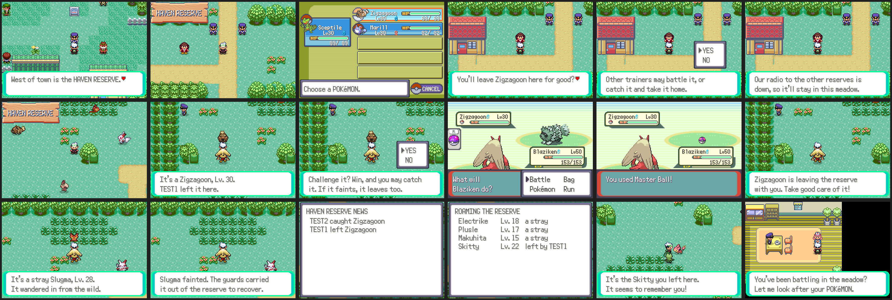

# The Haven Reserve



A guarded meadow west of Verdanturf Town where trainers leave Pokémon they
don't want. The Pokémon left there roam the meadow, and anyone can walk in
and battle them: win and you may catch one, knock it out and it leaves the
reserve. Online, the reserve is one place shared by every player and by the
roaming NPC trainers.

## Playing

- **Getting there**: the guard standing in the middle of Verdanturf Town
  takes you to the gate. Online, he "radios in" first: the game asks the
  server who is roaming the meadow right now.
- **Leaving a Pokémon**: the warden at the gate (just inside, next to the
  lodge) takes any Pokémon from your party except an egg or your last one
  that can battle. It runs off into the meadow at once. Online it goes to
  the server and every player can meet it; offline it is kept in your save
  (up to six) and roams your own reserve.
- **Meeting one**: walk up to a roaming Pokémon and talk to it to see what
  it is, its level and who left it. Challenge it to a wild battle with the
  Pokémon exactly as its trainer left it (moves, nickname, original
  trainer). Catch it and it's yours; knock it out and the guards carry it
  out. Either way it's gone for everyone. Run or lose and it stays.
- **Strays**: three wild Pokémon wander in each day (new ones the next day),
  stronger as you earn badges. They fill the spots nobody's Pokémon uses,
  so the reserve is never empty, online or off.
- **The notice board** by the gate shows the latest news online ("MAY
  caught Ziggy", "ROVER ED left Zigzagoon"), or who roams the meadow
  offline.
- **The lodge** (the house in the gate yard): a nurse heals your party and
  the head guard explains the rules.

## How it works

| Piece | Where |
|---|---|
| Map (36x30, Hoenn town style, forest ring, pond, tall grass, gate) | `tools/reserve/make_reserve.py` builds `data/maps/HavenReserve`, `data/layouts/HavenReserve` and the lodge `data/maps/HavenReserve_Lodge` (uses `LAYOUT_HOUSE1`) |
| Game code | `src/reserve.c`, `include/reserve.h`, `include/reserve_save.h`, `include/constants/reserve.h` |
| Scripts | `data/scripts/reserve.inc` (Verdanturf guard, warden, roamers, board, lodge) |
| Server | `server/community_reserve.py` (a community feature), tests in `server/test_community_reserve.py` |
| Screenshots | `tools/reserve_shots/` |

The meadow has eight spots: objects 1-8 of the map, drawn with
`VAR_OBJ_GFX_ID_0`-`7` and hidden with `FLAG_TEMP_11`-`18`, so the reserve
needs no saved flags or vars. The list of who's in each spot lives in EWRAM
(160 bytes) and is rebuilt when you come in through the Verdanturf guard. If
you continue a save inside the reserve it is rebuilt from what's known
offline.

Offline Pokémon are saved compactly in `SaveBlock3.reserve` (80 bytes: six
Pokémon as species, level, personality and IVs, plus the day's strays and a
couple of counters). Making one again keeps its species, level, nature,
gender, shininess and IVs.

### Server requests

The reserve uses the community request channel (`gCommunityMailbox`,
`docs/community.md`), request types 70-74:

| Type | Name | In | Out |
|---|---|---|---|
| 70 | `RESERVE_LIST` | | up to 8 roaming: 12 bytes each (id u32, personality u32, species u16, level u8, flags u8: 1 yours, 2 shiny, 4 female); row 1+n = who left each; args: count, residents |
| 71 | `RESERVE_LEAVE` | args species, level, flags; data: the Pokémon's 80 bytes + 12-byte nickname | args[0] its id; status 3 if the reserve is full |
| 72 | `RESERVE_CLAIM` | args[0] id | its 80 bytes (none for an NPC trainer's), args species, level, personality; status 2 if gone or someone else is battling it |
| 73 | `RESERVE_RESULT` | args id, end (0 still here, 1 caught, 2 knocked out) | |
| 74 | `RESERVE_LOG` | | rows: the latest news |

The eight shown are picked fresh every 5 minutes (`NETPLAY_RESERVE_ROTATE_SECONDS`)
from the residents nobody is battling, the same for everyone. A claim lasts
10 minutes (`NETPLAY_RESERVE_CLAIM_SECONDS`) if the game never reports
back. The reserve holds at most 600 (`NETPLAY_RESERVE_MAX`).

### For the roaming NPC trainers

`server/rovers.py` can use the same reserve with three functions in
`community_reserve`:

- `drop_off(server, name, species, level, personality=None, nickname=None, mon=None)`:
  a rover leaves a Pokémon (the game's 80 bytes are optional; without them
  the game makes it fresh from species, level and personality). Returns its
  id, or `None` if the reserve is full.
- `pick_for_rover(server, name, max_level=100, catch=True)`: a rover battles
  one it can handle and catches it (or knocks it out). Returns the Pokémon
  as a dict, now gone from the reserve, or `None`.
- `residents(server)`: everyone in the reserve.

Both show up on the notice board like a player's.

### Screenshots

```
python3 tools/reserve_shots/run.py tools/reserve_shots/online.lua OUT 60000 2
python3 tools/reserve_shots/run.py tools/reserve_shots/offline.lua OUT 30000 1
```

The online run has TEST1 leave a Zigzagoon and TEST2 come in later, catch
it with a Master Ball and knock out a stray; TEST1 then reads the board.
