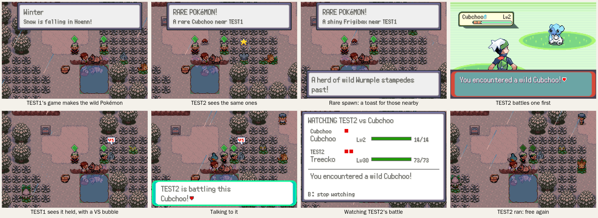
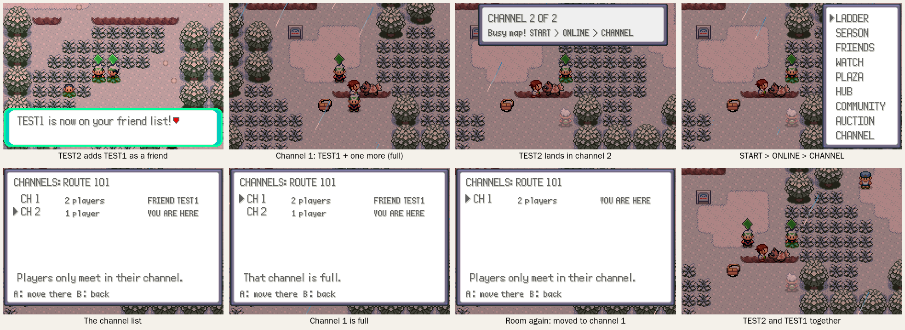

# Shared wild spawns and map channels





## Shared wild spawns

Online, everyone on the same map (and channel) sees the same visible wild
Pokémon.

- Each game makes the wild Pokémon around its own player, as offline
  (`src/wild_encounter_ow.c`, with packs and sleepers from
  [alive.md](alive.md)), and reports them to the server. Everyone else on
  the map sees them in the same tiles, walking the same way, asleep or
  awake. A game shows up to 8 of other players' Pokémon, the nearest first.
- With 3 or more of other players' Pokémon close by, a game stops making
  its own, so a crowd doesn't fill the grass.
- **Rare spawns are announced.** A shiny, a species the map's table has at
  4% or less, a roamer, a swarm Pokémon or a Feebas is rare. Players on
  the same map get a toast ("RARE POKéMON! A shiny Frigibax near TEST1")
  and the Pokémon has a twinkling star over it. Everyone online elsewhere
  gets a notice ("A shiny Frigibax appeared at ROUTE 101! (near TEST1)").
  Catching a rare one is news too.
- **First to battle claims it.** Talking to a wild Pokémon (or bumping into
  it) asks the server first. The first player gets the battle. For
  everyone else the Pokémon stops where it is, with a VS bubble over it,
  and talking to it says "TEST2 is battling this Frigibax! Watch the
  battle?". YES opens the live battle list (the same one as START >
  ONLINE > WATCH, where the battle is listed as "TEST2 vs Frigibax").
- When the battle ends: caught or knocked out, the Pokémon is gone for
  everyone; if the player ran, it is free again and walks off.
- Offline, or with no answer from the server within 2 seconds, your own
  game's Pokémon are yours to battle as before; someone else's got away.

## Map channels

A map holds 25 players at a time: you and the 24 others a game can show
(`NETPLAY_MAX_REMOTES`). When a 26th arrives, the server opens channel 2,
and so on. Players only see, battle, trade with and emote at the players of
their own channel, and only share wild Pokémon with them.

- Arriving on a map, you go to the channel with the most of your friends,
  if it has room; otherwise to the first channel with room. Travelling to
  a friend (START > ONLINE > FRIENDS) lands you in their channel when it
  has room.
- On a map with more than one channel, a toast says which one you're in
  ("CHANNEL 2 OF 2").
- **START > ONLINE > CHANNEL** lists the map's channels: how many players
  each has, the first of your friends there, and where you are. A moves
  you to another channel, unless it's full. You stay in the channel you
  picked while you're on the map.

Server option: `NETPLAY_CHANNEL_SIZE` (default 25) sets the players per
channel (the screenshots use 2).

## How it works

```
 game (gSharedMapMailbox) <-> bridge (netplay_world.lua, NetplayShared) <-> server/shared_map.py
```

- **Game:** `src/shared_map.c`, `include/shared_map.h`. The mailbox is
  found through a pointer at the end of the world mailbox
  (`gWorldMailbox.shared`, offset 0x398), so the bridge needs no extra scan
  and the phone app needs no change. It holds this game's 4 spawns (uid,
  graphics id, level, flags, tile, facing, and whether someone else has
  claimed it), the 8 nearest of everyone else's, the channel and the
  channel list, and one request at a time (claim, battle over, list
  channels, join channel).
- **Bridge:** the `NetplayShared` part of
  `tools/netplay_bridge/netplay_world.lua` sends `WSPAWN` when one of this
  game's spawns appears or moves, `WGONE` when it's gone (held back while
  this player is battling it, so others can still see and watch it), and
  turns requests into `WCLAIM`, `WEND`, `CHAN` and `CHAN JOIN`.
- **Server:** `server/shared_map.py` (protocol in its docstring). A spawn
  belongs to its player; it goes when they leave the map or disconnect.
  Channels sit on top of the server's rooms (`Server.place`, room =
  (room_of, channel)), so guild halls and the like still split players
  first.
- Ids: object local ids 241-248 for other players' Pokémon. Hooks:
  `UpdateOverworldWildEncounter` (holds spawning when crowded, and the
  screenshot shiny), `InteractWithOverworldWildEncounter` (claims first),
  `GetInteractedObjectEventScript` (talking to someone else's Pokémon),
  `World_OverworldUpdate`, `World_OnMapTransition`, `World_OnWildBattleEnd`,
  and `ReportSoloBattle` in `src/netplay.c` (claimed wild battles are
  watchable like gym battles). ONLINE menu: 9 rows now (CHANNEL last).
- Icons: `tools/shared_map/icons.py` draws the VS bubble and the star
  (Emerald palette, 1px dark outline).

## Tests and screenshots

- `python3 -m unittest server/test_shared_map.py`
- `python3 tools/shared_map/shots.py <out>`: two games against a real
  server. `spawns.lua`: TEST1's game makes the Pokémon on Route 101 (one
  forced shiny with `gSharedMapShowcase`), TEST2 sees them and the notice,
  battles one, TEST1 sees the VS bubble, asks to watch and watches until
  it's over. `channels.lua`: TEST2 adds TEST1 as a friend; with channels of
  2 and a stand-in on Route 101, TEST2 lands in channel 2, sees the list,
  can't join the full channel 1, and moves there once the stand-in leaves.
