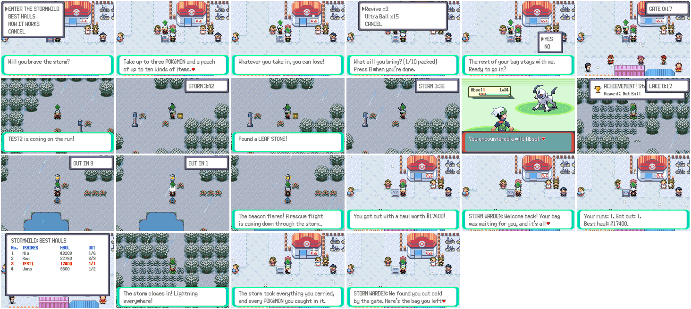
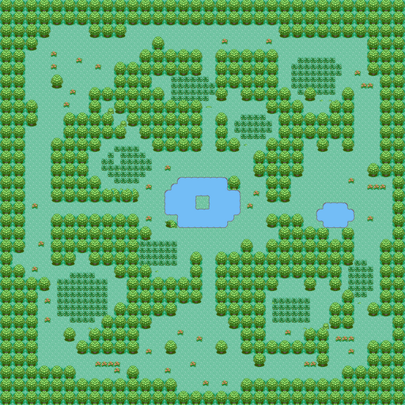

# The Stormwild: an extraction run



The **Storm Warden** stands by Mauville's Pokémon Center (20,6). Talking
to them while online opens ENTER THE STORMWILD, BEST HAULS and HOW IT WORKS.

## A run

1. **Team.** Only three Pokémon may go in (the rest go in a PC first), and
   at least one has to be able to fight.
2. **Pouch.** The player picks up to ten kinds of items from the item, ball
   and berry pockets, up to twenty of each. Everything else in those
   pockets waits at the gate (`gSaveBlockExt.stormwild.stash`). Key items
   and TMs stay in the bag.
3. **Lobby.** Up to 12 players share a run. The first one to join starts a
   30-second countdown and everyone online hears about it. Each player is
   dropped at one of eight points around the edge.
4. **In the Stormwild** (`MAP_STORMWILD`, 64x64, built by
   `tools/areas/stormwild.py`), the clock at the top right counts down
   15 minutes:
   - **Supply caches**: 14 of the map's 24 caches are stocked each run. The
     first player to open one gets its loot and it disappears for everyone.
     Four caches at the far edges and on the lake island have the rare table
     (Rare Candy, Max Revive, Full Restore, Big Nugget, PP Max, Ability
     Capsule, sometimes a Master Ball).
   - **Wild Pokémon**: strong, rare species (Absol, Zorua, Riolu, Axew,
     Larvitar, Deino, Goomy, Jangmo-o, Bagon, Beldum, Gible, Dreepy; Dratini,
     Lapras and Milotic in the water), levels 30 to 40, and shiny about one
     time in 130.
   - **Beacons**: TOWER (north-west), LAKE (east) and HOLLOW (south). One at
     a time lights up for 60 seconds, four times a run, never the same one
     twice in a row, the last just before the storm closes in. While one is
     lit, the clock shows its name and time left every other two seconds.
5. **Getting out.** Standing next to the lit beacon for 10 seconds
   (`OUT IN 10`... on the clock) calls a rescue flight. The player keeps
   everything in their bag and every Pokémon they caught, the bag that
   waited at the gate comes back, and the haul (the items at mart prices,
   plus ¥1,000 a Pokémon) goes on the week's **BEST HAULS** board.
6. **Failing.** If the clock runs out, or the team all faints, or the player
   leaves any other way (Fly, an Escape Rope, a reset), the run fails: the
   whole bag (the pouch and everything found) and every Pokémon caught in
   the run are lost (ron's choice, 2026-11-02). The Pokémon brought in
   always come home, with any injuries they picked up.

The game saves when the player goes in and when they come back, so
resetting can't undo a run: a run that was on when the game was reset is
lost on the next load.

## Raids

Two runners can battle each other (talk to them, as anywhere online). The
loser's game gives up its most valuable stack of items and up to two
Pokémon caught in the run (`XRUN ROB`). The server holds them for the
winner, who only gets them by getting out; if the winner fails too, they
are gone.

## How it's built

- Server: `server/online_xrun.py` (command `XRUN`; table
  `online_xrun_hauls`), tests in `server/test_online_xrun.py`. The server's
  clock runs the run; the status row `XRUN` tells each game the time left,
  the lit beacon, the caches taken and any raid to settle. Settings:
  `NETPLAY_XRUN_LOBBY`, `NETPLAY_XRUN_LENGTH`, `NETPLAY_XRUN_CACHES`,
  `NETPLAY_XRUN_SEED` (a fixed run).
- Game: `src/stormwild.c`, `include/stormwild.h`,
  `data/scripts/online/stormwild.inc`. Requests `ONL_REQ_XRUN_*` are 117-123
  (101-116 belong to the player-hosted events). The run's save is
  `struct StormwildSave` at the end of `struct SaveBlockExt`.
- Art: `tools/stormwild/draw_sprites.py` draws the beacon (unlit and lit)
  and the supply cache in the field ability palette
  (`graphics/stormwild/`).



## Screenshots

```sh
python3 tools/online_shots/run.py tools/stormwild/shots.lua out/stormwild 40000 2 tools/stormwild/shots_seed.py
```

TEST1 and TEST2 pack their pouches and go in together on a short fixed run
(4 minutes). TEST1 opens a cache and gets out at the first beacon to light;
TEST2 catches an Absol and is still inside when the storm closes in, so
loses the pouch and the Absol (the log shows the party going from 3 back
to 2).
