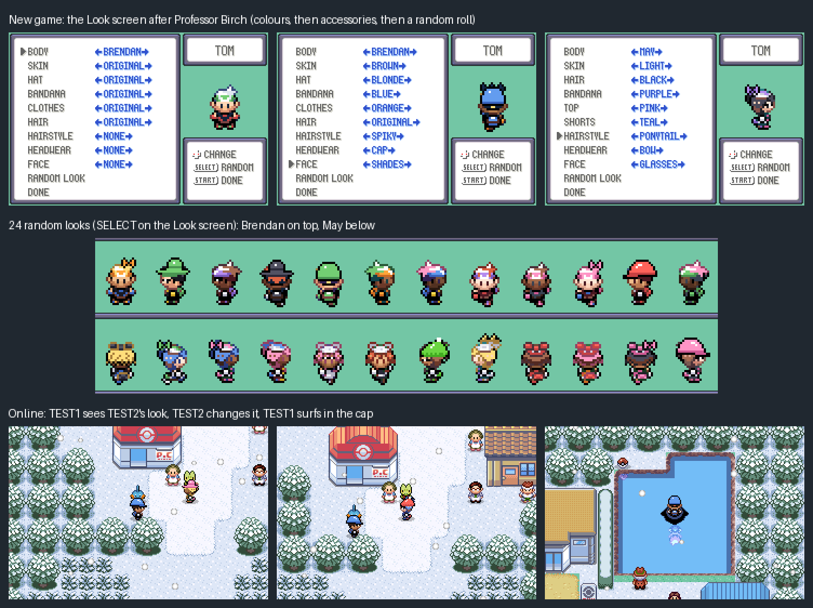

# Trainer look: colours and accessories



Every player picks how their trainer looks, so players don't all look the
same online. The **Look screen** opens in a new game right after Professor
Birch asks your name. You can open it again later from **START > STYLE**,
where B cancels.

| Row | Brendan | May | Choices |
| --- | --- | --- | --- |
| BODY | | | Brendan, May, Red, Leaf |
| SKIN | skin | skin | original + 5 tones |
| HAT / HAIR | his hat | her hair | original + 8 |
| BANDANA | bandana | bandana | original + 9 |
| CLOTHES / TOP | sleeves, shoes | top | original + 9 |
| HAIR / SHORTS | hair (also his shirt) | shorts | original + 8 darker shades |
| HAIRSTYLE | | | none, ponytail, long, spiky |
| HEADWEAR | | | none, cap, beanie, sun hat, bow, flower |
| FACE | | | none, glasses, shades |

SELECT (or RANDOM LOOK) rolls a whole look. Hats are drawn in the bandana
colour, and hairstyles use the hair colour. Colours and accessories apply to
Brendan and May; Red and Leaf keep their own art. Trainer-level outfits
(`docs/adventure.md`) still work: an outfit keeps your skin and hair colours
and your accessories.

## How it works

- **Save:** `SaveBlock2.trainerLook` (4 bytes in old filler): eight 4-bit
  fields, 0 meaning "as drawn". `include/trainer_look.h`.
- **Colours** are palette swaps. A recoloured trainer gets a sprite palette
  from a pool of 10 tags. Trainers with the same colours share one, and a
  trainer whose colours are back to the original goes back to the shared
  Brendan or May palette. If a crowded map has no palette slot free, the
  trainer keeps the original colours. Applied when the sprite is made or
  changes graphics (biking, surfing), and checked every 8 frames.
- **Accessories** are a second 32x32 sprite drawn over the trainer, using
  the trainer's own palette, so they cost no palette slot. They are drawn
  once per facing in `tools/trainer_look/art.py`. `gen_trainer_look.py`
  finds the head on every frame of every Brendan and May sheet (walking,
  running, both bikes, surfing, field move, fishing, watering) and stores
  where the picture goes and which pixels the trainer covers there. Parts
  marked "behind" (long hair, the ponytail from the front) only show where
  the trainer isn't. The layer is composed when the frame changes, in
  `TrainerLook_UpdateOverlays`, which runs after the sprites animate.
- **Online:** the look rides on the world `LOOK` line as a fifth field
  (`LOOK follower mount accessory trainer`, `server/world.py`). The world
  mailbox gains `trainerLook` (0x198) and `remoteTrainerLooks[8]` (0x19C) at
  its end, so no older offsets move. Other players are recoloured and wear
  their accessories just like the local player.
- **Memory:** 9 bytes of EWRAM for the overlay sprite ids, plus 36 bytes in
  the world mailbox. The Look screen's state is on the heap while it is
  open.

## Changing the art

Edit `tools/trainer_look/art.py` (or the colour lists in
`gen_trainer_look.py`), then:

```sh
python3 tools/trainer_look/gen_trainer_look.py                       # writes src/data/trainer_look.h
python3 tools/trainer_look/gen_trainer_look.py --preview out.png     # every frame wearing a few looks
```

## Screenshots

```sh
python3 tools/trainer_look/shots.py tools/trainer_look/shots/new_game.lua out/look 40000 1
python3 tools/trainer_look/shots.py tools/trainer_look/shots/gallery.lua out/gallery 30000 1
python3 tools/trainer_look/shots.py tools/trainer_look/shots/online.lua out/online 30000 2
```

`new_game.lua` plays from the title screen through Professor Birch to the
Look screen. `gallery.lua` opens START > STYLE and rolls 24 random looks.
`online.lua` runs two players and a server: each sees the other's look, one
changes it, and the other surfs in a cap.
