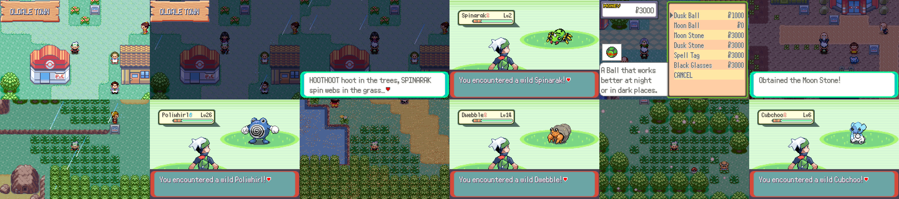
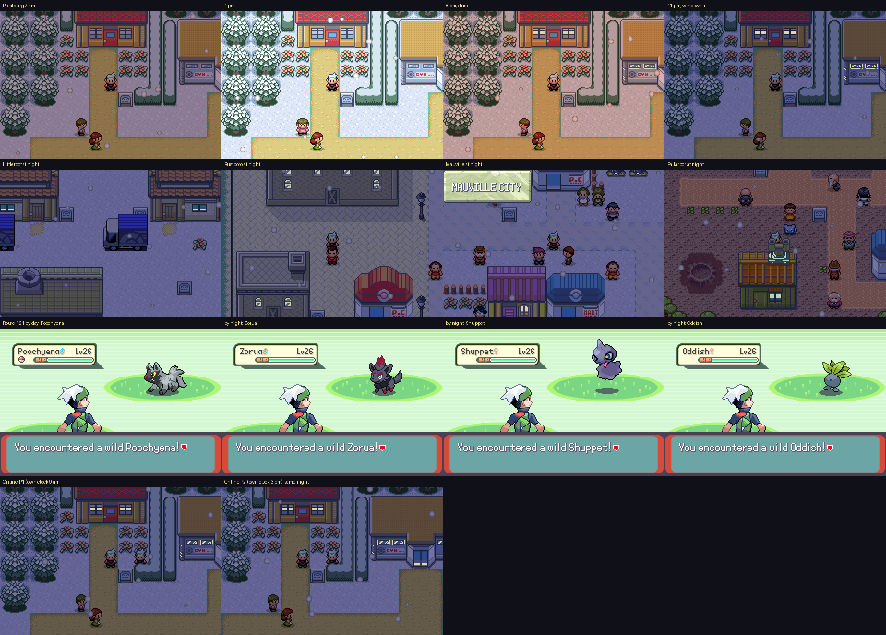
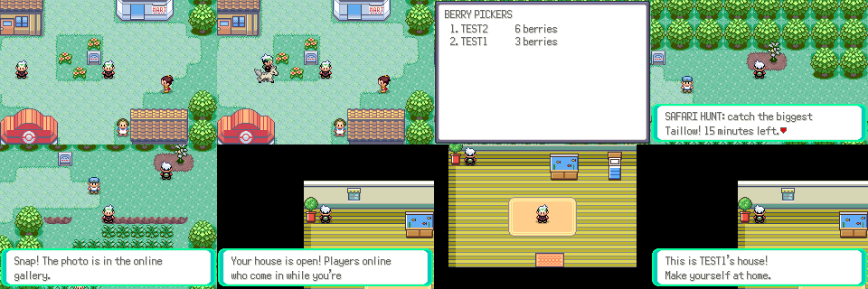

# World and gameplay features



Features that make the world itself more alive, offline and online. Each has
its own section; screenshots are made with `tools/world_shots/` (below).

Numbers this batch owns (agreed with the other feature threads):
flags `0x030`–`0x04F`, vars `0x40F7`–`0x40FF`, object local ids 200–214
for other players' followers and mounts, 215 for a quest legendary, netplay request/event types 96–127,
and its own EWRAM mailbox (`gWorldMailbox`, magic `PKMNWLD1`).

Script→C calls use `callnative`, so the shared `data/specials.inc` table is
left alone. Scripts live in `data/scripts/world/`, included from
`data/scripts/world.inc`.

## Day and night

The clock (the cartridge RTC) now changes which Pokémon appear:
`OW_TIME_OF_DAY_ENCOUNTERS` is on, and 13 areas have a night table
(`*_Night` in `src/data/wild_encounters.json`) with the official night
Pokémon at the same levels as by day:

| Area | At night |
|------|----------|
| Routes 101–104 | Hoothoot, Spinarak, Oddish, Murkrow (rare) |
| Petalburg Woods | Spinarak, Venonat, Hoothoot, Gastly, Morelull |
| Route 110 | Hoothoot, Gastly, Oddish, Murkrow |
| Route 113 | Houndour, Murkrow, Sneasel (rare) |
| Route 116 | Hoothoot, Venonat, Kricketot, Noibat |
| Route 117 | Volbeat, Illumise, Oddish, Morelull |
| Route 119 | Hoothoot, Noctowl, Murkrow, Misdreavus |
| Route 120 | Murkrow, Misdreavus, Absol, Gastly |
| Route 123, Mt. Pyre | Duskull, Misdreavus, Gastly, Haunter |

Morning, day and evening use the normal tables. The overworld is tinted by
time of day (the expansion's DNS).



**Day, night or both.** Every wild Pokémon is out by day, by night or at
both times (`sNightSpecies` and `sDaySpecies` in `src/world_daynight.c`;
anything not listed is out at both). Night: Hoothoot, Spinarak, Oddish,
Venonat, Zubat, Gastly, Duskull, Shuppet, Murkrow, Sneasel, Houndour,
Zorua, Volbeat/Illumise, Clefairy, Lunatone, Chinchou and the other owls,
moths and ghosts. Day: Pidgey, Taillow, Wingull, Swablu, Ledyba, Combee,
Sunkern, Hoppip, Ponyta, Tauros, Solrock and the other birds and sun-lovers.
Morning and day are day, night is night, and evening (7-8 pm) is twilight
when both are out. When the slot a table rolls belongs to a Pokémon that is
asleep at this hour, the roll is redone (`DayNight_PickSlot`, for grass,
water, rocks and fishing), so the tables need no changes and are never
empty: if nobody in a table is awake the first roll stands. The tags only
apply outdoors; caves, buildings and the sea floor are dark all day, and
Mt. Pyre's misty slopes keep their ghosts. Seasonal swaps
(`src/life_seasons.c`) still apply after the pick.

**Lit windows.** In the evening and at night house windows glow with warm
lamplight instead of darkening (`DayNight_UpdateLights`). The colours that
light up are listed per tileset in `src/data/daynight_lights.h`, picked with
`tools/daynight/render_map.py` (renders a map from source; `--mark t:pal:idx`
paints a colour magenta, `--night` previews the lights). It uses the DNS
light bit (bit 15 of a colour, which the GBA ignores), so it costs no
palettes and no EWRAM. Covered: the General tileset's houses (Oldale,
Petalburg, Lavaridge, Slateport, Fortree...), Littleroot, Rustboro,
Mauville and Verdanturf, Fallarbor and Lilycove. Street lamps share their
glass colour with walls, so they stay dark for now.

**One clock online.** Online, the game runs on the server's clock instead
of the cartridge's: the server sends `CLOCK seconds` (seconds since
midnight) after `WORLD` and once a minute, the bridge keeps it ticking in
`gWorldMailbox.clockMinute`, and `RtcCalcLocalTime` takes the hour and
minute from it (`DayNight_GetServerClock`; the date stays the
cartridge's). Players online at the same moment share the sky, the lit
windows, the wild Pokémon, time-based evolutions (Umbreon, Weavile,
Gliscor...) and the roaming weather. The server's clock is its local time,
or UTC plus `NETPLAY_CLOCK_UTC_OFFSET` minutes; other server modules ask
`world.time_of_day()`. Offline, the cartridge clock rules as before.

Screenshots: `python3 tools/world_shots/run.py tools/world_shots/daynight_cycle.lua OUT 400000`,
and online `NETPLAY_CLOCK_UTC_OFFSET=... python3 tools/world_shots/run.py tools/world_shots/daynight_online.lua OUT 60000 2`.

Night-only visitors (shown from 8 pm, `DayNight_UpdateFlags` in
`src/world_daynight.c`):

- **Oldale Town**: a storyteller who explains which Pokémon come out at night
  and gives a Spell Tag once.
- **Lilycove City**: the Night Market, selling Dusk Balls, Moon and Dusk
  Stones, Reaper Cloth, Spell Tags and Black Glasses.
- **Fallarbor Town**: a stargazer who gives a Moon Stone once.

## Roaming weather

Three weather fronts drift across Hoenn, one map per hour of the clock
(`src/world_weather.c`): a **rainstorm** (Route 101 → Lilycove via Routes 103,
110, 118–121), a **sandstorm** (Route 117 → Route 114 via Route 111–113 and
Fallarbor) and a **snow squall** (Route 102 → Route 115 via Petalburg, Route
104, Rustboro and Route 116). Each walks to the end of its path and back. Its
position only depends on the clock, so players online at the same time find
it in the same place. The rainstorm also brings light rain to the maps next
to it. When the hour turns while you stand on a map, the sky changes on the
spot. Story weather (Groudon/Kyogre, the Route 119/123 cycles, underwater)
is never replaced.

While a front is over a map, 35% of wild encounters there are weather
Pokémon, at the map's levels and at the stage they'd have evolved to by then
(official evolution levels):

- Rain: Lotad, Wingull, Psyduck, Poliwag, Surskit, Marill, Wooper, Tympole;
  rare Goomy.
- Sandstorm: Sandshrew, Trapinch, Cacnea, Baltoy, Hippopotas, Silicobra,
  Dwebble; rare Gible, Larvitar.
- Snow: Snorunt, Snover, Swinub, Spheal, Cubchoo, Vanillite, Snom; rare
  Sneasel, Alolan Vulpix.

A weather watcher in Oldale Town (next to the Pokémon Center) tells where
each front is right now.

## Fishing and berry picking

A bite opens the reel meter (`src/world_meter.c`): stop the needle in the
green with A to hook the Pokémon. Better rods get a smaller, faster zone
(4 tiles for the Old Rod, 2 for the Super Rod) but the same official
encounter tables. Every hooked Pokémon has a size: its official Pokédex
height scaled 75–125% by its personality, so the same Pokémon always
measures the same. Landing it (catching it) counts it, and a new biggest
fish shows a "personal record" notice.

Before a berry tree is picked, a three-stop meter adds one berry per hit
(up to the tree's 31-berry limit). R > RECORDS lists the biggest fish,
fish landed, berries picked, best harvest and the other world records.

## Legendary quests

Official legendaries at the levels the main series gives them, with their
own level-up moves (`src/world_legends.c`). Someone tells you the legend;
the legendary then stands at a first spot, but only in its weather or at
night. Walk up to it and it runs off; follow it to the second spot and
battle it there. If it faints or you run, it comes back; catching it
finishes the quest (achievements "Legend Seeker" and "Mythmaker").

| Legendary | Lv | Told by | When | First spot | Second spot |
| --- | --- | --- | --- | --- | --- |
| Raikou | 40 | Oldale weather watcher | thunderstorm | Route 110 (14,94) | Route 118 (62,10) |
| Suicune | 40 | Oldale weather watcher | rain | Route 120 (5,26) | Route 119 (30,17) |
| Entei | 40 | Fallarbor stargazer | night | Route 113 (9,10) | Route 113 (40,4) |
| Cresselia | 50 | Lilycove Night Market | night | Route 121 (12,9) | Route 121 (55,13) |

"When" is the weather the player sees, so the roaming rain front, Route
119's rain and Route 120's rainy middle all count. The legendary is a
spawned object (local id 215, `LOCALID_WORLD_LEGEND`); pressing A on it is
caught by `Legends_TryInteract` before the normal interaction code.
R > QUESTS lists the quests the player has heard of.

## Player housing

A new house on Starfall Isle (door at 39,32, east of the explorer's
house) opens into an empty 13x10 room (`tools/world_maps/make_house.py`
builds the layout from the standard house metatiles). The catalog on the
wall lists eleven pieces of furniture, drawn for this game in Emerald's
indoor style (`tools/world_shots/draw_furniture.py`, `graphics/world/
furniture/`): potted plant, bookcase, table, stool, bed, TV, lamp,
aquarium, ball cushion, trophy case and telescope. Pick one, face an
empty spot and press A to put it down; A on a placed piece offers to put
it away. Up to 8 pieces; placing 5 unlocks "Homeowner".

Furniture is drawn as sprites anchored to the map (sorted with the player
by y, so the player can walk behind tall pieces) and blocks its footprint
tiles. It is saved in `houseDecor` as (type, x | y << 4) pairs.

## Online



These work through the netplay server (`docs/netplay.md`) when the player
is connected; offline they quietly do nothing.

- **Followers and mounts.** Other players' following Pokémon walk behind
  them (local ids 200 + slot), shiny ones included, and a player riding
  shows on their mount.
- **Leaderboards.** R > LEADERBOARDS: biggest fish, berry pickers, hardcore
  runs and the current Safari hunt. The server keeps each player's best.
- **Safari hunts.** Every 30 minutes the server picks one of 20 common
  Hoenn Pokémon; catching it scores its size on the hunt board ("Safari Hunter"
  for the first entry). R > SAFARI HUNT says what is hunted and for how
  long.
- **Photos.** R > PHOTO saves a screenshot next to the bridge script and
  uploads it ("Say Cheese"); the server's web page lists them at `/gallery`.
- **House visits.** The house catalog's INVITE VISITORS opens the house:
  any player who comes in while the host is there sees the host's
  furniture ("This is TEST1's house!") and can't change it.

The ROM side is `src/world_online.c` and its own mailbox,
`gWorldMailbox` (`include/world_mailbox.h`): the player's look (follower,
mount, house and its furniture), one queued request at a time (score or
board), the board rows the bridge writes back, the hunt, a photo counter,
and every other player's look by netplay id. `tools/netplay_bridge/
netplay_world.lua` copies it to and from the server's world commands
(`server/world.py`):

| Bridge sends | Server sends | |
| --- | --- | --- |
| `WORLD` | `LOOK`/`HOUSE` of everyone, then `HUNT id minutesLeft` | on connecting |
| `LOOK follower mount [accessory [trainer [injury]]]` | `LOOK id follower mount accessory trainer injury` | to everyone else (accessory: what the follower wears, see Pokémon fashion in `docs/pastimes.md`; trainer: the player's colours and accessories, see `docs/trainer_look.md`; injury: the follower's scar and lost body parts, see `docs/injuries.md`) |
| `HOUSE open decorHex` | `HOUSE id open decorHex` | to everyone else |
| `SCORE board key value extra` | | best per player; hunt scores need the current hunt id as key |
| `WBOARD board key` | `WROW board rank name value extra` ..., `WBOARDEND board myRank` | top 10 |
| `HUNT` | `HUNT id minutesLeft` | about once a minute |
| `PHOTO hex`..., `PHOTOEND group num` | | PNG in 120-byte chunks, saved to `<db>-gallery/` |

Boards and hunts are saved to `<db>.world.json`.

## Screenshots

```sh
python3 tools/world_shots/run.py tools/world_shots/daynight.lua out/daynight
```

`run.py` boots the ROM headless (libmgba, the netplay e2e harness) through
the test boot, then runs the scenario. `Driver.scene(hour, MAPS.MAP_X, x, y)`
sets the clock and warps by writing `gWorldShowcase` (`src/world.c`);
`Driver.findBattle`, `Driver.runAway` and `Driver.talk` do the rest.

With a fourth argument of 2, `run.py` starts a server and runs two players
side by side (`tools/world_shots/online.lua`).
