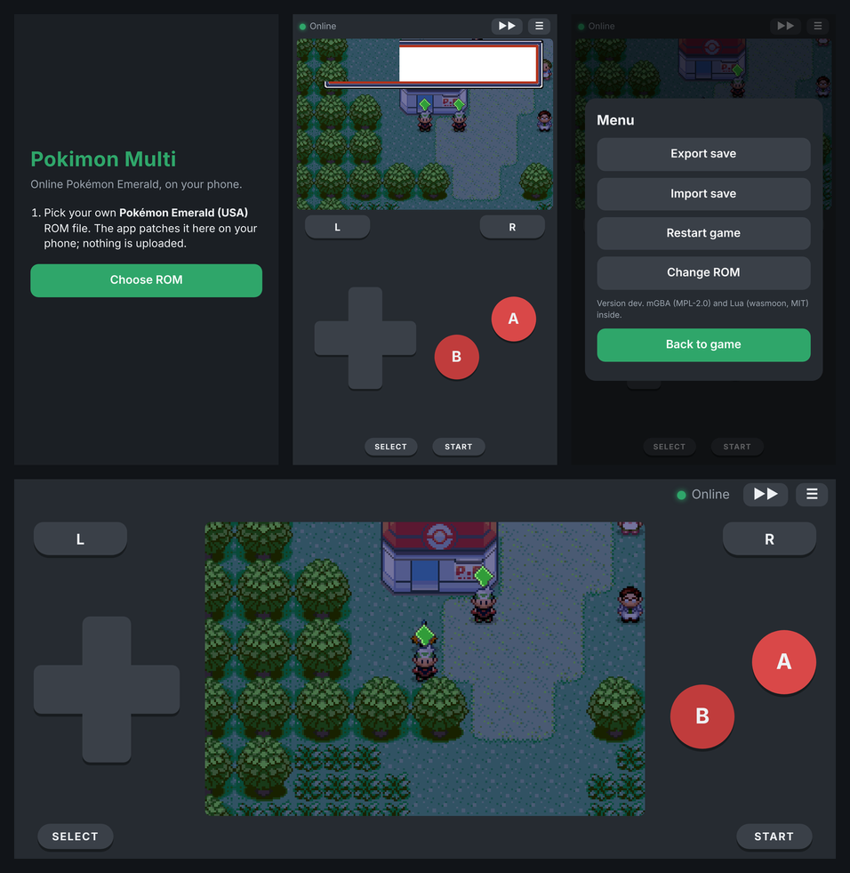

# Phone apps (Android and iOS)

Pokimon Multi on a phone, online play included. The apps carry the game's
patch but never the game: on first start you pick your own Pokémon Emerald
(USA) ROM and the app patches it on the phone.



## Installing

Each **Build game** release has `pokimon-multi-<version>.apk` and
`pokimon-multi-<version>.ipa` next to the patch.

**Android:** open the `.apk` on the phone and allow installing from your
browser or file manager when Android asks. Releases built without a signing
key (see below) can't install over each other; uninstall the old one first
(export your save before, from the menu).

**iPhone / iPad:** the `.ipa` is unsigned, so sign it with your own Apple ID
while installing:

- [AltStore](https://altstore.io) or [Sideloadly](https://sideloadly.io) on a
  computer, with a free Apple ID: the app runs for 7 days, then AltStore
  re-signs it (it does that by itself while the computer is on the same Wi-Fi).
  A free Apple ID can have 3 such apps.
- With a paid Apple Developer account ($99 a year) a signature lasts a year.
- In the EU, alternative app marketplaces are another route.

Turn on **Developer Mode** on iOS 16 or newer (Settings → Privacy & Security)
the first time.

## Playing

1. Start the app and tap **Choose ROM**; pick your Pokémon Emerald (USA).
   Anything else is refused. (An already patched ROM works too.)
2. The game starts. Pick **JOIN ONLINE** on the title menu to play online;
   the dot at the top turns green once you're on the server built into the
   game. CONTINUE plays offline.

Controls are on screen; slide a finger across the D-pad for diagonals. Turn
the phone for the landscape layout. ▶▶ is fast forward (offline is best for
it). The game saves to the phone whenever it saves in game. ☰ opens the
menu: **Export save** (a `.sav` file, to keep or move), **Import save** (a
`.sav` from mGBA, Delta, Pizza Boy and others), **Restart game** and
**Change ROM**.

## How it works

```
 app (Android WebView / iOS WKWebView)
   www/  web app: setup, touch controls, saves (IndexedDB)
     mGBA core (vendor/mgba.wasm)      runs the patched ROM
     Lua 5.4 (vendor/wasmoon)          runs tools/netplay_bridge/*.lua unchanged
   native code: TCP socket  <-->  netplay server
```

- `www/emulator.js` drives the mGBA core (`@wasm-gaming/mgba-wasm`, one
  frame per call) and finds the GBA's EWRAM in the core's memory by
  matching a savestate's copy of it, so the bridge can read and write the
  game's mailboxes as it does in desktop mGBA.
- `www/host.lua` runs the same bridge files as desktop mGBA
  (`netplay_world.lua`, `netplay_bridge.lua`, `netplay_ext.lua`) with memory
  and the connection provided by the app instead of mGBA's `emu` and
  `socket`. The bridge's mailbox scans get a fast path here.
- Browsers can't open TCP sockets, so the apps do it in native code
  (`android/.../NetBridge.java`, `ios/PokimonMulti/NetBridge.swift`) and the
  page talks to it through `www/net.js`. The server needs nothing new.
- `www/bps.js` applies the release's BPS patch to the player's ROM.

## Building

The **Build game** workflow does it all (the `phone_apps` box, on by
default). By hand:

```sh
cd mobile
npm ci
node scripts/assemble.mjs path/to/pokimon-multi.bps   # makes mobile/dist
gradle -p android assembleRelease                      # Android (SDK 35, JDK 17, Gradle 8.10)
cd ios && xcodegen generate && open PokimonMulti.xcodeproj   # iOS (Xcode 15+)
```

Without a patch, `assemble.mjs` still works and the app asks for the `.bps`
file as well as the ROM.

To keep Android updates installable over each other, make a keystore once
(`keytool -genkeypair -keystore release.jks -alias pokimon -keyalg RSA -validity 10000`)
and add the repository secrets `ANDROID_KEYSTORE_BASE64` (`base64 -w0 release.jks`)
and `ANDROID_KEYSTORE_PASSWORD`.

## Testing without a phone

- `node test/e2e_two_players.mjs` (needs a built `pokeemerald.gba`): two
  headless games on the app's emulator and bridge code connect to a fresh
  server and must see each other in Oldale Town.
- `python3 dev/serve.py` serves `dist/` at http://localhost:8090 with a
  WebSocket-to-TCP relay standing in for the native socket, to play the app
  in a desktop browser (arrows, X = A, Z = B, A/S = L/R, Enter = Start,
  Backspace = Select).
- `node test/screens.mjs BASE_ROM PATCH OUT_DIR` takes the screenshots above
  in a phone-sized Chromium with a second, headless player online.

The mGBA core is MPL-2.0 and wasmoon is MIT; `dist/vendor/NOTICE.txt` lists
them.
